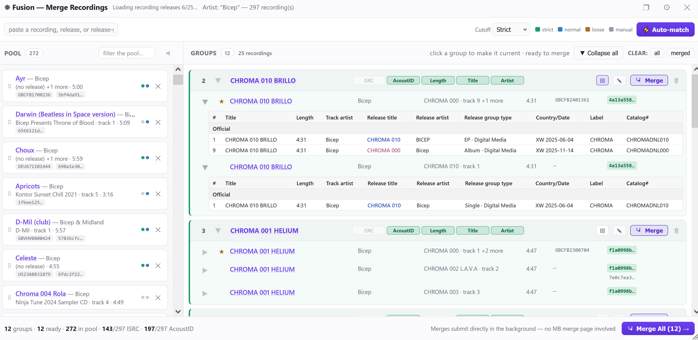

# Fusion 

A merge assistant for MusicBrainz recordings: gather candidates, let Match group the duplicates, adjust by hand, and submit every merge from one window.

- Install: [stable](https://raw.githubusercontent.com/majkinetor/musicbrainz-userscripts/refs/heads/stable/userscripts/fusion/fusion.user.js) or [latest](https://raw.githubusercontent.com/majkinetor/musicbrainz-userscripts/refs/heads/main/userscripts/fusion/fusion.user.js)
    - Or via bundle: [String Theory](../string_theory/README.md)
- [Changelog](./CHANGELOG.md)
- [View users](https://musicbrainz.org/search/edits?auto_edit_filter=&order=desc&negation=0&combinator=and&conditions.0.field=edit_note_content&conditions.0.operator=includes&conditions.0.args.0=Fusion)

## Features

- **[Pool and groups](#pool-and-groups)**: candidates on the left, merge groups on the right.
- **[Adding](#adding)** from the page you are on: a release, a release group, a recording, an artist's whole catalogue, or any entity to merge.
- **[Match](#match)** groups likely duplicates by ISRC, AcoustID, title, artist and length.
- **[Merging](#merging)** submits the merges in the background, each with an itemised edit note.
- **[Other entities](#other-entities)**: artists, releases, works and the other types collected and merged the same way.

## Pool and groups

Every candidate starts in the **Pool**. A live recording has a **live** tag; the place a recording was made shows after **@**, the date in its tooltip. Drag a candidate into a group, double-click it for the *current* group (whose header you clicked last), or select it and click a group. The grid icon in the pool's header, **Group all**, puts the selected candidate, or every one the filter shows, in one new group.

**Sort** the pool by **Added**, **Title** (ignoring a bracketed part such as *(remastered)*) or **Artist** then title. A repeated title is tinted, each run in its own colour. Match doesn't depend on the sort.

Type in the pool's filter to show only the candidates that match it.

◀ in the pool's header folds the pool to a thin rail, so the groups get the full width. Hovering the rail opens the pool over the groups until the pointer leaves it; ◀ there, or a click on the rail, keeps it open.

In a group:

- the **target**, the recording that survives, is on top with a gold ★; another row's ☆ makes it the target;
- ▶ on a row shows every release the recording is on; right-click it for every recording in the group;
- ↩ returns a recording to the pool, ✕ drops it altogether;
- 🗑 deletes the group and returns its members to the pool;
- **Clear ▾** in the groups' header clears all of this type, or one part: it empties the pool, returns every group to the pool, or removes the merged groups;
- a shared ISRC or AcoustID is tinted, one colour per value; past three, the unshared rest folds behind *+N more*;
- an AcoustID opens acoustid.org, where a wrong link can be fixed; ↻ then reloads the group's AcoustIDs, keeping its members;
- a length outside the tolerance is flagged amber, with the spread next to the title;
- a warning next to the title says when the members can't be one recording, or may not be: *live + studio*, *N places* (recorded at different places, or at one place on different dates), or *disamb.* (their disambiguations differ);
- a recording without a disambiguation shows its release's, tagged *album*, when another member's release is in the same release group; the *disamb.* warning compares it too.

## Adding

Fusion opens empty. **Ctrl+click** or **middle-click** its corner icon for the add menu, which offers what this page has to merge; the page's own entity starts ticked; select what else you want and **Add**. The pool fills without opening the window:

| Page             | Offers                                                                  |
| ---------------- | ----------------------------------------------------------------------- |
| Release          | the release, its recordings, its release group, its artists             |
| Release group    | the release group, its recordings, its releases, its artists            |
| Recording        | the recording, its artists                                              |
| Artist, any tab  | the artist, its recordings, its works, its releases, its release groups |
| Any other entity | that entity                                                             |

Recordings come into the pool as follows:

| Page            | Pool                                                                   |
| --------------- | ---------------------------------------------------------------------- |
| Release         | its recordings; *Load recordings from RG edition* adds another edition |
| Release group   | the recordings of every release in the group                           |
| Recording       | that recording                                                         |
| Artist, any tab | the artist's entire catalogue, not just the visible page (up to 2000)  |

**+** in the pool's header opens a field across it: paste a recording, release or release-group MBID or URL there to add it.

With the [String Theory](../string_theory/README.md#command-palette) bundle, **Ctrl+K** lists Fusion's commands too: open each type's window, add what this page offers, and the open window's buttons (Match, Group all, Merge all, Clear everything and the rest).

## Match

Match groups the recordings still in the pool, so a group you built by hand is never undone. The **Cutoff** sets how much evidence it needs:

| Cutoff             | Groups two recordings when they share…                                     |
| ------------------ | -------------------------------------------------------------------------- |
| strict *(default)* | an ISRC or an AcoustID                                                     |
| normal             | …or a similar title and artist, with lengths within tolerance (or unknown) |
| loose              | …or a similar title with either the length or the artist                   |

Each level has a colour, shown in the Cutoff's dot and its tooltip: a group card is tinted with the strictest level it still holds at.

Titles tolerate small typos, and a mix or edit written another way (*Song (Radio Edit)* and *Song - Radio Edit*), but not a word on each side that the other lacks: *Dwell I* and *Dwell IV*, or *In Volo - Drift* and *In Volo - Trace*, are different titles. Artists are compared by MBID when both recordings have them, so *Radium* and *DJ Radium* credited to the same artist match.

Match never groups:

- a video with an audio recording (not even with a shared ISRC; manual grouping refuses it too);
- a recording that has an open edit (unless you choose **Include pending edits**);
- a live recording with a studio one, or two recordings made at different places, or at one place on different dates (not even with a shared ISRC or AcoustID);
- lengths further apart than the setting (30 s);
- two recordings with ISRCs from one batch (the same registrant and year) but none in common, such as *QZTRX2699407* and *QZTRX2699409*: those are different tracks;
- two recordings that share only an AcoustID when their titles differ, such as *Feel What You Feel* and *Suspended Space*: AcoustIDs are submitted by users and sometimes land on the wrong recording.

A group's chips show the signals that hold for **every** member; one that holds for some is partial.

### Include pending edits

**Include pending edits**, in the menu beside Match, uses the selected cutoff but also groups recordings marked as having open edits and allows those groups to merge. Check the edits before merging: the flag can indicate a real pending edit, though MusicBrainz can also show it incorrectly.

### Match by position

**Match by position**, in the menu beside Match, ignores titles. It groups recordings that sit at the same track number on two different releases, with the same track count where both are known. It is meant for localised or translated titles, such as a Japanese edition beside its English one, where titles can't agree. The artists must still agree and the lengths must be within tolerance. Everything in the list above still holds. It runs only when you choose it, never on its own: on releases with different track lists it would pair the wrong tracks.

> [!NOTE]
> This follows MusicBrainz's [How To Merge Recordings](https://musicbrainz.org/doc/How_To_Merge_Recordings): match the acoustic content, not incidental metadata. The signals are a heuristic, so glance at each group before merging.

## Merging

**Merge ↗** on a group, or **Merge All** for each group in turn, submits without opening MusicBrainz's merge page.

Each merge gets an edit note listing what matched ("Same ISRC …", "Length difference 5s (3:59 – 4:04)"). ✎ in a group's title replaces it with your own text; Fusion's attribution line is always appended.

A merge always goes to a vote, even an auto-editor's, as a [destructive edit](https://musicbrainz.org/doc/Destructive_Edit). A refused merge is marked failed.

With **Auto clear merged** on (the default), a merged group leaves the board a few seconds after it merges, with its recordings.

## Other entities

Artists, releases, release groups, works, labels, places, events and series are merged in a window like the recordings' one, a window per type. Every type with something waiting shows as an icon with its count, beside Fusion's corner icon and in the window's title; click one to open that type. The title shows every type, so an empty one can be opened too. The trash button in the window's header clears every type's pool and groups, recordings included, after asking. Each row shows what MusicBrainz's own merge page does: for a release its artist, format, tracks, country and date, label, catalog number and barcode; for other types their type, area, dates, ISWCs and the like.

- Add them with the [add menu](#adding), or paste a MusicBrainz link or MBID into the field under **+** in the pool's header.
- The pool and the groups work as the recordings' do, with the same filter, **Sort** and ◀ fold: select, drag or double-click entries into a group, ★ for the one that's kept, ↩ and ✕, ✎ for the edit note. **Group all** puts the selection, or the pool as filtered, in one group.
- A group's chips show the fields all its members share, and a value shared by some is tinted alike in the rows. A release group of releases needs a merge strategy before it can merge: append mediums or merge them. None is preselected.
- In an artist group, the **Alias** chip says when one member's name is an alias of another: green when it matches exactly, partial when every word of the name is in the alias. The matched alias shows under that name.
- **Merge** submits one group, **Merge All** every group in turn; **Clear ▾** clears all of this type, empties the pool, returns the groups to the pool, or removes the merged ones.

What you collect, recordings included, is kept in your userscript manager and shows in every open tab.

Right-click a type's icon in the window's header or its counter beside Fusion's corner icon to empty that pool. Grouped entries stay.

### On merge edits

An open merge edit of any type, on its own page or in an edit list, shows Fusion's group card instead of MusicBrainz's Merge and Into tables, read only: the same chips, tinted values and alias lines (for recordings, the recordings window's card with ISRCs, AcoustIDs and lengths), so a voter sees what the merged entries share. A recording's ▶ unfolds every release it is on, as on the board; the header's toggle, or a right-click on a ▶, unfolds them all. Fusion's icon on the card switches to MusicBrainz's own tables, and the **Fusion** button above switches back; the choice is remembered. The button stays while the card shows too: a click switches between the two, the card reading its entries again, and a right-click opens Fusion's log. Each entry is read from MusicBrainz when the edit scrolls into view. This holds in Event Horizon's edit view and lists too, and on an edit reached without a page load. Applied and failed edits keep MusicBrainz's tables.

## Settings

The ⚙ window (or right-click Fusion's corner icon), which also holds the activity **Log**:

| Setting                                           | Default |                                                            |
| ------------------------------------------------- | ------- | ---------------------------------------------------------- |
| Look up AcoustIDs                                 | on      | fetch the pool's AcoustIDs from acoustid.org               |
| Auto clear merged                                 | on      | a merged group leaves the board a few seconds after        |
| Preload group release details                     | off     | fetch every grouped recording's releases in the background |
| Length tolerance                                  | 5 s     | lengths this close count as the same                       |
| Match never groups if lengths differ by more than | 30 s    | whatever else matches; grouping by hand still can          |
| Add Fusion card on merge edit pages               | on      | [the card on merge edits](#on-merge-edits); after a reload |

## Notes

- The log of a page where recordings were merged, or where something went wrong, is kept in this browser, so it can still be read after the page reloads: the log window lists the last 10, by date and page. **Clear history** deletes Fusion's.
