# String Theory — Unified Documentation

*Built 2026-10-27 11:14 · [String Theory README ↗](https://github.com/majkinetor/musicbrainz-userscripts/blob/main/userscripts/string_theory/README.md)*

## Table of contents

1. [Apollo Editor](#apollo-editor)
2. [Art Station](#art-station)
3. [Credit Hoarder](#credit-hoarder)
4. [Event Horizon](#event-horizon)
5. [Falcon](#falcon)
6. [First Contact](#first-contact)
7. [Fusion](#fusion)
8. [Group Therapy](#group-therapy)
9. [ISRC Scout](#isrc-scout)
10. [Mammoth](#mammoth)
11. [Mission Control](#mission-control)
12. [Platform Check](#platform-check)

---

## Apollo Editor

A faster release editor for MusicBrainz: artists and recordings auto-matched, clean tables for the tracklist and recordings, and tools for everything MusicBrainz's own editor makes slow.

- Install: [stable](https://raw.githubusercontent.com/majkinetor/musicbrainz-userscripts/refs/heads/stable/userscripts/apollo_editor/apollo_editor.user.js) or [latest](https://raw.githubusercontent.com/majkinetor/musicbrainz-userscripts/refs/heads/main/userscripts/apollo_editor/apollo_editor.user.js)
    - Or via bundle: [String Theory](../string_theory/README.md)
- [Changelog](../apollo_editor/CHANGELOG.md)
- [View users](https://musicbrainz.org/search/edits?auto_edit_filter=&order=desc&negation=0&combinator=and&conditions.1.field=edit_note_content&conditions.1.operator=includes&conditions.1.args.0=Apollo+Editor)

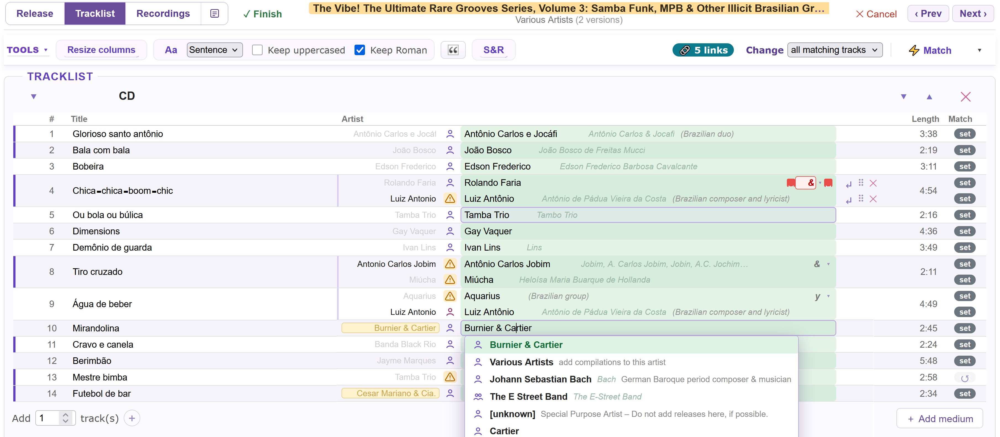

### Features

- **[Release information](#release-information)**: external links in a right column with a dead-link checker, a cover thumbnail, no help bubbles.
- **[Release group editor](#release-group-editor)**: the release group's edit page laid out like Release information.
- **[Entity editors](#entity-editors)**: the edit pages of artists, labels, places, series, works, recordings and events laid out the same way.
- **[Aliases](#aliases)**: every alias of an entity in one table, added, changed and removed together.
- **[Tracklist](#tracklist)**: an artist table with confidence colours, splitting, reordering and keyboard navigation.
- **[Pinned and recent](#pinned-and-recent)** artists and labels at the top of their pickers.
- **[Recordings](#recordings)**: track and recording side by side, with the differing characters highlighted.
- **[Matching](#matching)**: artists, recordings, the release label, artist and release group matched automatically, and a missing language and script detected.
- **[Tools](#tools)**: a configurable toolbar with the native tools and Apollo's own.
- **[Duplicates](#duplicates)**: a similarity score for each existing release, with a track-by-track comparison.
- **[Annotation editor](#annotation-editor)**: Markdown with a live preview.
- **[Highlighting](#highlighting)**: confusable punctuation, invisible characters and missing spaces made visible.
- **[Archive](#archive)**: the release's links saved on the Internet Archive, and a menu by each external link to its copies there.
- **[Disc IDs from a rip log](#disc-ids-from-a-rip-log)**, computed in the browser.

Each part is optional, and Apollo's corner icon switches to MusicBrainz's own editor and back.

### Release information

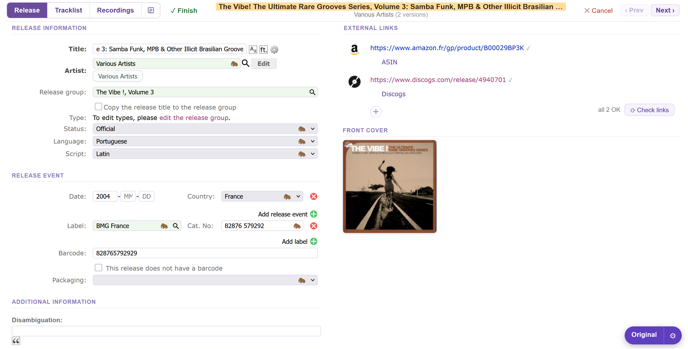

- **External links** sit in a right column, checked for dead links. Right-click a favicon or type to edit it. A link that can be a video has a camera glyph to mark it as one.
- **+** takes several links at once and pulls URLs out of anything pasted, HTML included, dropping duplicates and setting each link's type.
- A **front-cover thumbnail** under the links opens the cover-art page.
- Right-click a date's or label's ✕ to remove all of them.
- The help bubbles are gone; the badges say what is linked.
- The release **Artist** field is the Tracklist's artist cell, in place of MusicBrainz's box and its Edit popup. One line per artist, with its credited-as name, search, join phrase and match badge. **↵** adds an artist, **⋔** splits a combined name, **⠿** reorders, **✕** removes, and **＋** / **🔗** / **⚠** offer to create the artist or add its link.
- The release **Artist** is [matched](#artist-matching) on load like a track artist, and a confident match is linked. Click an uncertain **LOW** badge to link its candidate.
- The release **Label** is linked on load by its Discogs or platform link when exactly one label has it, else when exactly one label has its name or alias, else when the similar releases on the **Duplicates** tab credit exactly one label of that name. A badge by the field says how (**set**: already on the release, **user**: picked by you); click it to open the label.
- The **Release group** of a new release is selected from MusicBrainz's suggestions under the field when exactly one of them has the release's title (punctuation, spaces and case aside) and artist, and marked **auto**. Pick **Add a new release group** to undo it.
- The **Label** field searches with Apollo's picker, as the artist does: each label shows its aliases, disambiguation, type, label code and years, and an icon that opens it. A pasted MBID or label URL is set at once. **＋** in place of the search icon creates the typed label, with its Discogs or platform link when no label has it yet, and sets it once saved; right-click to create it in a background tab.

### Release group editor

The release group's edit page gets Release information's layout.

- The **Artist** field is the same artist cell, with the same buttons, and an unlinked name is [matched](#artist-matching) on load.
- **Primary type** and **Secondary types** are bars of buttons. Click a primary type to choose it and again to clear it; click secondary types to turn each on or off.
- **External links** sit in a right column with the dead-link checker, and the release group's cover under them.
- The help bubbles are gone, and a changed artist credit adds Apollo's line to the edit note.

### Entity editors

The edit pages of artists, labels, places, works, recordings and events (and their create pages) get the same layout.

- **External links** sit in a right column with the dead-link checker.
- **Name** and **Sort name** show their look-alike and invisible characters, double spaces and leading or trailing spaces on a line under the field.
- **Autofill**: paste a Wikidata, Wikipedia, VIAF or ISNI link and the empty fields fill from Wikidata: name, sort name, type, gender, dates, areas, IPI, ISNI, a place's coordinates, and the links Wikidata knows. A field you already filled stays as it is. It replaces [loujine's](https://github.com/loujine/musicbrainz-scripts/wiki) *Add external link* box, which is hidden while Apollo is on.
- Autofill and a place's map are cards at the end of whichever column is shorter.
- The help bubbles are gone, and Apollo's bar has ✓ Enter edit and ✕ Cancel.

### Aliases

An entity's **Add alias** page becomes a table of all its aliases, so several are added, changed and removed at once.

- Each line is one alias, in the order they were added, in columns: name, sort name, the locale and the type (both filter as you type), and begin and end dates. Once a locale is picked, a **☆** at the right of its field makes the alias the primary one for that locale (not once the alias has ended). A date is a year, year-month or full date; dots or slashes work too, and a day-first date like 31.12.2020 becomes 2020-12-31. Date fields take only digits and separators. A date that isn't whole when you leave the field, or an end before the begin, is marked in red, with the reason under the table, and nothing is submitted while it is. A search hint has only a name, as on MusicBrainz's form: its other fields are emptied and greyed out, and come back when you pick another type.
- The last line is empty: type a name there to add an alias, and a new empty line follows.
- A new alias's sort name follows its name, the way MusicBrainz guesses it (an artist's alias gets a person's, *Presley, Elvis*), until you type one yourself; **Aa** guesses it again.
- A new row is green, a changed one yellow, and a removed one red; **↺** brings a removed alias back.
- **Enter edit** appears once something has changed and enters one edit per green, yellow or red row. A row that fails turns red underneath, and hovering it shows MusicBrainz's reason.
- **↺** on a changed alias puts it back as it was; on a removed one it keeps the alias.

Elsewhere:

- An entity's **Aliases** tab shows how many aliases it has, and opens the same editor in place of MusicBrainz's list.

### Tracklist


**Artists**

- The picker colours each artist by [match confidence](#artist-matching), and shows aliases, disambiguation and a type icon linking to the artist.
- **Change** in the toolbar sets whether an edit applies to one track or to every track with the same credit.
- Ctrl-click a search result to set it on every unresolved track. Paste an MBID or artist URL to resolve it directly.
- **＋** creates an unresolved artist in the background, with sort name, type and its Discogs or platform link filled in.
- On hover: **split** an artist (with a join-phrase picker), remove a split artist, or reorder artists within a credit.
- A credited-as name's hover **×** clears it; right-click to clear every credited-as on the tracklist.
- The **N unresolved** badge jumps to the first unresolved artist.

**Tracks**

- On hover: **Split** and **Aa** (Guess case); left-click for one track, right-click for all.
- **⠿** drags a track within its medium. **⤓** moves a track and everything below it into the data section; **⤒** moves it back. A medium with a disc ID can't have data tracks.
- On hover, the last column has the track's **↺** (revert, when it has changed) and **✕** (remove).
- Changed tracks get a coloured left border; pending changes, splittable tracks and tracks Guess case would change are highlighted.
- Left-click a collapsed medium to expand it, right-click to expand all.
- Pregap and data tracks and disc IDs are supported.

### Pinned and recent

The artist and label pickers remember what you set, so an artist or label you use often is one click away.

- The list starts with a **Recent** header, collapsed until you click it; it stays open or collapsed as you last left it. It holds your pinned artists (or labels) first, then the last 30 you picked.
- Typing filters Recent, and the search's results follow below it.
- A row's pin icon pins or unpins it without setting it. Pinned ones stay until you unpin them.
- Artists and labels each have one list, shared by every field and release.

### Recordings

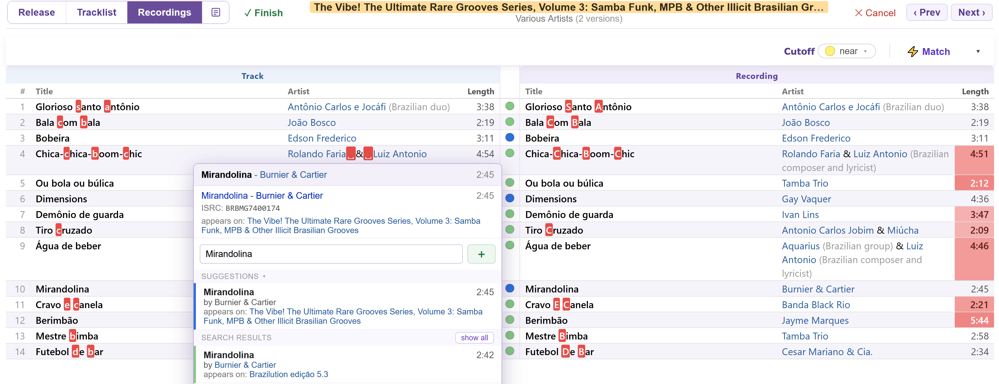

- Each row shows the track and its recording, a [confidence](#recording-matching) circle, and the characters that differ.
- The picker offers MusicBrainz's suggestions, a search, and the releases each candidate appears on. Paste a recording MBID or URL, or an ISRC: one match is linked at once, several are listed.
- **＋** on hover unlinks a recording, so the track gets a new one; **↺** restores the link the page loaded with.
- Videos have a camera marker before their name.
- Right-click a title or artist cell to copy it to the other side:

| Gesture                  | Copies                                               |
| ------------------------ | ---------------------------------------------------- |
| Right-click              | that cell                                            |
| Ctrl + right-click       | both fields of the row                               |
| Alt + right-click        | that field in every row                              |
| Ctrl + Alt + right-click | both fields in every row                             |
| Right-drag               | every cell it passes over, on the side it started on |

A copy to the recording applies on submit, shown as `→ New` beside the old value struck through; a copy to the track applies at once.

### Matching

**⚡ Match** matches everything still unresolved, or it runs when the page loads (see [Settings](#settings)). The best candidate is applied when it's confident enough; anything uncertain is left for you, as a candidate to confirm.

#### Artist matching

Stages, most confident first:

1. **Discogs or platform link.** Each credited artist, featured ones too, is matched by the release's Discogs link on the MusicBrainz artist (**DISC**), or, imported with [First Contact](../first_contact/README.md), by its page on the platform (**DZ** for Deezer…). A [consolidated](../mission_control/README.md#consolidate-a-new-release) release tries the other platforms' pages in turn.
2. **Release group.** The same track on other releases in the group, with its credited artists. This settles most tracks, compilations included. Badge: **RG**.
3. **Same position on other editions.** The track at the same position on the release group's other editions and on the [duplicates](#duplicates), when that track passes the [recording](#recording-matching) test (similar title and length within tolerance, or a title in another script on a medium that lines up). Its artist is taken if the name matches loosely (spaces, punctuation, quotes, a leading *The* ignored, or 85% similar): *Juan Formel* → *Juan Formell*, *Cedric Im Brooks* → *Cedric “Im” Brooks*. When the editions agree the artist is linked, keeping the seeded credited name. Badge: **POS**. When they disagree nothing is linked, and they head the picker under **On other editions at this position**.
4. **Exact name or alias.** Linked only when exactly one artist has the credited name as its name or an alias, among all of MusicBrainz's matches, not only the first page. Badge: **NAME** or **ALIAS**.
5. **Co-credit.** For a shared name, an artist credited with that name next to an artist already on this release. Exactly one such artist is linked; a tie is offered to pick from. Badge: **CRED**.

Green means matched confidently; a white search box means unresolved, counted by **N unresolved**.

**Match card.** Hover a badge for a card that shows:
- the stage, and whether Apollo linked the artist or you picked it;
- the linked artist, with its disambiguation, type, area and dates;
- the evidence: the Discogs artist or platform page, the release-group track, each other edition and whom it credits (✓ / ✗; one from the duplicate search may be this very release), the alias, the co-credit counts;
- the other candidates;
- when it matched.

| Badge                     | Meaning                                                                               |
| ------------------------- | ------------------------------------------------------------------------------------- |
| **DISC**                  | the Discogs artist credited on the release is linked from this MusicBrainz artist     |
| **DZ**, **SP**, **TD**, … | its page on the platform the release came from is linked from this MusicBrainz artist |
| **RG**                    | another release in the release group credits this artist on the same track            |
| **POS**                   | other editions credit this artist on the track at this position                       |
| **NAME**                  | the only MusicBrainz artist with this name (aliases checked too)                      |
| **ALIAS**                 | the only MusicBrainz artist with this credit as an alias                              |
| **CRED**                  | credited beside an artist already on this release, more often than any namesake       |
| **USER**                  | picked by you                                                                         |
| **SET**                   | linked before Apollo matched: by the release, the seed or the page                    |
| **LOW**                   | uncertain; the card lists what each stage found                                       |

The platform badges: **DZ** Deezer, **SP** Spotify, **TD** Tidal, **AM** Apple Music, **YTM** YouTube Music, **BC** Bandcamp, **BP** Beatport, **QZ** Qobuz, **SC** SoundCloud, **AMZ** Amazon Music, **VO** Volumo, **HD** HDtracks, **AMK** Audiomack, **7D** 7digital, **OTO** Ototoy, **PM** Presto Music.

**Discogs links.** When the Discogs link is known, the type icon offers what's missing: **🔗** creates the artist with the link, or adds the link to the matched artist. **⚠** warns that the link belongs to a different artist, or that the artist links a different Discogs page (often a wrong match). **🔗 N links** in the toolbar counts them and steps through them.

**Platform links.** A release imported with First Contact gets the same offers for each artist's platform page.

> [!NOTE]
> If a badge is ever lost when Apollo rebuilds its table (the artist stays linked, shown as *set*), a toast offers **Copy log** for a bug report.

#### Recording matching

**ISRC first.** On a release imported with [First Contact](../first_contact/README.md) from a platform that gives ISRCs (Deezer, Apple Music, Tidal, Beatport, …), the release's ISRCs are looked up first. A recording that is the only one with that ISRC, and agrees with the track on title and artist, is linked ahead of every other candidate. When several recordings share the ISRC, or the one that has it differs from the track, they are only offered: the picker lists them on top with an **ISRC** badge.

Then the release group's recordings are matched by title, artist and length, and the other tracks looked up one by one. When a title is worded differently (*Part 1* / *Pt. 1*), the same position on other editions, and then on releases of the same title and artist in other groups, is used if the title is similar and the length agrees. A title in another script (*Kalimba Night* for *カリンバナイト*) can't be compared, so its position is used when that edition's whole medium lines up: as many tracks, and every length within the tolerance.

| Colour | Confidence |                                               |
| :----: | ---------- | --------------------------------------------- |
|   🔵    | Exact      | every field the same                          |
|   🟢    | Tolerance  | within the [tolerances](#settings)            |
|   🟡    | Near       | one field differs, or lengths 3–15 s apart    |
|   🟠    | Low        | two fields differ, or lengths over 15 s apart |
|   🔴    | Very low   | all three differ, lengths over 10 s apart     |

**Cutoff** in the toolbar sets the lowest confidence that's linked. *Credited as* doesn't affect matching.

#### Language and script

When the release has no **Language** or **Script**, Apollo fills them in from the release and track titles, and marks the field **auto**. Bracketed parts such as *(Live)* or *[Remastered]* and anything after *feat.* are left out.

- **Script**: the one that more than 70% of the letters are written in. Kana makes it *Japanese* and Hangul *Korean*. When no script reaches 70%, as with parallel titles like *Laula Mulle Laulu = Обійми*, it's *[Multiple scripts]*.
- **Language**: [lande](https://github.com/fabiospampinato/lande), the detector Harmony uses, reads each script's words on their own and needs three titles or more and 80% confidence. When the titles mix Latin with another script, that script's language is used, since the Latin is usually its translation or transliteration. When lande isn't sure, a script that implies its language names one: Japanese, Korean, Greek, Hebrew, Thai, Armenian or Georgian.

Every language and script found is listed at the top of the field's list under **Detected by Apollo**, most likely first, with *[Multiple languages]* or *[Multiple scripts]* to pick them all.

A field that a seed or you already set is never touched. Apollo keeps updating its guess while you type titles, until you change the field yourself. Hover **auto** to see how the guess was made.

### Tools

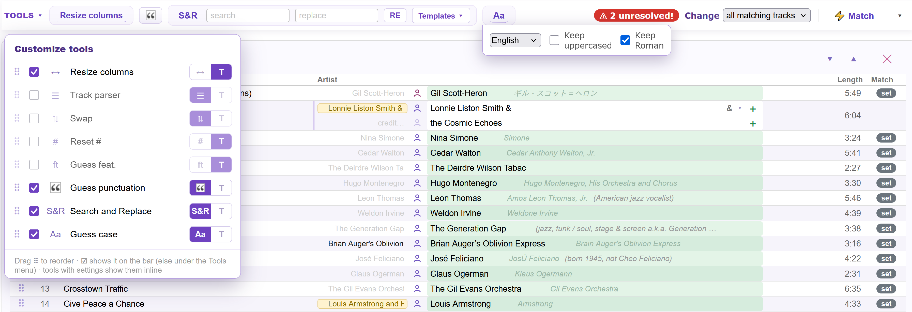

The toolbar holds the tools you choose; the rest are in **Tools ▾**, with **Customize…** to pick, reorder and show each tool as icon, text or both. Right-click a tool's name to fold its settings into a hover flyout.

| Tool                                                    |                                                                                                                                   |
| ------------------------------------------------------- | --------------------------------------------------------------------------------------------------------------------------------- |
| Track parser, Swap, Reset #, Guess feat.                | MusicBrainz's own                                                                                                                 |
| [Guess case](#guess-case)                               | MusicBrainz's capitalisation, with more languages                                                                                 |
| [Search and Replace](#search-and-replace)               | replace text in titles, with saved patterns                                                                                       |
| [Pattern parser](#pattern-parser)                       | a tracklist from text, by a pattern                                                                                               |
| [Length parser](#length-parser)                         | track lengths from any text or page                                                                                               |
| [Merge mediums, Split medium](#merge-and-split-mediums) | restructure the mediums, keeping the recordings                                                                                   |
| Resize columns                                          | Fit, Centered or Default widths                                                                                                   |
| Guess punctuation                                       | kellnerd's [guess-unicode-punctuation](https://github.com/kellnerd/musicbrainz-scripts#guess-unicode-punctuation), when installed |
| **↺ Revert all**, **✕ Clear all** (under ▾)             | back to the loaded page, or empty                                                                                                 |

#### Guess case

MusicBrainz's capitalisation, with more languages and rules. MusicBrainz's own guess-case buttons give the same guess.

- **Guess case** in the toolbar does every track.
- A track's **Aa** on hover shows its guess; a click applies it, a right-click does every track.
- The options sit beside **Guess case**, or open with a right-click on the release title's **Aa**.

The mode list has three groups. **○** by a Guess or Language mode makes it the **default** (**◉**): it runs on every track when the tracklist first opens, before the default [Search and Replace](#search-and-replace).

| Guess    | Capitals                                                                      |
| -------- | ----------------------------------------------------------------------------- |
| Auto     | the release language's mode; English with no language, Sentence for any other |
| Sentence | only the first word                                                           |

Auto also looks at each title:

- A title mostly in Cyrillic, Greek or Armenian gets Sentence.
- A title of three words or more gets its own language's mode when Apollo is sure of it, so a French title on an English release gets French. A shorter one keeps the release's mode: one or two words are too few to tell a language by.
- A title split by the **Separator** has its parts guessed apart: *love story / история любви* → *Love Story / История любви*.

| Language                     | Capitals                                                                      |
| ---------------------------- | ----------------------------------------------------------------------------- |
| English                      | every word but small ones: *The Sound of Silence*; keys as *in C-sharp minor* |
| Turkish                      | as English, with Turkish small words and *İ*/*ı*                              |
| French                       | Sentence, with French spacing: *Où es-tu ?*                                   |
| Spanish, Italian, Portuguese | Sentence                                                                      |
| Dutch                        | Sentence, *IJ* as one capital: *IJsland*                                      |

| Casing    | Capitals     |
| --------- | ------------ |
| lowercase | none         |
| UPPERCASE | every letter |

A casing changes the letters without guessing, takes none of the options, and can't be the default.

| Option    | Default | What it does                                                         |
| --------- | ------- | -------------------------------------------------------------------- |
| ABC       | on      | keeps capitals: *ABBA*, *KoRn*                                       |
| IV        | off     | *part ii* → *Part II*                                                |
| Separator | `/`     | in Auto, splits a title into parts guessed apart; empty never splits |

Every Guess and Language mode also lowercases version words in brackets: *official music video*, *slowed + reverb*, *sped up*, *bootleg*, *mashup*.

#### Search and Replace

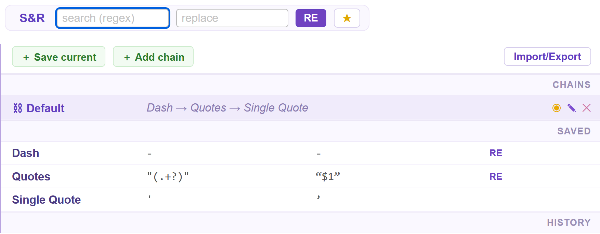

Replaces text in track titles. **★** saves patterns under a name; the last five are kept as history. **⛓** puts patterns in a **chain** run in order; **◉** marks one pattern or chain as the default, applied when the tracklist first opens. **Import / Export** is the whole set as JSON.

#### Pattern parser

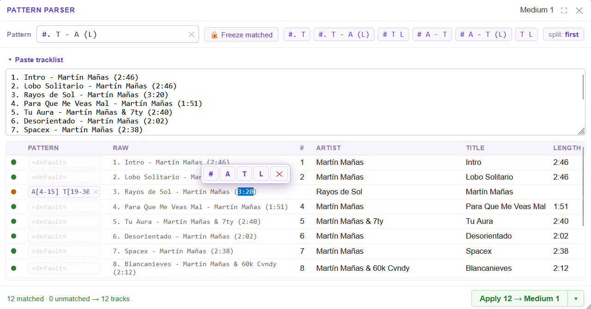

Fills a medium from pasted text, by a pattern. It opens with the current tracklist, so it also bulk-edits. On a new release with an empty tracklist it opens by itself on the Tracklist tab, in place of MusicBrainz's track parser.

| Token |              | Token |                               |
| ----- | ------------ | ----- | ----------------------------- |
| `#`   | track number | `M`   | medium                        |
| `T`   | title        | `-`   | separator: any of `- – — / :` |
| `A`   | artist       | `_`   | skip the rest                 |
| `L`   | length       |       |                               |

Anything else is literal and whitespace is elastic. A capital is a token only standing alone; `$T` forces one. Fields split at the first separator; **split: last** splits at the last. Examples: `#. T`, `# A - T (L)`, `# A - T (_`.

For fixed-width text a token takes a range: `T[6-]`, `T[6-20]`, `T[-5]`, `T[~3-]` (last 3), or `[from:to]` up to a character, such as `#[1:.]` or `L[(:)]`. `~` before a character means its last occurrence: `L[~(:)]`.

Each line's dot shows whether it matched (amber: by its own pattern). Edit a row's raw text in place, give it its own pattern, or bind a selected part of it to a field. **🔒 Freeze matched** keeps the current pattern on the rows it matches, so you can change it for the rest. **Apply** writes the pattern's fields and sizes the medium to the non-empty lines; its ▾ applies one field and keeps the track count.

#### Length parser

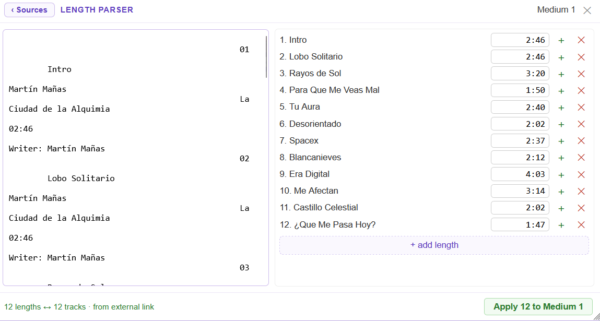

Reads every duration (`5:50`, `1′23″`, `1:02:03`) out of text and ignores the rest. The source is typed or pasted text, the clipboard, a page linked on the release (one favicon each), or a link pasted with **Ctrl+V**; a fetched page's URL goes into the edit note.

The lengths line up with the tracks by order: **✕** removes a row, **+** inserts one, click a value to edit it. An invalid time blocks **Apply**; an empty row leaves that track's length alone. On a release with several mediums, pick the medium in the header.

#### Merge and split mediums


- **Merge mediums**: the ticked mediums go into the first of them, in order; the others are removed.
- **Split medium**: the chosen track and the ones after it become a new medium after it, in the same format.

Titles, lengths, credits and recordings are kept and tracks are renumbered. A medium with a disc ID is refused.

> [!NOTE]
> MusicBrainz records this as an *Edit medium* plus a *Remove medium* per merged-away medium, or an *Add medium* for a split. The moved tracks get new track MBIDs. Without auto-edit rights, *Remove medium* waits for votes, so the old mediums show beside the merged one until then.

#### Other scripts' tools

Apollo lists a button another userscript adds to the page like one of its own, on the bar or in **Tools ▾**. How a script offers its button is in [DEVELOP.md](../apollo_editor/DEVELOP.md#other-scripts-tools).

### Duplicates

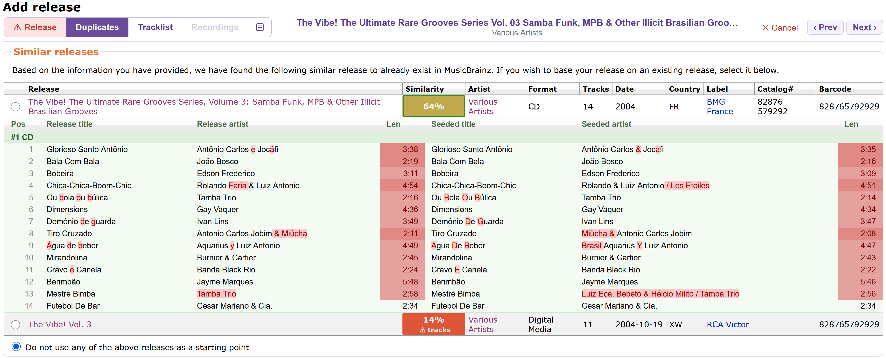

On the Add release *Duplicates* tab, a **Similarity** score for each existing release, from the titles, the artist and the track count. Click a score for a track-by-track comparison. Once artists are matched, the *Seeded* artists there are links, and the unmatched ones are underlined in amber.

### Annotation editor

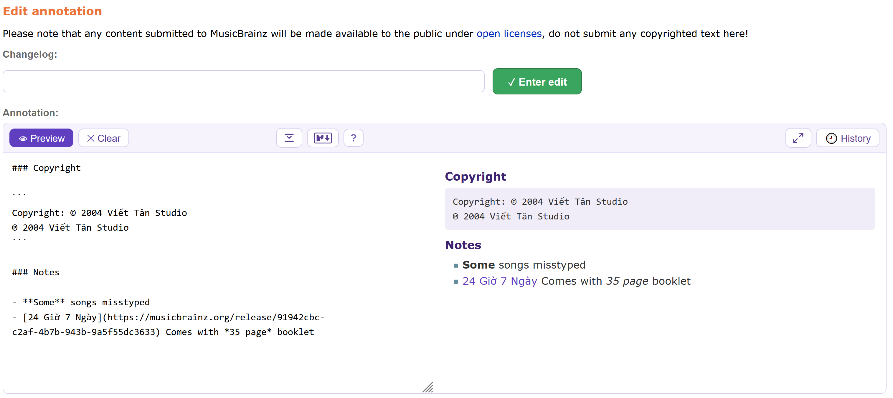

Edits the annotation as Markdown, in the release editor and on every entity's *Edit annotation* page. The toolbar has **Preview** (side by side, live), **Clear**, **Markup** (Markdown or MusicBrainz's own), **Help**, **Maximize** and **History**, which shows earlier versions and loads one back.

- An unnamed MusicBrainz link gets the entity's name.
- Enter continues a list; Tab on a selection makes a list and cycles bullets and numbers; Shift+Tab removes it.
- Links, emphasis, headings, nested lists, code blocks and rules convert both ways.

### Highlighting

With *Enable detailed highlighting* on:

- the differing characters of a title or artist are marked, and a length gap is shaded by its size. A different artist is boxed whole; a *credited as* difference on the same artist marks only its characters;
- confusable characters (`'` `’` `"` `-` `–` `—`) are enlarged, and invisible ones (no-break, zero-width, tab) are drawn, with their Unicode name in the tooltip;
- a join phrase missing a space shows `␣`, and a missing join phrase `␣?␣`.

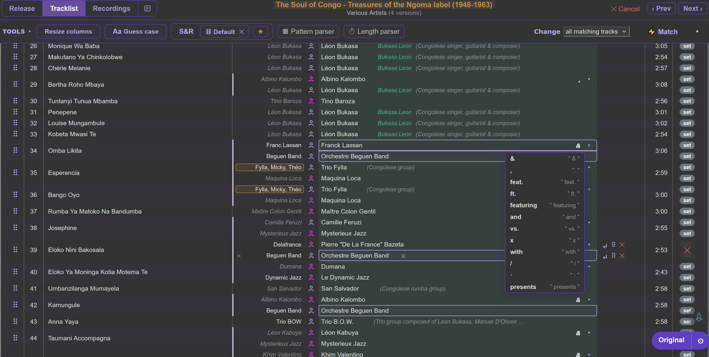

Apollo follows a dark MusicBrainz theme, such as kellnerd's [userstyle](https://github.com/kellnerd/userstyles#musicbrainz).

### Archive

At **Enter edit**, Apollo has the Internet Archive's Wayback Machine save every external link of the release, so anyone can later check what the pages showed; the [archive menu](#archive-menu) by each link opens its copies.

- Only the release's own links are saved, not the links an edit note mentions.
- Some sites refuse the Internet Archive; for Discogs, its release data is saved instead.
- Every edit saves them again. A page the Internet Archive saved a moment ago isn't saved twice.
- The edit doesn't wait for the saves.
- Links on MusicBrainz and the Internet Archive aren't saved, nor what [First Contact](../first_contact/README.md#archive) already archives for its import.
- Anonymous saves are limited, so some are refused on a release with many links. With your [archive.org keys](../first_contact/README.md#archiveorg-keys), shared with First Contact, the limit is much higher and each save takes a screenshot.

#### Archive menu

On release, release group, artist and label pages, a clock after each sidebar link lists its copies on the Wayback Machine:

| Menu item                  |                                                |
| -------------------------- | ---------------------------------------------- |
| Open the latest snapshot   | the page as last saved                         |
| Open the latest screenshot | its screenshot, when one was taken             |
| All snapshots (calendar)   | every saved copy, by date                      |
| Save it now                | saves the page now, in Save Page Now's own tab |

A Discogs link offers its saved release data. Nothing is sent to archive.org until you pick an item.

> [!NOTE]
> Archiving sends the address of every link on the releases you edit to archive.org, and with keys, under your account. Turn **Archive links on the Internet Archive** off in [Settings](#settings) if you don't want that.

### Disc IDs from a rip log

On a release's **Disc IDs** tab, each medium gets a drop zone for a rip log. Apollo computes its disc ID and opens MusicBrainz's attach page, edit note signed, for you to **Enter edit**.

| Program          | Reads                             |
| ---------------- | --------------------------------- |
| EAC, XLD, fre:ac | the TOC table (localised EAC too) |
| whipper          | the `TOC:` block                  |
| dBpoweramp       | `Track N: Ripped LBA x to y`      |
| cyanrip          | `Start LSN` / `End LSN`           |

Like Picard, whose parsers these are, it refuses a partial rip, a non-standard track sequence or an unknown file, and drops a trailing data track. A log whose track count doesn't match the medium asks before continuing.

### Settings

Right-click Apollo's corner icon.

| Setting                                                       | Default |                                                                                         |
| ------------------------------------------------------------- | ------- | --------------------------------------------------------------------------------------- |
| Modify Release information, Tracklist, Recordings, Duplicates | on      | replace that part of the editor                                                         |
| Modify annotations with Markdown                              | on      | the [annotation editor](#annotation-editor)                                             |
| Modify header and footer                                      | on      | a compact step switcher instead of the tabs and footer                                  |
| Zen editing                                                   | on      | hide the site header, title and footer; the title moves into Apollo's bar               |
| Auto confirm release submissions                              | on      | skip the confirmation page when a site seeds a release                                  |
| Archive links on the Internet Archive                         | on      | save the release's links at **Enter edit**; see [Archive](#archive)                     |
| Archive menu on external links                                | on      | the [archive menu](#archive-menu) by each link on entity pages                          |
| archive.org keys                                              | none    | your access key and secret, shared with First Contact: higher limits, plus a screenshot |
| Auto-match on start: Tracklist, Recordings                    | on      | match on load                                                                           |
| Auto-match on start: Label, Artist, Release group             | on      | match the release [artist, label and release group](#release-information) on load       |
| Discogs artist link matching                                  | on      | match by [Discogs link](#artist-matching) and offer missing links                       |
| Detect language and script                                    | on      | fill in a missing [language and script](#language-and-script)                           |
| Length tolerance                                              | 5 s     | `0` for exact                                                                           |
| Title tolerance                                               | 1       | differing characters allowed                                                            |
| Ignore casing                                                 | on      | case, accents and spacing don't count                                                   |
| Ignore punctuation                                            | on      | `&`/*and*, brackets, quotes, dashes and dots don't count                                |
| Enable detailed highlighting                                  | on      | see [Highlighting](#highlighting)                                                       |
| Row layout                                                    | normal  | compact, normal or cozy                                                                 |
| Alternate row colors                                          | off     | every other track tinted                                                                |
| Show grid                                                     | rows    | lines between rows and/or columns                                                       |
| Enlarge punctuation by                                        | 3 px    | `0` stops the enlarging; the markers stay                                               |
| Keep caret position on row navigation                         | on      | off: a cell is selected whole on arrival                                                |
| Highlight all instances of an artist on hover                 | off     | hovering an artist highlights it on every track                                         |

### Shortcuts

| Where         | Key                                    |                                                 |
| ------------- | -------------------------------------- | ----------------------------------------------- |
| Tracklist     | ↓, Enter                               | next row                                        |
| Tracklist     | ↑, Shift+Enter                         | previous row                                    |
| Tracklist     | Tab, Shift+Tab                         | next, previous column                           |
| Join phrase   | typing, ↓ ↑, Enter                     | filter the presets, move, pick                  |
| Length parser | Ctrl+V                                 | read the lengths from the link on the clipboard |
| Length parser | Ctrl+Enter                             | apply                                           |
| Annotation    | Ctrl+B, Ctrl+I                         | bold, italic                                    |
| Annotation    | Tab, Shift+Tab                         | make or change a list, remove it                |
| Guess case    | right-click a track's **Aa**           | every track                                     |
| Guess case    | right-click the release title's **Aa** | the options                                     |
| Aliases       | ↓ ↑                                    | the same column in the next, previous row       |
| Aliases       | Alt+↓, then ↓ ↑, Enter                 | open the locale or type list, move, pick        |

### Notes

#### Archiving requests

[DEVELOP.md](../apollo_editor/DEVELOP.md#archive) lists the requests sent to the Internet Archive, and which links are left out.

---

## Art Station

A cover and event art editor for MusicBrainz: one gallery to view, sort, reorder, retype, comment, remove, download and source a release's art, all staged and applied on **Enter edit**.

- Install: [stable](https://raw.githubusercontent.com/majkinetor/musicbrainz-userscripts/refs/heads/stable/userscripts/art_station/art_station.user.js) or [latest](https://raw.githubusercontent.com/majkinetor/musicbrainz-userscripts/refs/heads/main/userscripts/art_station/art_station.user.js)
  - Or via bundle: [String Theory](../string_theory/README.md)
  - [Picker](../art_station/as_picker/README.md) companion: [install](https://raw.githubusercontent.com/majkinetor/musicbrainz-userscripts/refs/heads/main/userscripts/art_station/as_picker/as_picker.user.js)
- [Changelog](../art_station/CHANGELOG.md)
- [View users](https://musicbrainz.org/search/edits?auto_edit_filter=&order=desc&negation=0&combinator=and&conditions.0.field=edit_note_content&conditions.0.operator=includes&conditions.0.args.0=Art+Station)

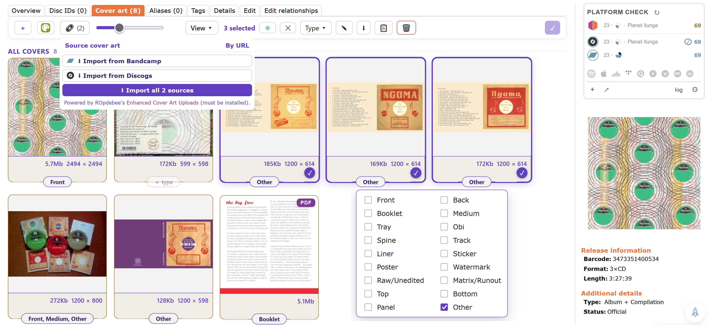

### Features

- **[Gallery](#gallery)** on a release's _Cover art_ and an event's _Event art_ tab: views, grouping, sorting and reordering by drag.
- **[Actions](#actions)** on one cover or the selection: type, comment, remove, download, report.
- **[Add images](#add-images)**: files, folders, zips, URLs, MH Covers, reverse-image search.
- **[Full-screen viewer](#full-screen-viewer)** with zoom, pan and slideshow.
- **[File names ⇄ types](#file-names--types)**: a downloaded archive re-adds with its types and comments.
- **[AI scan](#ai-scan)** reads a cover's printed credits for Group Therapy's Text parser.
- **[Applying changes](#applying-changes)** as parallel edits, with automatic retries.

### Gallery

Thumbnail size, a grid or a detailed view, grouping by [type](https://musicbrainz.org/doc/Cover_Art/Types), and sorting by position, type, dimensions or date. Drag one cover, or a whole selection, to reorder; select with right-click or right-drag.

Art Station's corner icon switches to MusicBrainz's own page and back; right-click it for the settings (⚙).

| Grouped by type                    | Detailed view                      |
| ---------------------------------- | ---------------------------------- |
| 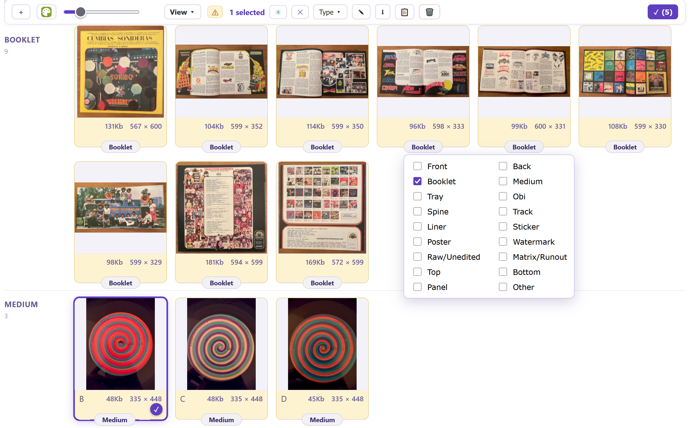 | 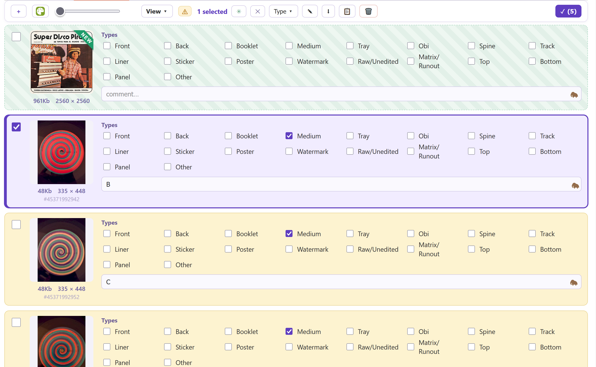 |

Each cover shows its size and resolution, and with _Show each cover's file type next to its size_ (⚙) its format: `3.2Mb PNG`.

### Actions

- **Set type**: tick one or more types; right-click a type to set only that one.
- **Set comment**: Enter moves to the next cover's comment. With [Mammoth](../mammoth) installed, the comment field gets its 🦣 memory.
- **Remove**, or the trash can on a cover's hover: the cover moves under the gallery to _Marked for removal_, with a **REMOVE** ribbon, until **Enter edit** removes it. **↺ keep** on one, or **↺ Keep** on a selection, brings it back. A cover whose removal is open for votes stays in the gallery, dashed red, with a **removal open · 6 days** chip that opens the edit, on its card and in the full-screen viewer.
- **✓ only this** on a new cover marks every other new cover for removal; the release's own covers stay.
- **Download** as a zip, [named by type](#file-names--types).
- **Report** in HTML or Markdown: inline, captioned, or a table (position, file, resolution, size) that also serves as the archive's `README.md`.

### Add images

| Source                                        |                                                                                  |
| --------------------------------------------- | -------------------------------------------------------------------------------- |
| Files                                         | drop or pick; the type is [guessed from the name](#file-names--types)            |
| Folder                                        | drop one, or Shift-click the drop zone; one level of subfolders, up to 100 files |
| Zip                                           | drop or pick one; unpacked in the browser like a folder                          |
| URL                                           | **Ctrl+V** a URL anywhere on the gallery, or the **URL (N)** panel               |
| [MH Covers](https://covers.musichoarders.xyz) | pick a cover; it's staged as a new one                                           |
| Reverse-image search                          | 🔍 on a cover searches Yandex, Google Lens, TinEye or Bing for a bigger copy     |

An Art Station download, added back as a zip, restores each cover's types and comment.

The Cover Art Archive takes JPEG, PNG, GIF and PDF, so a WebP, AVIF, BMP or TIFF is converted as it's added: to JPEG when lossy, to PNG when lossless or transparent (`WEBP→JPEG` with the file type shown). TIFF converts only where the browser shows it (Safari); elsewhere it's skipped.

The **URL (N)** panel has an import for each source the release links, plus any [registered providers](../art_station/DEVELOP.md#plugin-api). A middle-click imports from all and keeps the best cover: the largest front (each source's first image), then the smallest file.

A URL can be a store's release page or an image. Art Station takes the store's largest version; the edit note names the page, the image and the smaller one offered:

| Store pages                                               |                                                           |
| --------------------------------------------------------- | --------------------------------------------------------- |
| Apple Music, Deezer, Spotify, Tidal, Qobuz                | the cover; Qobuz adds its digital booklet when it has one |
| Bandcamp, Beatport, 7digital, Juno, Melon, Bugs, AllMusic | the cover                                                 |
| Discogs, Amazon                                           | every image                                               |
| VGMdb                                                     | every scan, typed by its caption                          |
| any other page                                            | its preview image                                         |

Links that open the add page with images, as Harmony's do, import with their types and comment.

With the [Picker](../art_station/as_picker/README.md), clicking a copy in the search results sends it back to the gallery.

### Full-screen viewer

Its keys are in [Shortcuts](#shortcuts-1). A zoomed image follows the mouse, or drags with that off in ⚙.

**↶ ↷** by **Download** turn the cover 90°. A new cover rotates in place; an existing one is staged as a rotated new copy with its type, comment and position, and the original is marked for removal. PNGs rotate losslessly, JPEGs are re-saved at high quality.

### File names ⇄ types

When an added image has no type, it's guessed from its file name (switch it off in ⚙):

| Type      | Name contains                                                                                                                                                                                                                        |
| --------- | ------------------------------------------------------------------------------------------------------------------------------------------------------------------------------------------------------------------------------------ |
| Front     | `front`, `folder`, `cover`, `frontal`, `recto`                                                                                                                                                                                       |
| Back      | `back`, `rear`, `verso`                                                                                                                                                                                                              |
| Booklet   | `booklet`, `inlay`, `insert`                                                                                                                                                                                                         |
| Medium    | `cd`, `disc`, `disk`, `vinyl`, `medium`, `label`, `side a/b/…`                                                                                                                                                                       |
| _by name_ | `tray`, `obi`, `spine`, `sticker`, `liner`, `poster`, `matrix`, `runout`, `track`, `top`, `bottom`, `raw`, `unedited`, `watermark`; for events `flyer`, `ticket`, `setlist`, `banner`, `program`, `schedule`, `map`, `logo`, `merch` |

Matching is by whole word and order-aware: `back cover` is **Back**, and _Super Disco Pirata_ is no type at all.

Downloads are named `<NN> <types> <comment>.<ext>`, with `none` for no type, e.g. `09 front,sticker Front cover with the sticker.jpg`.

### AI scan

**✦** on a cover sends it to an AI chat to read its printed credits: ChatGPT, Claude, Gemini, Perplexity, Grok or Copilot. The chat opens with the instructions, the release and its tracklist, and the image is on the clipboard: press **Ctrl+V**, then **Enter**. Right-click **✦** for the last AI used; **Copy prompt** copies only the instructions, for any other AI.

The answer is the credits as printed, each line with its [pattern](../group_therapy/README.md#patterns): paste it into [Group Therapy's Text parser](../group_therapy/README.md#text-parser) on the release's relationship editor and compare it with the cover there.

> [!NOTE]
> Gemini takes no instructions in its address, so they go on the clipboard with the image. Event art and PDFs have no **✦**.

### Applying changes

**Enter edit** lists the staged operations and submits them as MusicBrainz edits, with one edit note and _make votable_ for all.

- Each operation shows its cover and progress; the top bar counts the batch, with the upload rate while images upload.
- The edit note starts folded to its first line; click it to edit.
- **Dry run** is in the menu on **Submit edits** (▾): it shows what each edit would send, and submits nothing.
- Uploads go first, then removes and edits, in parallel; one reorder edit runs last and sets the final order.
- A removed cover that a new one replaces (its rotated copy, or the larger front [Mission Control](../mission_control/README.md) brings) says so in its edit note: the new image's address, size and source, the edit that added it, and the removed one's size.
- **Repeat** re-runs only the failed operations, and the reorder after them.
- _Automatically repeat failures_ (⚙, on) repeats them up to 10 times or 10 minutes, counting down in the footer; **Close** stops it.
- The log of a page where edits were submitted is kept in this browser, so it can still be read after the page reloads: the log window lists the last 10, by date and release. **Clear history** deletes Art Station's.

> [!NOTE]
> _Upload timeout_ (⚙, default 10 minutes, at most 120) is how long one file may take to reach the Internet Archive. Raise it for large PDF booklets when the Archive is slow; the failure message says when this limit was hit.

### Shortcuts

| Key       | Where           |                                 |
| --------- | --------------- | ------------------------------- |
| Ctrl+V    | gallery         | import the URL on the clipboard |
| ← → ↑ ↓   | gallery         | move between covers             |
| Enter     | gallery         | open the cover full-screen      |
| Space     | gallery         | select or deselect the cover    |
| Delete    | gallery, viewer | mark for removal                |
| ← → / ↑ ↓ | viewer          | previous, next / zoom           |
| Enter     | viewer          | edit the comment                |
| D         | viewer          | download the original           |
| P         | viewer          | slideshow                       |

| Mouse                                                   |                                                    |
| ------------------------------------------------------- | -------------------------------------------------- |
| right-click / right-drag                                | select / paint-select covers                       |
| right-click **URL (N)**                                 | import from every source                           |
| middle-click **URL (N)**                                | import from every source, keep only the best cover |
| wheel on the size buttons, or right button held + wheel | resize thumbnails in fine steps                    |
| viewer: wheel                                           | zoom toward the cursor                             |

### Notes

Another userscript can add its own image source, shown as **Import from &lt;name&gt;** in the URL panel; how is in [DEVELOP.md](../art_station/DEVELOP.md#plugin-api).

Discogs' full-size images, Amazon, VGMdb, Juno and 7digital check for bots: when an import asks, open the store page once in the same browser and import again. How each store is read is in [DEVELOP.md](../art_station/DEVELOP.md#sourcing-art-from-a-store).

---

## Credit Hoarder

Imports track and release credits from streaming services and databases into MusicBrainz relationships, with a review step so only entities that really exist in MusicBrainz are linked.

- Install: [stable](https://raw.githubusercontent.com/majkinetor/musicbrainz-userscripts/refs/heads/stable/userscripts/credit_hoarder/dist/credit_hoarder.user.js) or [latest](https://raw.githubusercontent.com/majkinetor/musicbrainz-userscripts/refs/heads/main/userscripts/credit_hoarder/dist/credit_hoarder.user.js)
    - Or via bundle: [String Theory](../string_theory/README.md)
- [Changelog](../credit_hoarder/CHANGELOG.md)

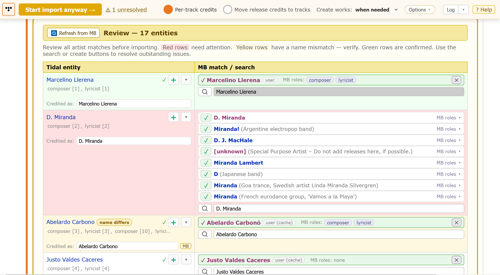

It appears on a release's **Edit relationships** page when there's something to import: a linked [provider](#providers) (or one [Platform Check](../platform_check/README.md) found), or track titles that name a remixer. See [Style / Relationships](https://musicbrainz.org/doc/Style/Relationships) for the guidelines.

> [!TIP]
> [Group Therapy](../group_therapy/README.md) adds batch helpers for the same page: group delete, highlight, copy and move credits.

### Features

- **[Import bar](#import-bar)**: pick a [source](#providers) and the import options.
- **[Review table](#review-table)**: confirm each credited name's MusicBrainz match, with automatic matching, a [confidence cutoff](#match-cutoff), search and entity creation.
- **[Consolidated import](#consolidated-import)** of every source at once, de-duplicated.
- **[Instant Fill](#instant-fill)** writes the confirmed relationships into the editor in one pass.
- **[Diagnostics](#diagnostics)**: a log of every step, to copy into an issue.

Credit Hoarder lists every credited artist, label and place, with clear matches selected. You resolve the rest or leave them out; Instant Fill adds the relationships, and you submit as usual.

### Import bar

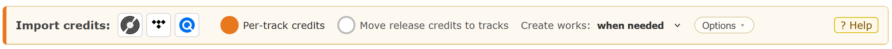

- **Import credits:** one icon per source available on this release. Click to import; right-click opens the source's page. Several sources can run in one session; their edits stack.
- **⚛ All** (with more than one source) runs a [consolidated import](#consolidated-import).

| Option                         |                                                                                          |
| ------------------------------ | ---------------------------------------------------------------------------------------- |
| Per-track credits              | import track credits as well as release credits                                          |
| Move release credits to tracks | put release-level recording credits (instruments, vocals, producer, mix…) on every track |
| Use works                      | existing ones (*create none*), also those writer credits need (*create needed*), or off  |
| Equivalence sets               | skip a role when an equivalent one is already there (writer ≡ composer)                  |
| Duplicate roles                | skip a role the recording already has                                                    |

### Review table

One row per credited entity:

| Row |                                                    |
| --- | -------------------------------------------------- |
| ⚪   | matched automatically                              |
| 🟢   | picked by you                                      |
| 🟡   | matched by URL, but the names differ; worth a look |
| 🔴   | unresolved, or matched below the cutoff            |

For sources that give an artist URL (Discogs, Tidal, Metal Archives), a chip shows it: ✓ already linked in MusicBrainz, 🔗 add it (opens the edit page prefilled), ⚠ linked to a different entity.

**Automatic matching**, in this order:

1. **Source URL**: the artist is linked to that URL in MusicBrainz. When it also carries the credited name, as its name or an alias, the row says `name+url` or `alias+url`; otherwise just `url`, and **+ alias** is offered.
2. **Release context**: one of the release artist's related artists (band members, collaborators) carries the name or alias: *George Harrison* on a Beatles release.
3. **Exact name or alias**, when exactly one MusicBrainz artist carries it (*Don Abi* → *Abiodun*). A common name like *Kim* can't be proven unique and is left for you, with the reason on the row.
4. **Co-credit**: a recording that credits the name alongside the release artist.

When name and URL disagree, the row is left for you. Matches are remembered, a bare name's for this release only. **🔄 Refresh from MB** re-matches rows remembered before a change in MusicBrainz; 🔄 forgets them all and matches again.

#### Match cutoff

Each automatic match has a dot saying how sure it is:

| Dot | Confidence  | Match                                                       |
| :-: | ----------- | ----------------------------------------------------------- |
|  🔵  | Exact       | `name+url`, `alias+url`                                     |
|  🟢  | Strong      | `url`, `context`                                            |
|  🟡  | Unique name | `name`, `alias`; a label or place by its exact name         |
|  🟠  | Weak        | `co-credit`, `similar name` ([⚛ All](#consolidated-import)) |

**Cutoff** in the table's header (default *Strong*) is the lowest confidence selected for you. A match below it waits on its row, marked *below cutoff*, for ✓. A change applies at once to every row but your own picks, which have a grey dot.

On a row:

- The roles under the name are the relationships it gets, with their task where there is one: *Coordinator [Album]* is *misc: album coordinator*. Hover them for the credit each came from.
- **Search** by name, or paste an MBID or a MusicBrainz URL.
- **+** opens MusicBrainz's create page prefilled (name, sort name, type, source URL) and selects the new entity once saved; a right-click creates it in the background. Where the source has a profile (Discogs), **▾** adds a disambiguation from the role or the profile, and the real name; its **Create ↗** takes a right-click too.
- **+ alias** adds a credited name the artist lacks as an alias, so the next import matches it: a click opens the prefilled form, a right-click adds it in the background. A one-off spelling is better left to *Credited as*.
- **Credited as** sets the credited name on every relationship for that entity. **[MB]** and **[source]** fill in either name.
- **⋔ Split** turns a combined name (`&`, `and`, `feat.`, `vs.`, `with`, `×`, `,`, `;`) into one row per artist, expanding a shared surname: *George & Ira Gershwin* → *George Gershwin*, *Ira Gershwin*.
- **MB roles** shows the artist's existing relationship types (producer, mix, instrument…), to sanity-check the source's role.

### Consolidated import

**⚛ All** harvests every source, merges the credits into one review table, and fills once, so the same person credited by Tidal and Qobuz is resolved once.

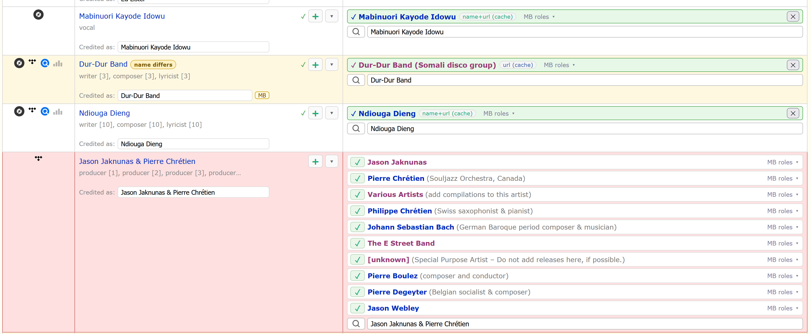

- Identical credits merge before matching; rows that resolve to the same entity merge after.
- An unresolved name a close typo or a middle initial away from a resolved one (*Mark Barott* → *Mark Barrott*) gets it as a [Weak](#match-cutoff) `similar name` match. Short names and ambiguous typos don't.
- The **source** column shows each provider that credited the row: coloured when it gave an artist URL (click to open it), grey when only a name.
- 🔗 adds every provider's URL at once, and a new artist is created with all of them.
- The edit note names the sources: `Source: Import all (Tidal, Qobuz, Deezer)`.

### Instant Fill

Adds the confirmed relationships to the editor without dialogs: release-level (labels, places, companies, artists), per track (instruments, vocals, engineers…) and per work (composer, lyricist, writer). A relationship that already exists, or was added earlier in the session, is skipped.

The edit note carries the statistics per source, with how the entities were matched: *Matched: 9 exact, 4 strong, 1 user (cutoff: strong)*. What an earlier source added counts as *already added this session*, not *already in MB*.

### Providers

| Source         | Credits                                                                                  | Artist identity                            | Login    |
| -------------- | ---------------------------------------------------------------------------------------- | ------------------------------------------ | -------- |
| Discogs        | the fullest: performers, instruments, engineering, production, artwork, mastering        | Discogs artist ID                          |          |
| Tidal          | producer, engineers, writers and publisher per track; performers and artwork per release | Tidal artist ID, on nearly all credits     |          |
| Metal Archives | the lineup with instruments, work credits, other staff                                   | Metal Archives artist ID                   |          |
| Qobuz          | composer, lyricist, producer, publisher, performers                                      | names, except the composer and main artist | optional |
| Apple Music    | composer, writer, lyricist, producer, engineers, arranger, vocals                        | names                                      |          |
| AllMusic       | performers, instruments, composer                                                        | AllMusic artist ID                         |          |
| YouTube Music  | writer, producer                                                                         | names                                      |          |
| Deezer         | composers only                                                                           | names                                      |          |
| mora           | composer, lyricist, arranger, producer                                                   | names                                      |          |
| Melon          | composer, lyricist, arranger                                                             | names                                      |          |
| Titles         | remixers named in the release's own track titles                                         | names                                      |          |

A source with an artist ID resolves to the exact MusicBrainz artist; a name-only credit goes through matching and your review.

- **Tidal** and **Metal Archives** open briefly in a background tab. Tidal's album-wide credits (the Info tab) are read too.
- **Qobuz**: signed in under [Platform Check](../platform_check/README.md), the credits are more reliable and carry the composer's artist ID; otherwise they are names only.
- **YouTube Music**, for a release linked to an album there, reads each song's *Credits*: *Written by* (a writer, on the work) and *Produced by*. *Performed by* and the label aren't imported; some labels send no credits. Songs are placed on the mediums by their track counts; when those don't add up, the log says so.
- **mora**, for a release linked to a mora.jp package, reads each track's composer, lyricist, arranger and producer. Several names in one credit are split on `、` and commas.
- **Melon**, for a release linked to a melon.com album, reads each song page's 작사, 작곡 and 편곡 (lyricist, composer, arranger), a few pages at a time.
- **AllMusic**, for a release linked to an AllMusic release page, reads each track's performers and composers from TiVo's music API. A first call can take 20 seconds; when the API is down, only AllMusic fails.
- **Metal Archives**: guitars and bass default to electric; guests get the *guest* attribute; on a split release, each band's credits stay on its own tracks.
- **Titles** reads named remixes: *Song (Artist Remix)*, *Track (KiNK Dub)*, *Tune (Tom Moulton Mix)*, *Cut (Remixed by Someone)* each give that recording a remixer. *(Extended Mix)*, *(Radio Edit)*, a bare *(Remix)* and *(Mixed by …)* don't. Check what it finds.

| Streaming role                                | MusicBrainz relationship                                                      |
| --------------------------------------------- | ----------------------------------------------------------------------------- |
| Composer, Lyricist, Writer, Orchestrator      | on the work (created if *Use works* allows)                                   |
| Producer, Mixing / Recording / Sound Engineer | on the recording (*mix*, *recording*, *sound*); an assistant gets *assistant* |
| Instruments, Vocals, Conductor                | on the recording                                                              |
| Artwork                                       | on the release                                                                |
| Music Publisher                               | a label, *publishing* the work (`Copyright Control` is dropped)               |
| Distributor                                   | a label, *distributed* the release                                            |

Not imported, but listed as skipped: main and featured artists and the record label (set elsewhere), mastering engineer (belongs on the release), sound editor, studio personnel.

### Diagnostics

The log records every step. Its menu copies it, with or without each source's raw and parsed data, for an issue. *Preflight diagnostics* trace every request.

### Notes

How each source is read is in [DEVELOP.md](../credit_hoarder/DEVELOP.md).

---

## Event Horizon

MusicBrainz, past the point of no return: release, release group, artist, label, recording, work, area, instrument, place, series and event pages redesigned around what you came for.

- Install: [stable](https://raw.githubusercontent.com/majkinetor/musicbrainz-userscripts/refs/heads/stable/userscripts/event_horizon/event_horizon.user.js) or [latest](https://raw.githubusercontent.com/majkinetor/musicbrainz-userscripts/refs/heads/main/userscripts/event_horizon/event_horizon.user.js)
  - Or via bundle: [String Theory](../string_theory/README.md)
- [Changelog](../event_horizon/CHANGELOG.md)

### Features

- **[The viewer](#the-viewer)** takes over a release, release group, artist, label, recording, work, area, instrument, place, series or event page, and moves between them without reloading.
- **[Sections](#sections)**: a rail at the side jumps to, folds, reorders or hides each part of the page.
- **[Tracks and platforms](#tracks-and-platforms)**: each track's credits and its streaming links, by icon.
- **[Releases and discography](#releases-and-discography)** as a grid or a table, grouped by type, with a filter.

### The viewer

Event Horizon shows its own page for each of these, and for search results. A link to another such page opens in place. The round corner icon switches back to MusicBrainz's page; right-click it for the settings.

- **Pictures**: an artist's or label's comes from its linked sites (click for the next, the badge opens its source); an area's is its Wikidata map with the flag; a place's its Commons or Wikidata image; an event's its front from the Event Art Archive.
- **Areas, instruments and places** list what is in, uses or happened at them.
- **Series** list their parts in the columns their type needs (release groups, releases, recordings, works, artists or events); **events** show their date, time, who played, and their setlist.
- **Search results** keep MusicBrainz's columns, with the score as a bar.
- **History** groups a release's edits, and MusicBrainz's other edit lists, into bursts; **a single edit** opens with its changes under the release it touches.
- **Art**, the cover-art page and the add-cover-art page alike, holds Art Station's gallery under the release's title; an event's event-art and add-event-art pages hold it under the event's.
- **Relate**, the release's relationship editor, stays MusicBrainz's but takes Event Horizon's look; its regions and tracks fold like cards.
- **Annotation** and, for a release group, **Cover art** open from Edit's menu (point at Edit); a release group's cover also offers **Set cover art** when you point at it. Both forms stay MusicBrainz's, in Event Horizon's look.
- If a page can't load, **Retry**, or **Show MusicBrainz's page**.

### Sections

Point at the rail beside the page to open it. Click a section to jump to it; the last row folds every section, or opens them all again. The order and what is hidden are remembered.

### Tracks and platforms

Open a track to see its recording and work credits. The platforms it is on (Spotify, Apple Music, Tidal, …) show as icons; point at one for its URL. A site without an icon of its own shows two letters of its domain.

Which platforms show, in which order, and how big, are in the settings' **Platforms** tab.

### Releases and discography

A release group lists its releases, and an artist or label its discography, grouped by type, albums first. Switch between a grid of covers and a table; click a table's column to sort it.

A recording shows its length, ISRCs and credits, its works beside them with their writers, and the releases it appears on. A work shows its writers, ISWCs and other codes, related works, and its recordings in a table by first release.

The funnel icon opens a filter: type part of a title, or add a filter by artist, year and so on. Esc clears it.

Every table's filter (the discography, the releases, an instrument's releases, a work's recordings and so on) also takes `column:value`, such as `artist:elvis`; put the value in quotes when it has spaces. The funnel next to a column's heading starts one for that column.

### Settings

Right-click the corner icon. Changes apply at once; **Reset to defaults** undoes them all.

| Setting                   | Default                                                    |                                                                            |
| ------------------------- | ---------------------------------------------------------- | -------------------------------------------------------------------------- |
| Release → Info            | released, labels, barcode, length, links                   | the facts shown beside the cover                                           |
| Release → Under the cover | Other covers, Rating, Genres                               | what shows under the cover                                                 |
| Platforms → Show          | off                                                        | **Names** beside the icons; **Gray icons** until pointed at                |
| Platforms → Icon size     | 22px                                                       | the size of a platform icon                                                |
| Platforms → Platforms     | Spotify, Apple Music, Tidal, Qobuz, Deezer, YouTube Music  | click to show or hide, drag to reorder; the rest go behind +N              |
| Artist → Images from      | Discogs, Wikipedia, Deezer, Spotify, Tidal, Apple Music, SoundCloud | click to turn one off or on, drag to reorder; the first one found is shown |
| General → Page width      | Medium                                                     | how wide the page grows on a big screen                                    |

### Shortcuts

| Key         | Where       |                   |
| ----------- | ----------- | ----------------- |
| Esc         | filter      | clear it          |
| Esc         | a menu      | close it          |
| Right-click | corner icon | open the settings |
| Right-click | a track     | fold its disc     |
| Right-click | a section   | fold the section  |

---

## Falcon

A MusicBrainz batch editor: queue many entities, then let a pool of workers add their links, ISRCs, names, aliases, disambiguations and cover art, through MusicBrainz's own forms or its API.

- Install: [stable](https://raw.githubusercontent.com/majkinetor/musicbrainz-userscripts/refs/heads/stable/userscripts/falcon/falcon.user.js) or [latest](https://raw.githubusercontent.com/majkinetor/musicbrainz-userscripts/refs/heads/main/userscripts/falcon/falcon.user.js)
    - Or via bundle: [String Theory](../string_theory/README.md)
- [Changelog](../falcon/CHANGELOG.md)
- [View users](https://musicbrainz.org/search/edits?auto_edit_filter=&order=desc&negation=0&combinator=and&conditions.1.field=edit_note_content&conditions.1.operator=includes&conditions.1.args.0=Falcon)

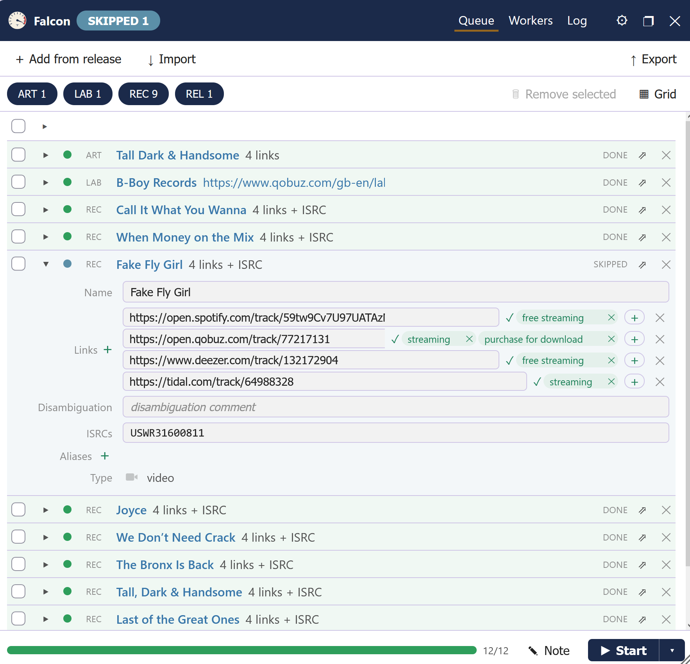

An importer like [Harmony](https://harmony.pulsewidth.org.uk) hands you 20–50 artists, recordings and labels that each need links, ISRCs and a cover. MusicBrainz has no write API for most of that, so tools open a tab per entity for you to handle one by one. Falcon does them as one batch.

### Features

- **[Queue from anywhere](#filling-the-queue)**: a [Harmony](#from-harmony) import, [the page you're on](#from-the-current-page), [a series](#from-a-series), a [JSON file](#json-model) or [another script](#from-another-script).
- **[Editing the queue](#editing-the-queue)** as a list of forms or a spreadsheet-like grid.
- **[Failures you can inspect](#the-run)**: MusicBrainz's own error on the row, the worker left where it stopped, retry in place.
- **[Attributes](#attributes)**: links, names, disambiguations, aliases, ISRCs, the video flag, cover art.
- **[Batch edit note](#batch-edit-note)** on every edit of a run.
- **[Hands-free Harmony import](#hands-free-import)**, including retries when MusicBrainz errors, and a hand-off to Picard once the run finishes.
- **[Export and import](#json-model)** a run as JSON, with each item's outcome, so a partial batch can be rerun without repeating what went through.

Untouched rows, and aliases and links the entity already has, are skipped. A link in another locale counts as had (a Qobuz page linked as `gb-en` isn't added as `us-en`), and the row says which.

### Filling the queue

Open Falcon with **Ctrl+Alt+F** or its corner icon (right-click: **Options**). The release editor has no icon, but the key works.

#### From Harmony

On a Harmony *Release Actions* page ([harmony.pulsewidth.org.uk](https://harmony.pulsewidth.org.uk) or [harmony.mybrainz.dev](https://harmony.mybrainz.dev/)), **Send N to Falcon** (bottom-right; right-click: **Options**) opens MusicBrainz with the batch queued: links for every entity, the recordings' ISRCs, and the front cover.

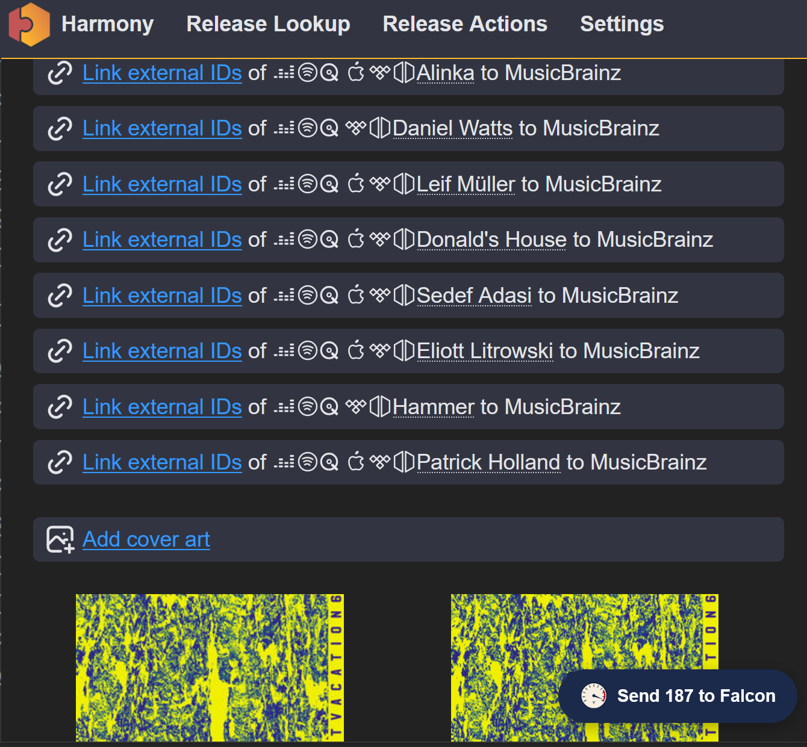

- **ISRCs** go by tracklist position: ISRC *N* to track *N* as MusicBrainz has it. If the counts differ, the extras are dropped and logged. (A recording linked to the wrong provider track still gets that track's ISRC; Falcon can't tell.)
- **Cover art**: Falcon takes each candidate's largest version from its store, measures it, and picks the largest, then the smallest file; expand the row to change the pick, type or comment. The edit note names the source, its size and what it was chosen over.

> [!WARNING]
> A release that already has cover art gets none. Turn off *Add covers only when there aren't any* to add one anyway; the row then warns when the release has art. If you upload covers with [Art Station](../art_station) instead, turn on *Ignore cover art* under *Harmony*.

#### From the current page

On a release or release group page, **+ Add from** fills the queue with its entities, with empty fields. Fill in the rows you want and press **Start**. **Export** turns it into a JSON worksheet to fill in later.

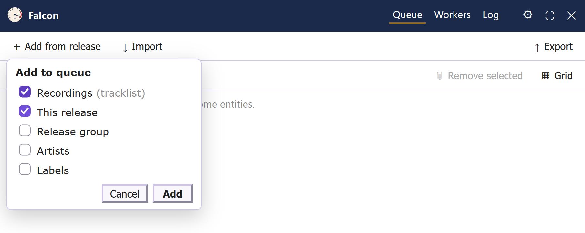

Ticking the *Video* camera on a selected recording ticks it on every selected recording.

#### From a series

On a series page, **+ Add from series** queues its release groups (optionally every release in them), or its releases (optionally their release groups), in the series' own order. Together with [renaming](#attributes), this is how a series gets its titles conformed.

### Editing the queue

**List** / **Grid** switches the view.

- **List**: expand a row to edit it as a form. Each link shows its types; the mark before it (✓ done, ✗ failed, ↗ not run yet) opens it.
- Edit a URL in its box (empty drops it). A type badge picks another type or **✕** drops it; **+** after the types adds one, **+** by *Links* adds a link, the link's **✕** removes it. A link without a type shows *auto*, left for MusicBrainz to guess.
- **Grid**: one line per row, with its name, disambiguation and ISRCs editable in place. **▸** opens the row's links and aliases (and a release's cover art) beneath it, lined up under *Name*; aliases are added and edited only there.

The [keyboard](#shortcuts-3) moves between fields like a spreadsheet; in the list, rows open and close as you go.

### The run

Review the queue, then press **Start**. Right-click a row's type to select every item of that type; the header chips (`art`, `lbl`, `rec`, `rel`, `rg`) exclude a type without removing it.

| Status      |                                                                                |
| ----------- | ------------------------------------------------------------------------------ |
| queued      | not processed yet                                                              |
| in progress | being processed                                                                |
| done        | everything went through                                                        |
| partial     | some of it failed                                                              |
| failed      | nothing went through                                                           |
| manual      | finished by you in a tab                                                       |
| skipped     | nothing to submit, MusicBrainz reported no change, or a special-purpose entity |
| excluded    | its type's chip is off                                                         |

- A special-purpose artist or label, such as *Various Artists*, *[unknown]* or *[no label]*, is skipped without opening its edit page: MusicBrainz lets only a few editors change those.
- A failed row shows MusicBrainz's own error on hover. **FAILED** / **PARTIAL** / **MANUAL** chips at the top filter the queue to those rows.
- A worker that can't commit stays where it stopped, dimmed but live, and a fresh one takes over. Click a red status to jump to it in the **Workers** tab; **⛶** enlarges it.
- **⇗** opens the entity's edit page in a tab, prefilled, for you to finish.
- **Retry failed**, in Start's **▾** menu, reruns the failed and partial rows in place.

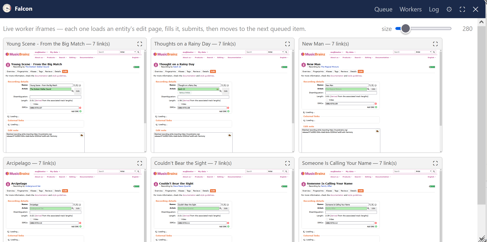

A link MusicBrainz can't classify on its own (a Bandcamp track: purchase or streaming?) fails with that reason instead of blocking its row; use **⇗** to pick the type.

> [!NOTE]
> Workers are MusicBrainz's own edit pages, filled in and submitted out of sight; how is in [DEVELOP.md](../falcon/DEVELOP.md#workers). *Workers* in [Settings](#settings-2) sets how many run at once.

#### The log

The **Log** tab filters by level or worker (`w1`, `w2`, …) and searches; **⧉ Copy** gives Markdown for an issue, and **debug** records each worker's every step.

The last 10 runs' logs are kept in this browser, so a run whose tab crashed can still be read: pick it beside the filter. **Clear history** deletes Falcon's. A long run keeps its start and end.

### Attributes

|                                      | artist | label | recording | release | release group |
| ------------------------------------ | :----: | :---: | :-------: | :-----: | :-----------: |
| links, name, aliases, disambiguation |   ✓    |   ✓   |     ✓     |    ✓    |       ✓       |
| ISRCs, video, length                 |        |       |     ✓     |         |               |
| cover art, barcode, event, tracks    |        |       |           |    ✓    |               |

- **Name**: the ✎ box starts with the current name. A rename shows once its edit passes the vote.
- **Aliases**: one row per alias, with its name, its language and **✕**; the **+** by the *Aliases* label adds one, or use [JSON](../falcon/examples/aliases.json) for many. A new alias takes the language last typed; `name@locale` typed in the name box sets the language too. Enter on a filled alias opens the next one, on an empty one moves on to the next row's aliases; Esc drops a new, still empty row.
- **Video** is only ever set, never cleared.
- **Barcode** fills a release that has none and unticks *This release does not have a barcode*. A different barcode is kept, and the row says so.
- **Event** gives a release that has no release event one: the date (`2014`, `2014-02` or `2014-02-20`), then the country's code, `2014-02-20 XW`. Only `XW` ([Worldwide]) is known so far; another code leaves the country empty. An existing event is kept, and the row says so.
- **Tracks** changes a release's track titles and lengths, each as medium.track, a quoted title, a length, separated by `;`: `1.2 "New title" 5:02; 1.3 6:58`. `+rec` after the title gives the recording that title too. A track that has changed since, or a length on a medium with a disc ID, is kept, and the row says so. In the grid, barcode, event and tracks are in the row's opened part.
- **Length** sets a recording's own length (`m:ss`). MusicBrainz takes it only for a recording without tracks; any other's comes from its tracks, and the row says so.

> [!WARNING]
> MusicBrainz silently drops the locale of a *Search hint* alias; Falcon warns in the log. Use the `<entity> name` type for a localised title.

### Batch edit note

**✎ Note**, left of Start, adds its text to every edit of the run: forms, aliases and covers. It isn't kept across reloads, so an old reason can't slip into a new batch.

### Hands-free import

Two settings, both on by default, carry a finished Harmony import to a finished run:

|                           | Runs on     | Does                     |
| ------------------------- | ----------- | ------------------------ |
| *Auto send*               | Harmony     | presses *Send to Falcon* |
| *Auto start import after* | MusicBrainz | presses *Start*          |

*Auto send* waits for Harmony to finish, counts down on the button (a click cancels, a right-click cancels and opens the options), and stands down when there's nothing to send. *Auto start import after* counts down on **Start** for its seconds (10 by default); a click on Start cancels.

**When Harmony errors**, the page loads short of actions:

- **a MusicBrainz error**: Falcon reloads the page, a few times, waiting longer each time;
- **a provider error**, or retries exhausted: Falcon sends what it has, as *Send 43 to Falcon (partial)*, with the reason as the batch's edit note (reloading can't fix a provider).

A partial run can be topped up later; what went through isn't repeated. *Reload release page after import without errors* shows the result on the release page, the corner icon green; a run with failures isn't reloaded, so its queue survives.

### JSON model

What **Import** reads, **Export** writes, and Harmony and other scripts produce: a bare array of items, or `{ "items": [...] }` with an optional root `note` (the [batch edit note](#batch-edit-note)) and `name` (the run's name in the log history, for a queue with no release in it to be named after).

```json
{
  "note": "Links and covers from the label's site",
  "items": [
    { "entityType": "artist", "mbid": "d31f76d2-1d8e-4271-8027-148f375979d7", "urls": [{ "url": "https://myspace.com/x", "linkTypeId": null }], "status": "done" },
    { "entityType": "recording", "mbid": "e42f8e08-3150-4c6c-be5b-4030c29b1bf7", "disambiguation": "live version", "isrcs": ["NLTH62000001"] },
    { "entityType": "release", "mbid": "8ad416ad-f3a1-43bb-9e85-786efefd5173",
      "urls": [{ "url": "https://www.discogs.com/release/1", "linkTypeId": "75" }],
      "cover": [{ "url": "https://e-cdns-images.dzcdn.net/images/cover/x/1000x1000.jpg", "type": "Booklet", "comment": "page 1" }] }
  ]
}
```

| Key                             |                                                                                                                                                                             |
| ------------------------------- | --------------------------------------------------------------------------------------------------------------------------------------------------------------------------- |
| `entityType`                    | `artist`, `label`, `recording`, `release`, `release_group`                                                                                                                  |
| `mbid`                          | the entity                                                                                                                                                                  |
| `urls[]`                        | `{ url, linkTypeId }`; without a type, MusicBrainz classifies the link                                                                                                      |
| `rename`                        | a new name (`name` is the current one, read only)                                                                                                                           |
| `disambiguation`                | the disambiguation comment                                                                                                                                                  |
| `aliases[]`                     | `{ name, locale, type, primary, sortName, begin, end, ended }`, or `"name@locale"`; each is its own edit. `type` as MusicBrainz names it (`Recording name`, `Search hint`…) |
| `isrcs[]`                       | recordings                                                                                                                                                                  |
| `video`                         | recordings; only `true` does anything                                                                                                                                       |
| `length`                        | recordings: the length in ms, for a recording without tracks                                                                                                                |
| `cover[]`                       | releases: `{ url, type, comment, candidates }`, type defaulting to Front                                                                                                    |
| `barcode`                       | releases: a barcode for a release that has none                                                                                                                             |
| `labels[]`                      | releases: `{ mbid, name, catno, add }`: an empty catalog number to fill, or a label to add                                                                                  |
| `event`                         | releases: `{ date: { year, month, day }, country }` for a release without an event                                                                                          |
| `tracks[]`                      | releases: track titles and lengths, `{ medium, position, title, recording, ms, was }` ([below](#track-changes))                                                             |
| `note`                          | that item's own edit note                                                                                                                                                   |
| `status`, `error`, `urlResults` | written by Export: the outcome of the last run                                                                                                                              |

#### Track changes

A release's `tracks[]` changes its tracks, each by `medium` and `position` (from 1): `title` gives the track a new title, and the recording too with `recording: true`; `ms` a new length. `was: { title, ms }` is what the track had when the change was made: a track that holds something else by now is left alone (`ms: null` means a track without a length). Without `was` the change is made whatever the track holds. The older `lengths[]` (`{ medium, position, ms }`) fills tracks without a length.

#### From another script

Another script can hand Falcon a queue in the [JSON model](#json-model), by a `?falcon=` link or by an event on the page; a link never starts the queue. Sending the same batch twice doesn't run it twice. [Mission Control](../mission_control/README.md#execute) and [Platform Check](../platform_check/README.md#artists-and-labels) send their links, barcodes, catalog numbers, release events and track titles and lengths this way. How is in [DEVELOP.md](../falcon/DEVELOP.md#handoff).

### Settings

| Setting                                                  | Default   |                                                                                                             |
| -------------------------------------------------------- | --------- | ----------------------------------------------------------------------------------------------------------- |
| Hide Falcon icon                                         | off       | Ctrl+Alt+F still opens it                                                                                   |
| Add covers only when there aren't any                    | on        | a release that already has cover art gets none from the queue                                               |
| Harmony: Ignore cover art                                | off       | a Harmony import queues no cover art                                                                        |
| Harmony: Auto send                                       | on        | see [Hands-free import](#hands-free-import)                                                                 |
| Harmony: Auto start import after … seconds               | on, 10    | see [Hands-free import](#hands-free-import)                                                                 |
| Harmony: Reload release page after import without errors | on        | see [Hands-free import](#hands-free-import)                                                                 |
| Harmony: Open in new tab                                 | on        | off navigates the Harmony tab                                                                               |
| Harmony: Automatically send to Picard using port         | off, 8000 | hand the release to [Picard](https://picard.musicbrainz.org/) after a run (needs its *Browser integration*) |
| Workers                                                  | 5         | entities processed at once                                                                                  |

The Picard port also sets MusicBrainz's own tagger button, whether *Automatically send to Picard* is ticked or not.

> [!TIP]
> To report a problem: turn **debug** on in the **Log** tab, reproduce it, then **⧉ Copy** the log into the issue.

### Shortcuts

| Key              |                                                                              |
| ---------------- | ---------------------------------------------------------------------------- |
| Ctrl+Alt+F       | open or close Falcon                                                         |
| Esc              | hide Falcon (an item popup over it first); a run goes on                     |
| Enter / Down     | the same field on the next row                                               |
| Shift+Enter / Up | the same field on the previous row                                           |
| Tab / Shift+Tab  | the next / previous field, on to the next / previous row                     |
| Right / Left     | the next / previous field, once the cursor is at the end / start of the text |

In an alias box with text in it, Enter adds the alias first; press it again to move on.

---

## First Contact

Import a release into MusicBrainz from the platform's album page with one click: the release editor opens with everything the platform knows filled in.

- Install: [stable](https://raw.githubusercontent.com/majkinetor/musicbrainz-userscripts/refs/heads/stable/userscripts/first_contact/first_contact.user.js) or [latest](https://raw.githubusercontent.com/majkinetor/musicbrainz-userscripts/refs/heads/main/userscripts/first_contact/first_contact.user.js)
    - Or via bundle: [String Theory](../string_theory/README.md)
- [Changelog](../first_contact/CHANGELOG.md)
- [View users](https://musicbrainz.org/search/edits?auto_edit_filter=&order=desc&negation=0&combinator=and&conditions.0.field=edit_note_content&conditions.0.operator=includes&conditions.0.args.0=First+Contact)

> [!IMPORTANT]
> By default every album page you import is sent to the Internet Archive to be saved, so anyone can later check what it showed. See [Archive](#archive-1); turn it off in [Settings](#settings-3).

### Features

- **[Import](#import)** a release from the album page into the MusicBrainz release editor.
- **[Already in MusicBrainz?](#already-in-musicbrainz)**: before the editor opens, the album is looked up in MusicBrainz, so one it has gets its missing parts instead of a second copy.
- **[Consolidate](#consolidate)**: compare the album with the other platforms in Mission Control, and take the best of each.
- **[Send to Harmony](#send-to-harmony)**: look the album up on Harmony instead, with every platform that has its barcode.
- **[Platforms](#platforms)**: what is read from each one.
- **[Artist matching](#artist-matching-1)** is left to Apollo Editor, which gets every artist's platform link.
- **[Archive](#archive-1)**: the album page is saved on the Internet Archive.
- **[Moving the button](#moving-the-button)**: drag it anywhere; each platform remembers its place.

### Import

On a platform's album page, click **Import to MusicBrainz**: once the release is read, the release editor opens in a new tab, filled in:

| Field                | From                                                                                              |
| -------------------- | ------------------------------------------------------------------------------------------------- |
| Title, artist credit | the album, with any *feat.* artists split off the title into the credit                           |
| Type                 | the platform's album / EP / single / compilation, or a [guess](#release-type) when it doesn't say |
| Status, packaging    | Official, None                                                                                    |
| Release event        | the platform's release date, Worldwide                                                            |
| Label                | the platform's label; *A / B* becomes two labels, *AC/DC Records* stays one                       |
| Barcode              | the platform's UPC                                                                                |
| Script               | Latin, when every title is in Latin letters; otherwise left for you                               |
| Tracklist            | one Digital Media medium per disc, with titles, track artists and lengths                         |
| External link        | the album page                                                                                    |
| Annotation           | the platform's [notes](#platforms), with their source; off per platform in [Settings](#settings-3)  |
| Edit note            | the album page, the script and its version                                                        |

A compilation the platform credits to one of its artists becomes Various Artists and a Compilation, when the credited artists are on fewer than half the tracks and the tracks have five or more artists.

#### Release type

When the platform gives no type, or only a plain *album* while the title says otherwise, it is guessed, the most certain sign first:

| Sign                                                                          | Type   |
| ----------------------------------------------------------------------------- | ------ |
| *EP* or *E.P.* in the title                                                   | EP     |
| the title ends in *Single*, or says *single* on up to 8 tracks and 50 minutes | Single |
| every track is one song in other versions (*Remix*, *Instrumental*, *VIP*…)   | Single |
| 7 tracks or more, or over 30 minutes                                          | Album  |
| up to 7 minutes                                                               | Single |
| 2 tracks or more, up to 30 minutes                                            | EP     |

Without every track's length: 1 track is a Single, 3 to 6 an EP, 7 or more an Album, and 2 are left for you. The log says which sign decided.

### Already in MusicBrainz?

Before the release editor opens, First Contact looks the album up in MusicBrainz. A light on **Import to MusicBrainz** says what it found:

| Light         | MusicBrainz has                                                 |
| ------------- | --------------------------------------------------------------- |
| green         | a release with this album's link                                |
| yellow        | a release with its barcode                                      |
| orange        | a release with a similar title, the same artist and track count |
| empty circle  | none of these                                                   |
| dashed circle | the check failed; the import goes on without it                 |

A release counts as this album unless its barcode, format (digital, CD, vinyl…) or track count differs. Other editions are listed too, greyed. Icons under each release say what agrees with the album, marked ✓ (the link, barcode, title, track count, format and date), and what differs, marked ≠ in amber; hover one to compare the two.

When MusicBrainz may have the album, a panel lists those releases before the editor opens. For each:

- **Update this release** opens it with [Mission Control](../mission_control/README.md), which compares it with the platforms, this album included, and offers what it lacks: the barcode, labels and catalog numbers, release event, track lengths, ISRCs and links.
- **Add link only** opens its edit page with this album's links and an edit note. It shows only when the release lacks a link.

**Import anyway** opens the release editor as usual. Mission Control adds links only for the platforms Platform Check knows: for Presto Music, Ototoy, mora, Melon and Bugs, use **Add link only**.

The *Check MusicBrainz* [setting](#settings-3) says when the album is looked up:

| Check MusicBrainz |                                                                          |
| ----------------- | ------------------------------------------------------------------------ |
| On import         | when you click **Import to MusicBrainz**                                 |
| On page load      | as the page opens, so the light shows at once; the import uses that read |
| Off               | never                                                                    |

### Consolidate

The button with [Mission Control](../mission_control/README.md)'s icon opens the release editor with Mission Control over it, which finds the album on the other platforms so you can take the best title, date, label, tracklist and ISRCs of all of them ([Consolidate a new release](../mission_control/README.md#consolidate-a-new-release)).

It needs Mission Control and Platform Check, both in [String Theory](../string_theory/README.md). Presto Music has no Consolidate button: Mission Control doesn't compare it.

First Contact reads the platforms for Mission Control on a release MusicBrainz already has too, when Mission Control [compares it with the platforms](../mission_control/README.md#compare-with-the-platforms).

### Send to Harmony

The button with [Harmony](https://harmony.pulsewidth.org.uk/)'s icon opens the album in Harmony's lookup instead, which finds it by barcode on the platforms ticked in [Harmony's settings](https://harmony.pulsewidth.org.uk/settings); [Falcon](../falcon/README.md) works there as usual. Open those settings once: until then Harmony looks an album link up only on its own platform, and a barcode nowhere.

The *Harmony* setting picks which Harmony opens: [harmony.pulsewidth.org.uk](https://harmony.pulsewidth.org.uk/) or [harmony.mybrainz.dev](https://harmony.mybrainz.dev/). Each keeps its own settings.

| Platform                                                                        | Sent                                |
| ------------------------------------------------------------------------------- | ----------------------------------- |
| Deezer, Bandcamp, Discogs, Apple Music, Tidal, Qobuz, Beatport, Spotify, Ototoy, mora, Melon, Bugs, AllMusic | the album link, at once |
| Volumo, HDtracks, SoundCloud, Audiomack, 7digital, Presto Music                 | the barcode, once the album is read |
| YouTube Music, Amazon Music                                                     | nothing; the button is greyed out   |

Harmony can't read the last two rows' platforms, so for the middle row First Contact sends the barcode; an album without one (a SoundCloud set that isn't a label's) sends nothing. YouTube Music and Amazon Music show no barcode.

### Platforms

| Platform                        |      ISRCs      |  Barcode   | Label                 | Notes          |
| ------------------------------- | :-------------: | :--------: | --------------------- | -------------- |
| [Deezer](#deezer)               |        ✓        |     ✓      | ✓                     |                |
| [Bandcamp](#bandcamp)           |                 |     ✓      | on a label's page     | about, credits |
| [Discogs](#discogs)             |                 |     ✓      | ✓ with catalog number | notes          |
| [Apple Music](#apple-music)     |        ✓        |     ✓      | ✓                     | review         |
| [Tidal](#tidal)                 |        ✓        |     ✓      | from the ℗ line       |                |
| [Qobuz](#qobuz)                 |                 |     ✓      | ✓                     | review         |
| [Beatport](#beatport)           |        ✓        |     ✓      | ✓ with catalog number | description    |
| [Spotify](#spotify)             |                 |     ✓      | ✓                     |                |
| [YouTube Music](#youtube-music) |                 |            |                       | description    |
| [Volumo](#volumo)               |        ✓        |     ✓      | ✓ with catalog number | description    |
| [HDtracks](#hdtracks)           |        ✓        |     ✓      | ✓                     | description    |
| [SoundCloud](#soundcloud)       |   label sets    | label sets | ✓                     | description    |
| [Amazon Music](#amazon-music)   |                 |            | from the ℗ line       | ℗ line         |
| [Audiomack](#audiomack)         |        ✓        |     ✓      | from the ℗ line       | description    |
| [7digital](#7digital)           |        ✓        |     ✓      | ✓                     | ℗ and © lines  |
| [Ototoy](#ototoy)               |                 |            | ✓                     | album info     |
| [mora](#mora)                   |                 |  some      | ✓                     |                |
| [Melon](#melon)                 |                 |            | ✓                     |                |
| [Bugs](#bugs)                   |                 |            | ✓                     |                |
| [AllMusic](#allmusic)           |        ✓        |     ✓      | ✓ with catalog number |                |
| [Presto Music](#presto-music)   | streamed albums |     ✓      | ✓ with catalog number | about          |

#### Deezer

Pages: `deezer.com/…/album/<id>`

Featured artists come from the title's *feat.* clause: Deezer lists them as main artists. A trailing *(Original Mix)* is dropped from track titles.

#### Bandcamp

Pages: `<name>.bandcamp.com/album/<slug>`

- A comma list of artists (*Future Funk Squad, Omega Sparx, Stu Brootal, The Crystal Method*) is split into separate artists, except the account's own name.
- On a label's page the label is filled in; on an artist's own page it is left empty.
- A compilation's *Artist - Title* track titles are split into artist and title.
- The album link gets both *purchase for download* and, when it streams, *stream for free*.
- Only the artist the page belongs to has a Bandcamp link to hand off.
- An album that isn't out yet hides its unreleased tracks' lengths; First Contact takes them anyway, with a warning and a line in the edit note, as they can still change.

#### Discogs

Pages: `discogs.com/release/<id>`

- Format per medium (LP is 12" Vinyl), and sides A/B, C/D… become one medium each, numbered A1, B2…; *CD 1 …* style headings become medium titles.
- A work listed over its movements becomes one track per movement, *Concerto…, RV 531: I. Allegro*, when each movement has its own track number; movements that share one (*3a*, *3b*) stay one track, *Concerto…: I. Allegro / II. Largo*.
- Status *Promotion* or *Bootleg* and the *Compilation* type come from the format's descriptions, packaging from its free text.
- Artists keep their credited name (*DJ Fresh* for *Fresh*) and lose Discogs's *(2)* numbering; *Featuring* track credits go after *feat.*
- Country when it is one country (not *UK, Europe & US*).
- A label listed twice with its catalog number written two ways is kept once; *Not On Label* becomes *[no label]*.
- Every artist and label carries its Discogs link for Apollo.

#### Apple Music

Pages: `music.apple.com/<country>/album/…`

- Read from the page's country store.
- Every track has its ISRC; every artist its Apple link.
- *- Single* / *- EP* at the end of the title is the type, not part of the title.
- Music videos are left out.
- The link gets *streaming page* and, when the iTunes Store sells the album, *purchase for download*.
- An album can list tracks Apple doesn't offer, so 1.8 is followed by 1.10. First Contact names them and asks first; *Import anyway* adds each as an empty track at its position, for you to title or remove, and the edit note lists them.

#### Tidal

Pages: `tidal.com/album/<id>`, `tidal.com/browse/album/<id>`, `listen.tidal.com/album/<id>`

- Read from the US store, else the British or German one.
- Every track has its ISRC; every artist its Tidal link.
- The *feat.* Tidal puts in a track's version goes into the credit, any other version (*Radio Edit*) stays in the title.
- Tidal has no label field, so the label is read from its copyright line: *℗ 2020 Outpost Recordings* gives Outpost Recordings, *… under exclusive license to Columbia Records, a Division of …* gives Columbia Records. A line that doesn't read as one name leaves the label for you.

#### Qobuz

Pages: `qobuz.com/<country-lang>/album/<slug>/<id>`

- Qobuz's per-track artist is unreliable (it can name a band member), so an album by one artist credits its main artists on every track, with the title's *feat.*; a Various Artists album takes each track's artist.
- The type isn't given, so it is guessed.
- A page that lists only part of a long album says so in the log.

#### Beatport

Pages: `beatport.com/release/<slug>/<id>`

- Every track has its ISRC and Beatport link; every artist and the label their Beatport link.
- A mix name other than *Original Mix* goes into the track title: *Leg Pulling (Dub)*.
- Beatport credits every track artist to the release, so more than four of them make it Various Artists.
- Beatport's own type is mostly just *Release*, so the type is usually guessed.
- The link gets *purchase for download* and, when it streams, *streaming page*.
- When [Mission Control](../mission_control/README.md#consolidate-a-new-release) compares a Beatport album it isn't open on, Beatport's bot check can refuse the page. It is then read through [Platform Check](../platform_check/README.md)'s Beatport login; without one, open any Beatport page in this browser first.

#### Spotify

Pages: `open.spotify.com/album/<id>`

- If the log says nothing was heard from the player, reload the page.
- Every artist and every track has its Spotify link.
- The date is as precise as Spotify has it.

#### YouTube Music

Pages: `music.youtube.com/browse/MPREb_…`, `music.youtube.com/playlist?list=OLAK5uy_…`

- Every artist has its YouTube Music channel.
- Featured artists come from the title's *feat.*: YouTube Music lists them as main artists.
- The type (Album, EP, Single) is YouTube Music's; the date is the year only.
- The link is the album playlist.

#### Volumo

Pages: `volumo.com/album/<barcode>-<slug>`, `volumo.com/album/<id>`

- Every track has its ISRC; every artist its Volumo link.
- A mix name other than *Original Mix* goes into the track title.
- More than four release artists make it Various Artists.

#### HDtracks

Pages: `hdtracks.com/#/album/<id>`

- HDtracks has no artist pages, so artists have no link to hand off.

#### SoundCloud

Pages: `soundcloud.com/<user>/sets/<slug>`

- A set the label distributed (a *label set* above) has each track's ISRC and the barcode; the set's type (album, EP, single, compilation) is used.
- Only the uploading account has a SoundCloud link to hand off.

#### Amazon Music

Pages: `music.amazon.com/albums/<id>`, and the other countries' `music.amazon.*`

- No Amazon account is needed. The catalogue read is amazon.com's (US).
- The tracklist is one medium: Amazon Music doesn't mark discs, so split them in the editor.
- A track's artists come from its artist line (*A, B & C*), and only the first has an Amazon Music link; an *&* inside one name (*Simon & Garfunkel*) stays one artist.
- The date is the one the album page shows, which for a reissue can be the original's.
- The label is read from the ℗ line, as for [Tidal](#tidal); the whole line also goes to the annotation (see [Settings](#settings-3)), since it may or may not name the label.

#### Audiomack

Pages: `audiomack.com/<artist>/album/<slug>`, `audiomack.com/<artist>/song/<slug>`

- No Audiomack account is needed.
- A song page is imported as a one-track single.
- A track's artists come from its artist line (*A, B & C*), and the featured ones from its title or Audiomack's *featuring*. Only the uploading account has an Audiomack link to hand off.
- The tracklist is one medium.

#### 7digital

Pages: `<store>.7digital.com/artist/<artist>/release/<slug>`

- No 7digital account is needed. If the page asks you to prove you're human, do it first, then import.
- The barcode, type, date, discs and ISRCs come from 7digital's catalogue, which can't list an album's tracks: each track is searched for, a few at a time.
- A track's artists come from its artist line (*A, B & C*, *A x B*, *A feat. B*). The release artist has a 7digital link to hand off, and so does a track artist who is the whole line.
- When [Mission Control](../mission_control/README.md#consolidate-a-new-release) compares a 7digital album and the page asks to verify you're human, the album is read from 7digital's catalogue search instead: the same data, without the page's ℗ and © lines.

#### Ototoy

Pages: `ototoy.jp/_/default/p/<id>`

- No Ototoy account is needed.
- Ototoy shows no barcode, ISRCs or type, so the type is guessed and the country is Japan.
- The date is the original release date when the page has one.
- A track's artists are all the artists Ototoy links for it, and the featured ones come from its title's *(feat. …)*. On some compilations those links include the arranger or the label, so check the track artists there.
- The hi-res and CD-quality editions are separate pages; the format some titles carry (*Disc2(24bit/44.1kHz)*) is left out of the title.
- The catalog number isn't filled in: Ototoy often shows the CD's or a distributor's code instead.

#### mora

Pages: `mora.jp/package/<label>/<id>/`

- No mora account is needed.
- mora shows no ISRCs or type, so the type is guessed and the country is Japan. The barcode is filled in only when mora's product code is one; otherwise that code goes in as the catalog number, so check it.
- The tracklist is one medium: mora doesn't mark discs, so split them in the editor.
- Every artist has their mora link.

#### Melon

Pages: `melon.com/album/detail.htm?albumId=<id>`

- No Melon account is needed.
- Melon shows no ISRCs or barcode. The type comes from Melon's album type (정규, 싱글, EP, OST…), and the country is South Korea.
- The label is the album's planning company (기획사), not its distributor.
- Every artist and every track has its Melon link.

#### Bugs

Pages: `music.bugs.co.kr/album/<id>`

- No Bugs account is needed.
- Bugs shows no ISRCs or barcode. The type comes from Bugs' album type (정규, 싱글, EP, OST…), and the country is South Korea.
- The label is the album's planning company (기획사), or its distributor (유통사) when there is none.
- Each track's length is a request to Bugs, so a long album takes a moment.
- Every artist and every track has its Bugs link.

#### AllMusic

Pages: `www.allmusic.com/album/release/<slug>-mr<id>`

- The data comes from TiVo's music API, which AllMusic is built on. A first call can take 20 seconds, and when the API is down the import stops with an error.
- The type is Compilation or Live when AllMusic flags it so; the country is left empty.
- Every artist has its AllMusic link.

#### Presto Music

Pages: `prestomusic.com/classical/products/<id>`, `prestomusic.com/jazz/products/<id>`, `streaming.prestomusic.com/album/<id>`

- No Presto account is needed.
- The shop and the streaming app share their product numbers, so an album imports the same from either. ISRCs come from the streaming app, so only an album that streams has them.
- From the streaming app the release is *Digital Media*, with the streaming link and the shop link. Its barcode comes from the booklet, so an album without a booklet has none.
- From the shop, a download also gets the streaming link, when the album streams. A CD, SACD or vinyl doesn't: on MusicBrainz the download is a separate release.
- Presto sells CDs, SACDs, vinyl and downloads, so the medium's format is the one on the page: *CD*, *Hybrid SACD*, *Vinyl*, or *Digital Media* for a download. A physical one gets the *purchase for mail-order* link and no packaging; the country is left for you.
- A set of several discs (*5 CDs*) comes as one medium: Presto doesn't say where each disc starts. A message says so; split it at each disc's first track with Apollo Editor's [Split medium](../apollo_editor/README.md#merge-and-split-mediums).
- A classical work's movements are its tracks, titled *Work: Movement*; a work without movements is one track. The composer Presto puts before a title (*Beethoven: …*, *Ida Sand: Salt & Sugar*) is left out.
- Track artists are the names Presto lists for each work without an instrument or role. The musicians listed with one (*Ida Sand (piano)*, *Ola Gustafsson (guitar)*) are left out; when every name has one, as on most classical pages (*Chiaroscuro Quartet (stringquartet)*), all of them are the artists. Artists have no Presto link to hand off.
- Some lengths are missing; those tracks get none.
- When the shop page lists no tracks (a new vinyl, say), the tracklist is taken from another format of the same album, the CD first. A message and the edit note say where it came from: check it, as the vinyl can differ. When no format lists tracks, nothing is imported.

### Artist matching

First Contact hands every credited artist's platform link, the release's and each track's, to [Apollo Editor](../apollo_editor/README.md#artist-matching), which matches them, the link first: on start with *Auto-match on start: Label, Artist* (the default), or with its **Match**. Apollo offers to add the link to an artist that lacks it, or to create the artist with it. Other scripts can read the same [handoff](#handoff).

### Archive

On every import, First Contact has the Internet Archive's [Wayback Machine](https://web.archive.org/) save the album page, so anyone can later check what it showed; the snapshot is found by the page's address.

- The import doesn't wait for the save; the [log](#settings-3) says how it went.
- Deezer and Apple Music build their pages in the browser, so a saved page shows little. For these, the album data First Contact read is saved too.
- Discogs refuses the Internet Archive, so its release data is saved instead.
- Spotify, Tidal and YouTube Music also build their pages in the browser, and their data can't be saved. For these, add your archive.org keys: the save then also takes a screenshot of the page.

#### archive.org keys

Anonymous saves are limited per connection, so after many imports some are refused. With your own keys:

- the limit is much higher;
- each save also takes a screenshot of the page;
- a page saved in the last 30 days isn't saved again.

To get them, make a free account on [archive.org](https://archive.org), log in, and open [archive.org/account/s3.php](https://archive.org/account/s3.php). Copy the *access key* and the *secret* into **⚙︎ → archive.org keys**.

[Apollo Editor](../apollo_editor/README.md#archive) archives a release's links with the same keys, shared in [String Theory](../string_theory/README.md).

> [!NOTE]
> Archiving sends the address of every album you import to archive.org, and with keys, under your account. Turn **Archive the album page on the Internet Archive** off in [Settings](#settings-3) if you don't want that.

### Moving the button

Drag the buttons anywhere; each platform remembers its place, and **⚙︎ → Reset** puts them back. They stay put on the screen, or, with *Moved button scrolls with the page on* platform, scroll with that platform's page.

### Settings

**⚙︎**, or a right-click on any of the buttons.

#### Import

| Setting                            | Default                   |                                                                                                                     |
| ---------------------------------- | ------------------------- | ------------------------------------------------------------------------------------------------------------------- |
| MusicBrainz server                 | musicbrainz.org           | where the release editor opens and the album is [looked up](#already-in-musicbrainz): musicbrainz.org, beta or test |
| Check MusicBrainz                  | On import                 | when the album is [looked up](#already-in-musicbrainz) in MusicBrainz                                               |
| Annotation from *platform*'s notes | on                        | the album's [notes](#platforms) go into the annotation, with *From <platform>: <album page>*                        |
| Close this page after the import   | off                       | the tab closes once the album is sent on; not on a failure                                                          |
| Consolidate button                 | on                        | the [Consolidate button](#consolidate) beside **Import to MusicBrainz**                                             |
| Send to Harmony button             | on                        | the [Harmony button](#send-to-harmony) before **⚙︎**                                                                |
| Harmony                            | harmony.pulsewidth.org.uk | which Harmony the [Harmony button](#send-to-harmony) opens: this one or harmony.mybrainz.dev                        |

A review in the notes is the critic's text (Qobuz's and Apple's are usually AllMusic's): check you may copy it before you submit.

#### Archive

| Setting                                        | Default |                                                                                  |
| ---------------------------------------------- | ------- | -------------------------------------------------------------------------------- |
| Archive the album page on the Internet Archive | on      | each import saves the album page; see [Archive](#archive-1)                        |
| archive.org keys                               | none    | higher limits and a screenshot; shared with Apollo; see [keys](#archiveorg-keys) |

#### Button

| Setting                                          | Default |                                                                                                               |
| ------------------------------------------------ | ------- | ------------------------------------------------------------------------------------------------------------- |
| Icon only                                        | off     | the button shows only its icon; its tooltip and progress stay                                                 |
| Hide settings button, use right click instead    | off     | no **⚙︎**; right-click any of the buttons for the settings                                                    |
| Moved button scrolls with the page on *platform* | off     | on this platform only, a [moved](#moving-the-button) button stays on its spot on the page and scrolls with it |
| Position: Reset                                  |         | **this one**: back to the bottom-right corner on this platform; **all**: on every platform                    |

### Notes

#### Handoff

Other scripts on the release editor page can read what First Contact sent: the release and every track with each artist's name and platform link. [DEVELOP.md](../first_contact/DEVELOP.md#handoff) says how, and how each platform is read.

#### Archiving requests

[DEVELOP.md](../first_contact/DEVELOP.md#archive) lists the requests sent to the Internet Archive, with and without keys.

---

## Fusion

A merge assistant for MusicBrainz recordings: gather candidates, let Match group the duplicates, adjust by hand, and submit every merge from one window.

- Install: [stable](https://raw.githubusercontent.com/majkinetor/musicbrainz-userscripts/refs/heads/stable/userscripts/fusion/fusion.user.js) or [latest](https://raw.githubusercontent.com/majkinetor/musicbrainz-userscripts/refs/heads/main/userscripts/fusion/fusion.user.js)
    - Or via bundle: [String Theory](../string_theory/README.md)
- [Changelog](../fusion/CHANGELOG.md)
- [View users](https://musicbrainz.org/search/edits?auto_edit_filter=&order=desc&negation=0&combinator=and&conditions.0.field=edit_note_content&conditions.0.operator=includes&conditions.0.args.0=Fusion)

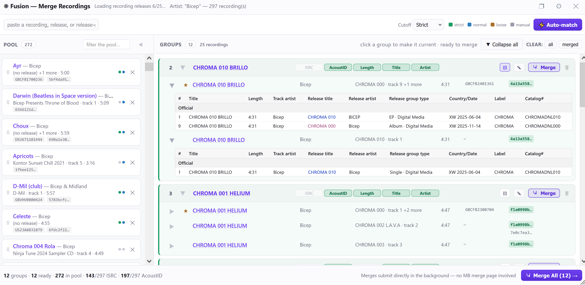

### Features

- **[Pool and groups](#pool-and-groups)**: candidates on the left, merge groups on the right.
- **[Seeding](#seeding)** from a release, a release group, a recording, or an artist's whole catalogue.
- **[Match](#match)** groups likely duplicates by ISRC, AcoustID, title, artist and length.
- **[Merging](#merging)** submits the merges in the background, each with an itemised edit note.

### Pool and groups

Every candidate starts in the **Pool**. A live recording has a **live** tag; the place a recording was made shows after **@**, the date in its tooltip. Drag a candidate into a group, double-click it for the *current* group (whose header you clicked last), or select it and click a group.

**Sort** the pool by **Added**, **Title** (ignoring a bracketed part such as *(remastered)*) or **Artist** then title. A repeated title is tinted, each run in its own colour. Match doesn't depend on the sort.

In a group:

- the **target**, the recording that survives, is on top with a gold ★; another row's ☆ makes it the target;
- ↩ returns a recording to the pool, ✕ drops it altogether;
- 🗑 deletes the group and returns its members to the pool; **Clear board** does it for every group;
- a shared ISRC or AcoustID is tinted, one colour per value; past three, the unshared rest folds behind *+N more*;
- an AcoustID opens acoustid.org, where a wrong link can be fixed; ↻ then reloads the group's AcoustIDs, keeping its members;
- a length outside the tolerance is flagged amber, with the spread next to the title;
- a warning next to the title says when the members can't be one recording, or may not be: *live + studio*, *N places* (recorded at different places, or at one place on different dates), or *disamb.* (their disambiguations differ);
- a recording without a disambiguation shows its release's, tagged *album*, when another member's release is in the same release group; the *disamb.* warning compares it too.

### Seeding

Fusion opens with a pool already filled from the page you launched it on:

| Page                | Pool                                                                   |
| ------------------- | ---------------------------------------------------------------------- |
| Release             | its recordings; *Load recordings from RG edition* adds another edition |
| Release group       | the recordings of every release in the group                           |
| Recording           | that recording                                                         |
| Artist → Recordings | the artist's entire catalogue, not just the visible page (up to 2000)  |

Paste a recording, release or release-group MBID or URL into the input to add it.

### Match

Match groups the recordings still in the pool, so a group you built by hand is never undone. The **Cutoff** sets how much evidence it needs:

| Cutoff             | Groups two recordings when they share…                                     |
| ------------------ | -------------------------------------------------------------------------- |
| strict *(default)* | an ISRC or an AcoustID                                                     |
| normal             | …or a similar title and artist, with lengths within tolerance (or unknown) |
| loose              | …or a similar title with either the length or the artist                   |

Each level has a colour, shown in the Cutoff's dot and its tooltip: a group card is tinted with the strictest level it still holds at.

Titles tolerate small typos, and a mix or edit written another way (*Song (Radio Edit)* and *Song - Radio Edit*), but not a word on each side that the other lacks: *Dwell I* and *Dwell IV*, or *In Volo - Drift* and *In Volo - Trace*, are different titles. Artists are compared by MBID when both recordings have them, so *Radium* and *DJ Radium* credited to the same artist match.

Match never groups:

- a video with an audio recording (not even with a shared ISRC; manual grouping refuses it too);
- a recording that has an open edit;
- a live recording with a studio one, or two recordings made at different places, or at one place on different dates (not even with a shared ISRC or AcoustID);
- lengths further apart than the setting (30 s);
- two recordings with ISRCs from one batch (the same registrant and year) but none in common, such as *QZTRX2699407* and *QZTRX2699409*: those are different tracks;
- two recordings that share only an AcoustID when their titles differ, such as *Feel What You Feel* and *Suspended Space*: AcoustIDs are submitted by users and sometimes land on the wrong recording.

A group's chips show the signals that hold for **every** member; one that holds for some is partial.

#### Match by position

**Match by position**, in the menu beside Match, ignores titles. It groups recordings that sit at the same track number on two different releases, with the same track count where both are known. It is meant for localised or translated titles, such as a Japanese edition beside its English one, where titles can't agree. The artists must still agree and the lengths must be within tolerance. Everything in the list above still holds. It runs only when you choose it, never on its own: on releases with different track lists it would pair the wrong tracks.

> [!NOTE]
> This follows MusicBrainz's [How To Merge Recordings](https://musicbrainz.org/doc/How_To_Merge_Recordings): match the acoustic content, not incidental metadata. The signals are a heuristic, so glance at each group before merging.

### Merging

**Merge ↗** on a group, or **Merge All** for each group in turn, submits without opening MusicBrainz's merge page.

Each merge gets an edit note listing what matched ("Same ISRC …", "Length difference 5s (3:59 – 4:04)"). ✎ in a group's title replaces it with your own text; Fusion's attribution line is always appended.

A merge always goes to a vote, even an auto-editor's, as a [destructive edit](https://musicbrainz.org/doc/Destructive_Edit). A refused merge is marked failed.

### Settings

The ⚙ window (or right-click Fusion's corner icon), which also holds the activity **Log**:

| Setting                                           | Default |                                                            |
| ------------------------------------------------- | ------- | ---------------------------------------------------------- |
| Look up AcoustIDs                                 | on      | fetch the pool's AcoustIDs from acoustid.org               |
| Match on open                                     | off     | run Match once the pool has loaded                         |
| Preload group release details                     | off     | fetch every grouped recording's releases in the background |
| Length tolerance                                  | 5 s     | lengths this close count as the same                       |
| Match never groups if lengths differ by more than | 30 s    | whatever else matches; grouping by hand still can          |

---

## Group Therapy

Batch operations and helpers for the MusicBrainz *Edit relationships* page.

- Install: [stable](https://raw.githubusercontent.com/majkinetor/musicbrainz-userscripts/refs/heads/stable/userscripts/group_therapy/group_therapy.user.js) or [latest](https://raw.githubusercontent.com/majkinetor/musicbrainz-userscripts/refs/heads/main/userscripts/group_therapy/group_therapy.user.js)
    - Or via bundle: [String Theory](../string_theory/README.md)
- [Changelog](../group_therapy/CHANGELOG.md)
- [View users](https://musicbrainz.org/search/edits?auto_edit_filter=&order=desc&negation=0&combinator=and&conditions.0.field=edit_note_content&conditions.0.operator=includes&conditions.0.args.0=Group+Therapy)

> [!TIP]
> [Uncheck checkboxes with Esc](https://github.com/chaban-mb/userscripts/blob/main/docs/USERSCRIPTS.md#musicbrainz-uncheck-checkboxes-with-esc) is a good companion.

### Features

- **[Batch delete](#batch-delete)** by role, by entity, or both.
- **[Copy and move](#copy-and-move)** credits between recordings, works, releases, and a release and its recordings.
- **[Set dates](#set-dates)** on many credits at once.
- **[Release group consolidation](#release-group-consolidation)**: one matrix of release credits across the whole group.
- **[Work matching](#work-matching)** links recordings to existing works, a medley to each of its works.
- **[Text parser](#text-parser)** turns liner notes into relationships.
- **[Replace role](#replace-role)** on many credits at once.
- **[Highlight](#highlight)** a role or an entity everywhere, with counts.
- **[Edit note](#edit-note)**: a line per action, under Group Therapy's signature.

Everything works on new relationships too, and, except consolidation, only stages changes for you to save.

### Batch delete

Right-click a relationship's **×**:

- *Remove this one*
- *Remove "‹role›" — all tracks*
- *Remove "‹target›" — everywhere*
- *Remove "‹role›" + "‹target›"*

Each option shows what it touches (*guitar — all tracks (14) · tracks 1–12*) and keeps to the ticked recordings or works, if any. It works on works too.

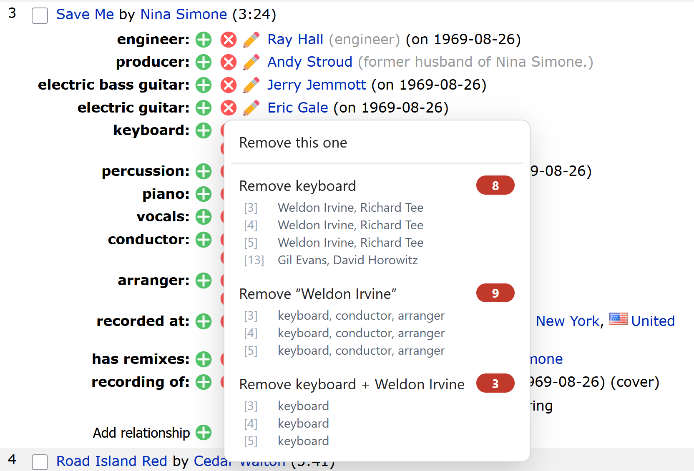

### Copy and move

The destinations are the ticked recordings, or every other track when none are ticked.

**From a recording or work**: right-click its checkbox and choose *Copy* or *Move* (copy, then remove from the source). The menu lists the credits, all ticked:

- right-click a credit to keep only its role; Shift + right-click adds a role;
- hover a credit for **[A]**, which ticks every track crediting that artist, and **[R]**, the same artist in the same role.

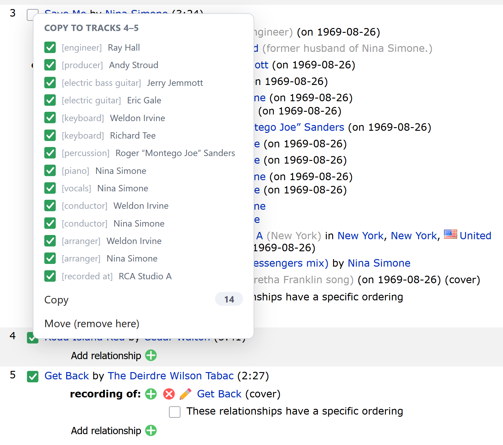

**From another release** in the group: **⧉ Copy from release…** lists its release credits (artists and labels) to pick from. Roles that don't suit this release's format (vinyl-only on a digital edition) start unticked.

**Between the release and its recordings** (the toolbar's *Vertical* section):

- **⬆ Release → recordings** copies or moves the release credits to the recordings. A work role (lyricist, composer, librettist, translator) goes on the tracks' works, only when every chosen track has one; add works first with **◎ Match works…**. **Move** removes from the release only what it placed. Release-only roles (liner notes, mastering, artwork, ℗, ©…) start unticked.
- **⬇ Recordings → release** collects the recordings' credits onto the release, with the track range each covers.

Both take a [track selector](#track-selector) and map each role to the destination's link type by name; a role with no equivalent is skipped and counted.

#### Set dates

Right-clicking a dated relationship (a *recorded at* with a date) offers **Set dates from…**, listing every datable credit on the selected tracks, by track:

- the begin and end date (`YYYY`, `YYYY-MM` or `YYYY-MM-DD`) are prefilled from that relationship and editable;
- credits whose role is on your remembered **roles** list start ticked (right-click a role to add it, click its chip to drop it);
- **Apply** sets the date on every ticked credit that has none.

> [!NOTE]
> MusicBrainz's editor keeps an existing date when a relationship is updated, so dated credits are shown but left as they are.

### Release group consolidation

**▦ Consolidate RG…** shows every release credit across the group as a role × release matrix: one row per credit, one column per release (A, B, C…, with a format badge), green where the credit exists.

- Click a cell to add that credit to that release, a column letter to add everything addable to it, or **Auto select** for all. A credit that doesn't suit a release's format shows `·`; click to force it.
- **Apply** submits the additions, one batch per release.
- A release whose credits couldn't be read (MusicBrainz throttling) shows `?` and gets nothing until **Retry** reads it.
- With more than 10 releases, you pick which ones to consolidate.

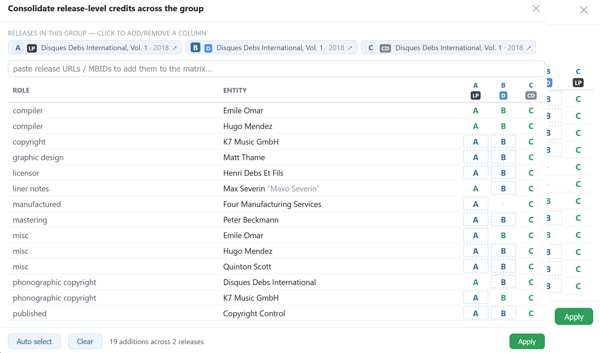

### Work matching

**◎ Match works…** links each recording to an existing work, so a compilation of standards reuses the works instead of creating duplicates. Candidates come from ISRCs (a recording sharing an ISRC usually shares the work) and from MusicBrainz's work search, ranked by exact title, then by how many recordings use each work: *Beat It* resolves to Michael Jackson's work, not a same-named cover.

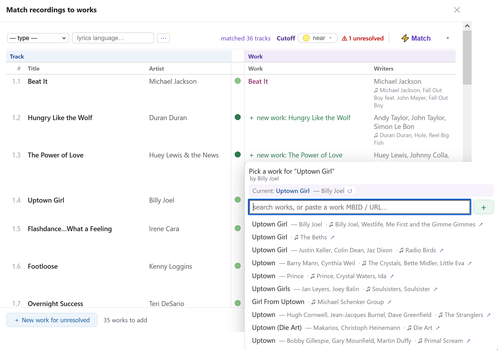

| Dot |                                                                       |
| --- | --------------------------------------------------------------------- |
| 🔵   | confirmed by a shared ISRC                                            |
| 🟢   | the only work with this title                                         |
| 🟡   | exact title and clearly the most recorded, but others share the title |
| 🔴   | ambiguous; check it                                                   |

**⚡ Match** selects the rows at or above the **Cutoff**. ✎ on a row searches, takes a pasted work MBID or URL, or creates a work. **＋ New work for unresolved** creates one for every unmatched recording. **Apply** stages the performance relationships.

**Medleys**: a title of several works [split by " / "](https://musicbrainz.org/doc/Style/Titles#Extra_title_information_(ETI)), like `Land of Hope and Dreams / People Get Ready`, gets a row per work, and **Apply** links the recording to all of them. `AC/DC`, without spaces, stays whole. **Split on /** (on) turns this off.

### Text parser

**✎ Text parser…** turns credit text (liner notes, a credits block, or the release's annotation via **Load annotation**) into relationships, reading each line with a [pattern](#patterns). It opens under the toolbar, in the page, so the release's tracks and credits stay in reach as you scroll. Its two top rows stay on top:

- the settings, what is left and **Apply**. What is left shows as one pill each (`5 names`, `2 roles`, `2 lines` not parsed), and a click on one takes you to the next: its row is marked, and what is missing in it flashes. `✓ all picked` shows when nothing is. The row you work in is marked too.
- the [pattern](#patterns) (its ▾ has the usual ones), 🔒 Freeze, the pasted text (one line until you click it, then numbered as the rows are), **Cutoff**, **Load annotation** and **Apply & clear annotation**.

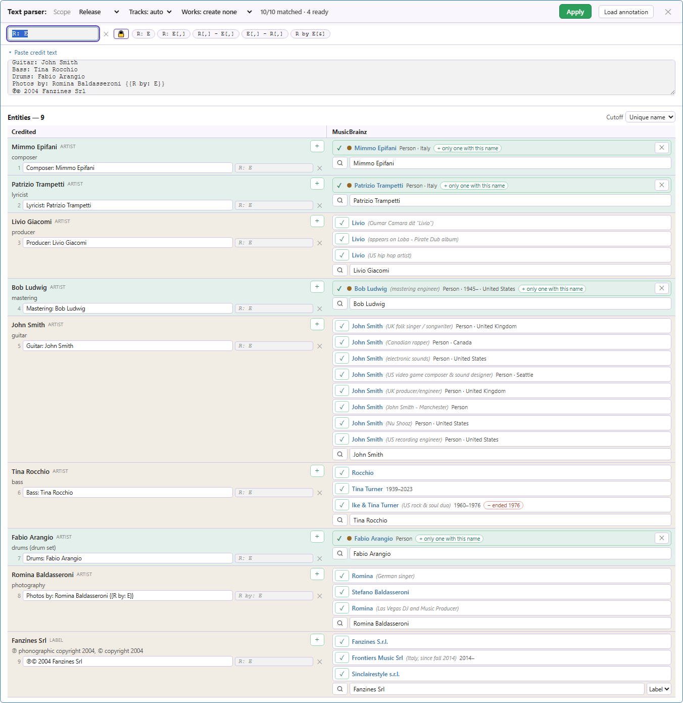

Each name gets one row: the credit on the left, MusicBrainz on the right.

- **Left**: the name as credited, its roles, the tracks a credit names, and under them the line each came from. **+** creates the artist, label or place (right-click: in the background).
  - A role in red has no match; the roles beside it, when there are some, are the closest, and a click picks one. Click the role itself to pick from all of them: the credit's kind (artist, label or place) is in the picker's header, its roles come first and the other kinds' last, each tagged with its kind. The pick applies to every credit with the same role text and the same kind of entity, so *produced at* picked for a studio leaves its line's producer an artist's *producer*, and it is remembered: that role text resolves by itself on the next release.
  - A line's text and its own pattern can be edited there, and **✕** removes the line. A line that gives no credit stays in its place as a *not parsed* row, to fix there.
  - A credit keeps the text's spelling as its credited name when it differs from MusicBrainz's; its tooltip shows both. Right-click the name to use MusicBrainz's instead, in the text too, or tick **Use MB name as credit** for every credit.
- **Right**: the pick, or the [candidates](#matching-1). **✓** picks one for every credit with that name; right-click **✓**: for one credit only. **✕** on a pick brings the candidates back.
  - The box under them searches, or takes a pasted MBID or URL. Where the role allows more than one kind, choose artist, label or place beside it. Picking a role of another kind (a label's *published* for "Publisher: …") does the same.
- Row colours: green is ready, amber needs a pick or a role, red has no candidates.
- **Copyright lines** (©, ℗, *licensed to/from*, *distributed by*, *marketed by*) are recognised without a pattern. One year becomes both the begin and end date, as [MusicBrainz asks](https://musicbrainz.org/relationship/2ed5a497-4f85-4b3f-831e-d341ad28c544). Several holders on one line (`℗ 2012 Shady/Aftermath/Interscope`) become one credit each, and a line with two markers is split in two when pasted.
- Matching runs by itself after each change: it resolves roles and finds each name's candidates. A role is matched by MusicBrainz's own wording, word by word, only among the roles the credit's kind can have: *Lyrics by* → *lyricist*, *All music written by* → *composer*, *Production by* → *production*, *Mastered by* → *mastering*. A role that exists only for labels picks a label; an ambiguous one defaults to a label, or an artist when the name is one of the release's artists.
- Instruments and vocal types resolve to the *instrument* or *vocal* role plus that attribute: *Flute*, *Lead Vocals*, *Backing Vocals* → *background vocals*. A leading *Guest*, *Additional*, *Solo*, *Co-*, *Executive*, *Assistant* or *Associate* is added as an attribute when the role allows it: *Guest Vocals*, *Co-Producer*, *Executive Producer*.
- **Scope** sends the credits to the release (default) or to recordings chosen with a [track selector](#track-selector); the roles offered follow the scope.
- **Works**: a work role going to tracks goes on their works. *create none* (default) skips a track without one; *create needed* creates it, named after the recording, so match existing works first with **◎ Match works…** or it makes duplicates.
- **Apply** stages the credits. After **Load annotation**, **Apply & clear annotation** also clears the release's annotation, with its own edit note.

The text and the picks last until the page reloads.

> [!NOTE]
> Only single-line credits are parsed; grouped multi-line blocks are not.

#### Matching

Each candidate shows its type, life span and area, and why it ranks where it does (`+ on release`, `+ related`, `− born 1990`); its tooltip has the detail (*Already lyricist on this release*, *member of band · Toto*).

| Dot | Confidence  | Why                                                                         |
| :-: | ----------- | --------------------------------------------------------------------------- |
|  🟢  | Strong      | on the release or its group, a member or co-credit of its artist, your pick |
|  🟡  | Unique name | the only artist or label in MusicBrainz with this name or alias             |
|  🔴  | Weak        | the best guess                                                              |
|  ⚪  | You         | picked by you                                                               |

**Cutoff** (default *Unique name*) is the lowest confidence picked for you, and only when the candidate clearly leads the next one. A match below it waits on its row, marked *below cutoff*. Your picks are remembered for the release artist, so the next release of that artist starts from them.

The candidates also rank on the role and the release: a person for an instrument or a vocal, a group for an orchestra or a choir; someone born after the release or gone long before it ranks lower, and one from the release's country higher.

Beyond this release, the parser also looks at who the other releases of its release group credit (three of them, `+ same group`) and, for a name still left open, who recordings credit beside the release artist (`+ co-credit`).

**MB roles**, on a row with several candidates, asks whether each of them has held the row's role before: `+ producer ×3` (its tooltip says on what) ranks one up and can pick it, `− never producer` only says so. It reads up to five candidates' relationships from MusicBrainz, which takes a moment for a prolific one, so it waits for the click.

#### Patterns

A pattern works like [Apollo's track parser](../apollo_editor/README.md#pattern-parser): `R` is the role, `E` the entity (an artist, label or place, decided per row), and everything else is text the line must contain. Case doesn't matter, so `R by E` reads `PRODUCED BY JERRY ROSS`.

| Pattern       | Line                                                                      |
| ------------- | ------------------------------------------------------------------------- |
| `R: E`        | `Mastering: Nick Robbins`                                                 |
| `E - R`       | `Nick Robbins - Mastering`                                                |
| `R by E`      | `Produced by Jerry Ross`                                                  |
| `E[,] - R[,]` | `Cameron Allen - Flute, Tenor Saxophone` → one row per role               |
| `R: E[&]`     | `Graphic Design: Ricardo H Fernandes & Yacine Blaeich` → one row per name |

A bracket after `R` or `E` splits it into rows: `[,]` on commas, `[&]` on " & ", `[and]` on the word "and", `[, and /]` on all three. A word splits only with spaces around it, so `AC/DC` stays whole. A `;` separates several credits on one line.

**Where the pattern comes from**, strongest first:

| Source                               | Applies to         |
| ------------------------------------ | ------------------ |
| a line's own pattern box             | that line          |
| `Nick Robbins - Mastering {{E - R}}` | that line          |
| a line of only `{{E - R[,]}}`        | the lines below it |
| the pattern box at the top           | every other line   |

`{{}}` alone on a line ends a block. `{{…}}` can sit anywhere in a line and is cut out of its text, so credits printed in several shapes go in as one paste, each line kept as printed. Art Station's [AI scan](../art_station/README.md#ai-scan) writes them. **🔒 Freeze matched** pins the top pattern on the lines it matches, like in Apollo, and leaves lines with their own pattern alone.

**Tracks**: with **Tracks named in credits** on (the default), a clause after the role or the name, like `(1)`, `(A1 B2)`, `(tracks 2 6 9)`, `[tracks 1-3]` or `on tracks 2 and 6`, sends that credit to those tracks; every other credit follows Scope. A split never cuts inside brackets, so `Lyricist: Mimmo Epifani (tracks 1-3, 5-11)` read with `R: E[,]` stays one name.

A clause counts only when every number is a track on this release, so `(2003)` stays a year. A line with two track lists is marked **⚠ split line** and stays release-level.

#### Track selector

| You type       | You get                               |
| -------------- | ------------------------------------- |
| `3`, `A1`      | that track, as numbered in the editor |
| `5-7`, `1,3`   | a range, a list                       |
| `2:4`, `2:4-6` | track 4 (4–6) on medium 2             |
| `2:*`          | every track on medium 2               |
| `all`          | every track                           |
| *(empty)*      | the ticked tracks                     |

A number that matches no track position counts as the Nth track, so on a vinyl `1, 2, 4` finds A1, A2, B1.

### Replace role

Right-click a credit's pencil for **Replace role "writer"…** (every credit with that role) or **Replace "writer" for "X"…** (only that artist's), limited to the ticked recordings or works if any. Pick the new role from the types MusicBrainz accepts for that pair. Typical use: turn every *writer* on an instrumental release into *composer*.

> [!NOTE]
> MusicBrainz can't change a relationship's type, so this removes and re-adds it. Attributes belong to the old type and are dropped; the toast counts the credits that had some.

### Highlight

Hover an entity or a role to light up every occurrence, with a count and where it appears: *48× · tracks 1–12*.

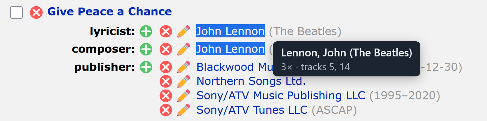

### Edit note

Group Therapy adds its signature and a line per action to the edit note (*Copied 2 credits from track 1 to tracks 2–5*, *Removed guitar (14)*), keeping your text.

### Settings

| Setting                   | Default |                                                 |
| ------------------------- | ------- | ----------------------------------------------- |
| Hide help text            | on      | hide MusicBrainz's help above the relationships |
| Hide native batch tools   | off     | hide MusicBrainz's own batch-tools table        |
| Auto-match on start       | off     | open the work matcher and match on page load    |
| Auto-match on open        | on      | match when the work matcher opens               |
| Uncollapse media on start | on      | expand every medium on load                     |

### Shortcuts

| Gesture                                      |                                           |
| -------------------------------------------- | ----------------------------------------- |
| right-click a relationship's **×**           | [batch delete](#batch-delete)             |
| right-click a recording's or work's checkbox | [copy / move](#copy-and-move) its credits |
| right-click an entity name                   | open that relationship's edit dialog      |
| right-click a credit's pencil                | replace role, or set dates                |
| right-click a credit in the copy list        | keep only that role (Shift adds it)       |
| hover an entity or role                      | highlight it                              |

---

## ISRC Scout

Shows a release's ISRCs, fills in the missing ones from several providers, and finds and manages its recordings' streaming and store links.

- Install: [stable](https://raw.githubusercontent.com/majkinetor/musicbrainz-userscripts/refs/heads/stable/userscripts/isrc_scout/isrc_scout.user.js) or [latest](https://raw.githubusercontent.com/majkinetor/musicbrainz-userscripts/refs/heads/main/userscripts/isrc_scout/isrc_scout.user.js)
    - Or via bundle: [String Theory](../string_theory/README.md)
- [Changelog](../isrc_scout/CHANGELOG.md)
- [View users](https://musicbrainz.org/search/edits?auto_edit_filter=&order=desc&negation=0&combinator=and&conditions.0.field=type&conditions.0.operator=%3D&conditions.0.args=76&conditions.0.args=78&conditions.1.field=edit_note_content&conditions.1.operator=includes&conditions.1.args.0=ISRC+Scout)

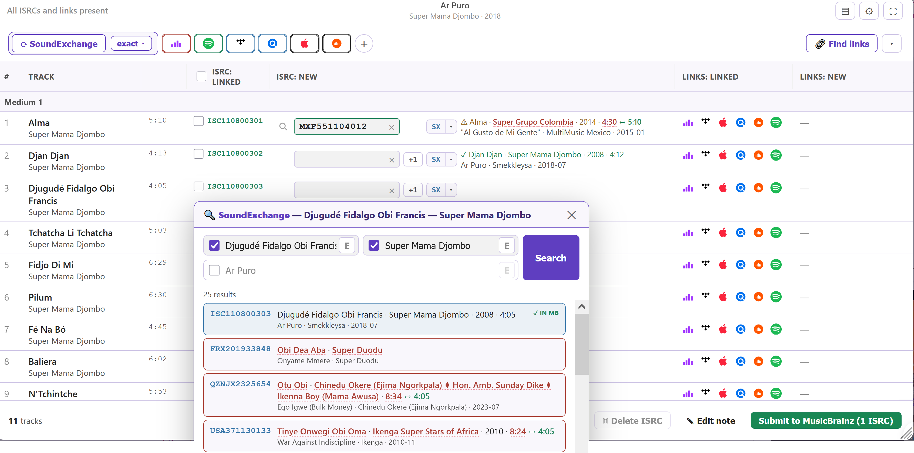

### Features

- **[Providers](#providers-1)** found through the release group and [Platform Check](../platform_check/README.md), not just the release's own links.
- **[ISRC badge](#isrc-editor)** by the release title, showing how many tracks lack an ISRC.
- **[ISRC editor](#isrc-editor)**: every track's ISRCs, with validation, provider [imports](#importing-isrcs), [per-track lookups](#per-track-lookup), bulk paste, export and deletion.
- **[Links](#links)**: find and add the recordings' streaming and store links, and end or remove existing ones.
- **[Tracklist](#tracklist-1)**: ISRC and Links columns on the release page's own tracklist.

### Providers

| Provider                        | ISRC import | Track links | Resolved by                                                                           |
| ------------------------------- | :---------: | :---------: | ------------------------------------------------------------------------------------- |
| Deezer                          |      ✓      |      ✓      | ISRC, on any release                                                                  |
| Tidal                           |      ✓      |      ✓      | ISRC, on any release                                                                  |
| Beatport                        |      ✓      |      ✓      | the album, matched by ISRC                                                            |
| Volumo                          |      ✓      |      ✓      | the album, matched by ISRC                                                            |
| Qobuz                           |      ✓      |      ✓      | the album; ISRCs by position, links by ISRC                                           |
| Apple Music                     |      ✓      |      ✓      | the album; by position (+ title for links)                                            |
| SoundCloud                      |      ✓      |      ✓      | the set (a track URL counts as a one-track release); by position (+ title for links)  |
| Audiomack                       |      ✓      |      ✓      | the album (a song URL counts as a one-track release); by position (+ title for links) |
| Spotify                         |      ✓      |      ✓      | ISRCs through [a lookup service](#spotify-1); links from the album, by position + title |
| Bandcamp                        |             |      ✓      | the album page, by position + title                                                   |
| [YouTube Music](#youtube-music-1) |             |      ✓      | the album, when linked (by position + title); else ISRC, on any release               |
| [Amazon Music](#amazon-music-1)   |             |      ✓      | the album, when linked (by position + title)                                          |
| HDtracks                        |      ✓      |             | the album                                                                             |
| [Presto Music](#presto-music-1)   |      ✓      |             | the album, shop or streaming link; by position                                        |
| [7digital](#7digital-1)           |      ✓      |             | the album: each track searched by title                                               |
| SoundExchange                   |      ✓      |             | a title and artist search                                                             |

An album-based provider needs the release's album link: already in MusicBrainz, found by Platform Check, or pasted with **(+)**. No login is needed anywhere except Qobuz outside the countries it serves (see [Qobuz](#qobuz-1)).

> [!WARNING]
> Album imports map tracks by position and trust the link: provider titles legitimately differ (*feat.*, *remaster*). A fill whose length is more than 10 s off is kept but marked amber, and counted as *⚠ N implausible*. An album with more tracks than the release is flagged as a likely wrong edition. Check the amber rows before submitting, or [remove them all](#submitting).

### ISRC editor

Click the **ISRC** badge (`✓ 12/12`, or `⚠ 9/12` pulsing when some are missing). Each track shows its ISRCs and an input for a new one: red is invalid, orange a duplicate, green good.

ISRCs show in their parts, `US-AM1-85-74817` (country, registrant, year, number); a copy is the plain code. *Show ISRCs in parts* turns it off.

#### Importing ISRCs

The toolbar shows the providers available for this release:

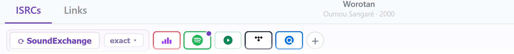

| Icon     | Comes from                                                                         |
| -------- | ---------------------------------------------------------------------------------- |
| circled  | the release's own links                                                            |
| plain    | [Platform Check](../platform_check/README.md)                                      |
| blue dot | another release in the group (option *Use providers from the whole release group*) |

**(+)** imports from any album URL you paste. **⟳ SoundExchange** searches every track by title and artist, fills the confident matches, and shows the other candidates per row; on a long release, click a *Not searched* row to search the next tracks. Deezer continues the same way.

> [!NOTE]
> A Platform Check link withheld for a barcode or format mismatch isn't used, because the mismatch may mean it's a different release altogether. *Ignore Platform Check link confidence* uses it anyway; a wrong track count always excludes it.

#### Per-track lookup

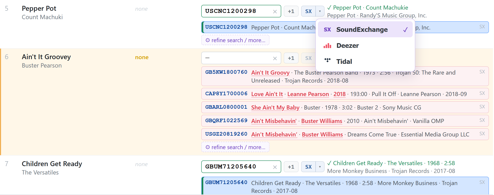

- **+1** fills the previous track's ISRC plus one.
- **lookup** looks the row's ISRC up on the selected provider and shows its title, artist and length, mismatches in red. Guests (*feat.*, extra artists) aren't a mismatch, and a word of five letters or more one letter off (*Les Ecrocs*) is marked ⚠ as *spelled differently*. Its menu switches every row to another provider; a right-click runs it on all tracks.
- **All** (top of the menu) checks the row's ISRCs on [every provider](#checking-every-provider) at once.
- **⚙** opens a SoundExchange search you can tune (title, artist, release, exact), with a link to run it on their site.

| Check         | Mismatch when                                                             |
| ------------- | ------------------------------------------------------------------------- |
| Title, artist | the words don't match (a couple of extra words, like a version, are fine) |
| Year          | recorded after the release year (+1)                                      |
| Length        | more than 10 s off; MusicBrainz's length is shown alongside               |

A result passing every check fills an empty field (blue); a length mismatch only warns (yellow). Lookups run when you leave a field you typed into, press the button, or search SoundExchange, whose captcha or rate limit shows in the toolbar to solve.

#### Checking every provider

**All** checks the row's ISRCs on every provider available for the release (not SoundExchange, which serves a captcha on nearly every run): the entered one and every ISRC the recording already has. **All** at the end of the toolbar, or a right-click on a row's **All**, checks every track.

The row shows a verdict: **✓ 4/4** when every provider that knows the ISRC agrees, **⚠ 1/4** when some don't, **– 0/4** when none knows it. Hover the verdict for the comparison; a click pins it. Each line starts with the provider's verdict:

- Deezer and Tidal look the ISRC up: ✓ their song for it is this track, ⚠ it is another song.
- An album provider (Qobuz, Apple, Beatport…) reads the release's album there: ✓ it has this ISRC at the same position as this track (📍), or at another position (↪ track 3: the album orders its tracks differently). When the album hasn't the ISRC at all, ✗ it has **another** ISRC at this track's position, offered with **use**. An ISRC that belongs to another track of the release, or that the row already has, is never offered.

The header lists the row's ISRCs first, then any other ISRC a provider named, each with how many providers have it for this track. Click one to see what the providers say about it. **copy** puts the comparison on the clipboard as a Markdown table.

#### Paste, export, delete

- **Paste** one ISRC per line in track order (an empty line skips a track), or address tracks: `3=USABC1234567`, `USABC1234567 | 1.3`, `1.3 USABC1234567`. Then *Apply to empty fields* or *Apply (overwrite)*.
- **Export** as text or JSON (`{ recordingMBID: "ISRC" }`), to the clipboard.
- Tick existing ISRCs and **🗑 Delete checked**: one *Remove ISRC* edit each, through your logged-in session.

#### Submitting

Submitting ISRCs needs authorizing once: **⚙ Setup → Authorize**, then approve in the tab that opens. musicbrainz.org and beta share it; test.musicbrainz.org needs its own. When MusicBrainz stops accepting it, Setup asks again; *Sign out* forgets it.

Amber fills (see the warning under [Providers](#providers-1)) are counted in the footer's *⚠ N implausible fills — verify*: click it to go to the first one, or **✕ Remove** to empty them all (**Undo** puts them back until the next change). Submitting with amber fills asks first: *Review first*, *Remove them, submit the rest*, or *Submit anyway*.

### Links

The **Links** tab shows, per track, what each recording already links to (**Linked**) and what was found but isn't linked yet (**Add**). Linked shows every site, ones ISRC Scout can't add too, with MusicBrainz's icon (or a globe) where ISRC Scout has none.

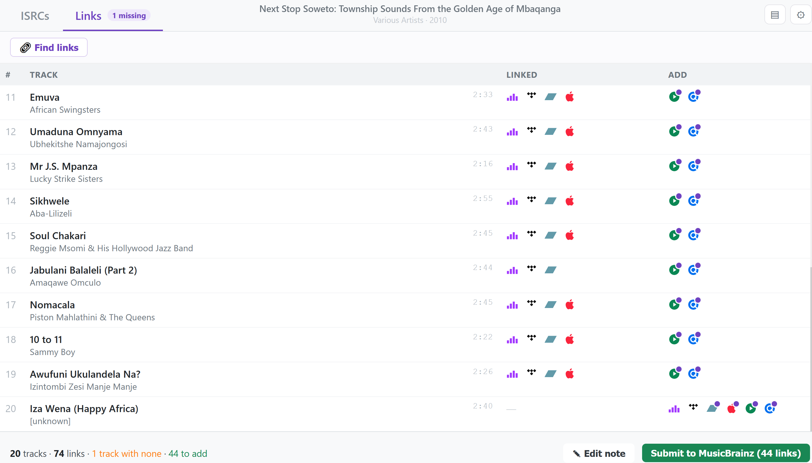

**Find links** resolves every track on every available provider, in parallel. A provider matched by position (Apple Music, Bandcamp, SoundCloud, Audiomack, Spotify, YouTube Music, Amazon Music) must also have the track's title, allowing a typo, a *feat.* or another apostrophe. A Deezer track that no longer plays anywhere isn't offered. **➕ Add links** adds everything found, with no authorizing needed.

#### Match

**⚡ Match** does both: it imports ISRCs from the fastest source the release links (Qobuz, Audiomack, Apple Music, Tidal… before Deezer, 7digital and Spotify), moving on when one fails or gives nothing, then runs **Find links**. It skips the release group's links, which need you to look.

| Click               | on an **Add** icon               | on a **Linked** icon                           |
| ------------------- | -------------------------------- | ---------------------------------------------- |
| left                | open the provider's track        | open the provider's track                      |
| right               | add this link                    | toggle *ended* (shown faded)                   |
| Ctrl + right        | add every link on the track      | end every link on the track                    |
| Alt + right         | add this provider on every track | end this provider on every track               |
| middle              |                                  | remove this link                               |
| Ctrl / Alt + middle |                                  | remove on the track / this provider everywhere |

End a link when the release is taken down and it no longer resolves ([MusicBrainz style](https://musicbrainz.org/doc/Style/Relationships/URLs#When_to_remove)). Ending and removing work on any linked provider.

> [!TIP]
> Editions are often split by platform: one carries Deezer, another Spotify. With *Use providers from the whole release group* on, a provider missing here is taken from a sibling release (it shares the recordings) and marked with a purple dot.

### Tracklist

The release page's tracklist gets **ISRC** and **Links** columns. An ISRC opens its MusicBrainz page, an icon the provider's track; a platform with several links shows how many, and opens the first that hasn't ended. An ended link is faded. **ISRC** and **Links** above the tracklist show or hide each column.

### Settings

**⚙** in the editor's header:

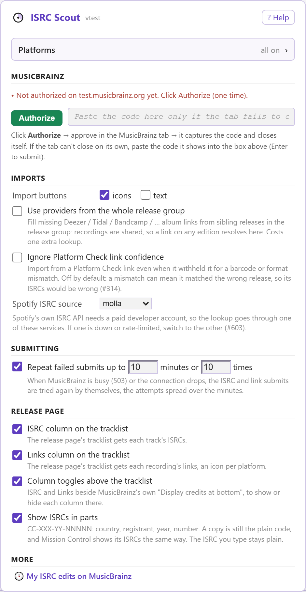

| Setting                                    | Default                    |                                                                                |
| ------------------------------------------ | -------------------------- | ------------------------------------------------------------------------------ |
| Platforms                                  | all on                     | the platforms ISRC Scout uses ([Platforms](#platforms-1))                        |
| Authorize                                  |                            | OAuth for submitting ISRCs                                                     |
| Import buttons                             | icons                      | icons, text, or both                                                           |
| ISRC column on the tracklist               | on                         | the ISRC column on the release page ([Tracklist](#tracklist-1))                  |
| Links column on the tracklist              | on                         | the Links column on the release page                                           |
| Column toggles above the tracklist         | on                         | **ISRC** · **Links** above the tracklist                                       |
| Show ISRCs in parts                        | on                         | `CC-XXX-YY-NNNNN`, here and in [Mission Control](../mission_control/README.md) |
| Use providers from the whole release group | off                        | take missing providers from sibling releases (one more lookup)                 |
| Ignore Platform Check link confidence      | off                        | use links Platform Check withheld for a barcode or format mismatch             |
| Repeat failed submits                      | on, 10 minutes or 10 times | try a submit again when MusicBrainz is busy (503) or the connection drops      |
| Spotify ISRC source                        | Harmony                    | or molla, or ISRC Hunt                                                         |

#### Platforms

A platform switched off loses its import button and lookup, Match, Find links and All skip it, and its found links are dropped. Platform Check keeps its own list.

### Shortcuts

| Key   |                                                               |
| ----- | ------------------------------------------------------------- |
| Esc   | close the open panel, else the editor                         |
| Enter | submit the focused URL input, or run the SoundExchange search |

The mouse gestures on links are in the [Links](#links) table.

### Notes

#### YouTube Music

YouTube Music shows no ISRCs. With the release's album linked, each track comes from its tracklist by position and title, as official audio. A song a free listener can't play is left out, as the links are *free streaming*. Without the album, the ISRC is searched; a result counts only as official audio with the track's title, within 3 s of its length, from this release's album. The log says what it skipped and why.

#### Amazon Music

Amazon Music shows no ISRCs; its links come from the release's linked album, by position or title, when the title matches and the length is within 3 s. They are added as *streaming page*; no account is needed.

#### 7digital

Each track is searched by its title, keeping the linked album's results; a long album takes some seconds. 7digital tracks have no pages, so there are no links. No login is needed.

#### Presto Music

The ISRCs come from Presto's streaming app, which shares the shop's product numbers, so a shop link works too, on a CD as on a download. An album Presto doesn't stream has none; the log says so. Presto doesn't say where each disc starts, so a set takes this release's discs in order when it has as many tracks.

#### Spotify

Spotify's ISRCs come through a lookup service. Pick it in **⚙ Setup**; switch if one is down or throttled:

- **[Harmony](https://harmony.pulsewidth.org.uk)**, the default, gives them by disc and position, with each track's length.
- **[molla](https://isrc.mollamusicgroup.com)** maps the album's ISRCs by position when its track count matches the release, otherwise by title and artist. Its shared quota often runs out.
- **[ISRC Hunt](https://isrchunt.com)** gives them by disc and position.

#### Beatport

An import reads the Beatport release in a background tab. A Beatport release page you open is read too.

#### Qobuz

Outside the countries Qobuz serves, its ISRCs need a Qobuz login: sign in under [Platform Check](../platform_check/README.md) (*⚙ Setup → Auth → Qobuz account*). The login works from anywhere, and ISRC Scout and Credit Hoarder share it; only its token is kept, never the password.

How each provider is read is in [DEVELOP.md](../isrc_scout/DEVELOP.md).

---

## Mammoth

Reusable edit notes in a panel beside the edit-note field of every edit form, and remembered values for any other field.

- Install: [stable](https://raw.githubusercontent.com/majkinetor/musicbrainz-userscripts/refs/heads/stable/userscripts/mammoth/mammoth.user.js) or [latest](https://raw.githubusercontent.com/majkinetor/musicbrainz-userscripts/refs/heads/main/userscripts/mammoth/mammoth.user.js)
    - Or via bundle: [String Theory](../string_theory/README.md)
- [Changelog](../mammoth/CHANGELOG.md)

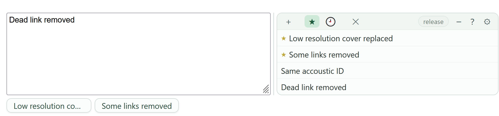

### Features

- **[Saved notes](#saved-notes)**: save, pin as buttons, search, sort and reorder edit notes, with a history of the notes you submitted.
- **[Mammoth babies](#mammoth-babies)**: the same for other fields (catalogue number, label, artist…), and **[any field you choose](#custom-fields)**.

### Saved notes

- **＋** saves the current text. In **History**, ★ moves a note to the saved ones.
- ★ on a saved note pins it as a **button** under the field.
- Sort **manually** (drag ⠿), by **most used** or by **recent**.
- Click applies a note, replacing or appending ([Shortcuts](#shortcuts-6)); appending skips a line that's already there.

The panel starts minimized to an icon: hover to peek, click to pin, **⤢** restores it, **–** minimizes it.

> [!TIP]
> With *Scope per resource* on, each kind of edit note (release, artist, recording…) keeps its own saved notes and history.

### Mammoth babies

A 🦣 pin in a field recalls the values saved for it, shared across releases. The built-in ones cover catalogue number, label, artist, status, language, script, country, type and the task fields.

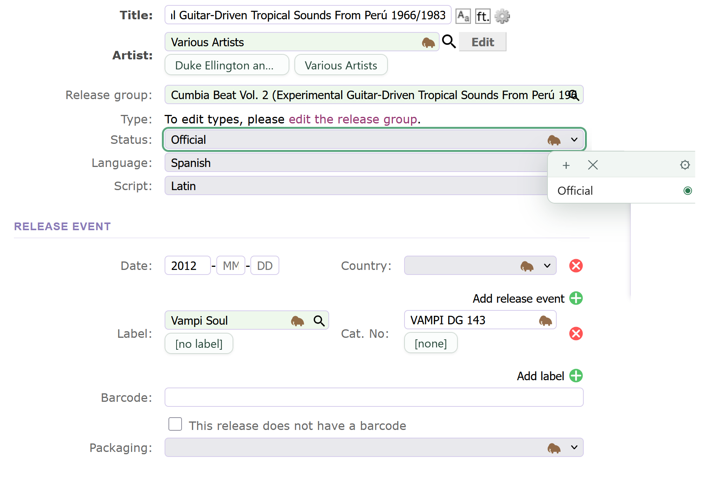

In the pin's panel, **＋** saves the current value and **✕** clears the field. On a saved value:

|     |                                                        |
| --- | ------------------------------------------------------ |
| ★   | pin it as a button under the field                     |
| ◉   | make it the default, filled in when the field is empty |
| 🗑   | delete                                                 |
| ⠿   | drag to reorder                                        |

Label and Artist recall the entity itself, by its MBID, not a new search.

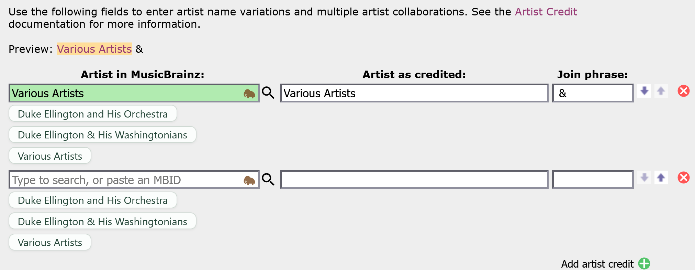

#### Custom fields

Put a 🦣 on any field of any MusicBrainz page: **⚙ → Babies → ＋ Add field**. The built-in fields are listed there too, so you can edit, disable or restore them (**↺ Defaults**).

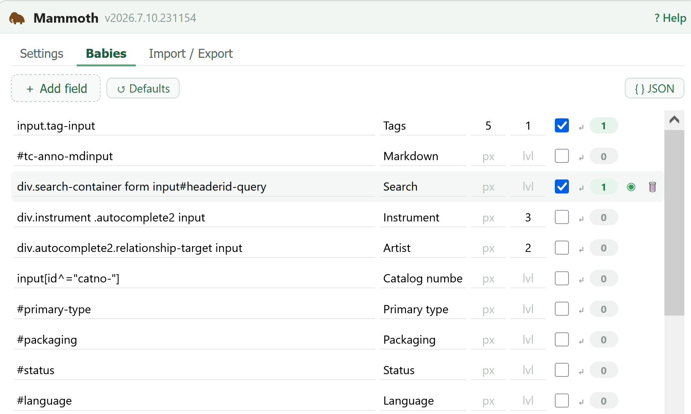

| Column       |                                                                                        |
| ------------ | -------------------------------------------------------------------------------------- |
| **Selector** | its selector (Inspect → *Copy selector*); commas for several; *matches N* checks it    |
| **Label**    | the panel's title, and the field's identity: fields with the same label share one list |
| **px**       | nudge the pin sideways, clear of the field's own icon                                  |
| **lvl**      | where the bar attaches: `0` floats under the field, `N` goes after its Nth ancestor    |
| **↵**        | submit the field's form after a recall, like pressing Enter (tags, header search)      |

Works on `<input>`, `<select>` and `<textarea>`.

> [!TIP]
> On an entity autocomplete (instrument, artist…), save the value with its MBID appended (`handclaps b8d84cec-…`) and recalling it selects that entity.

**`{ } JSON`** switches the list to editable JSON, which is also the export (copy) and import (paste + **Apply**):

```json
[
  { "selector": "div.instrument div.autocomplete2 input", "label": "Instrument", "deltax": 16 },
  { "selector": "input.tag-input", "label": "Tags", "submit": true },
  { "selector": "#some-field", "label": "Off for now", "enable": false }
]
```

Keys: `selector` (required), `label`, `deltax` (px), `deltav` (lvl), `submit`, `enable`, and `mbid`, which only means something on the built-in Label and Artist fields.

### Settings

**⚙** opens three tabs: **Settings**, **[Babies](#custom-fields)**, and **Import / Export** (paste many notes, or *Export all*, one note per line or separated by empty lines).

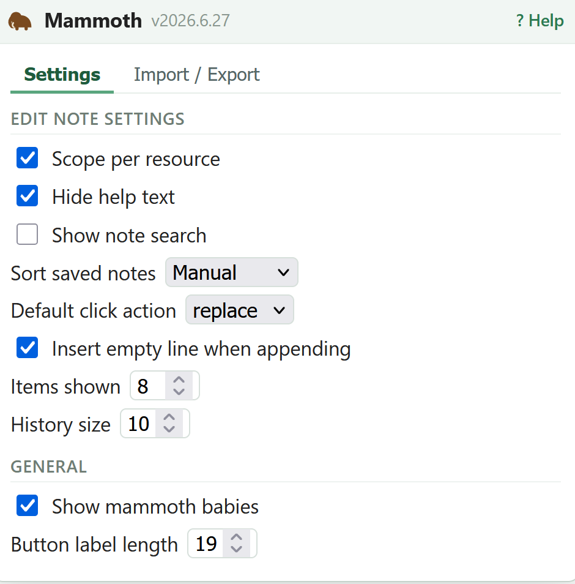

| Setting                        | Default |                                                       |
| ------------------------------ | ------- | ----------------------------------------------------- |
| Scope per resource             | off     | separate notes per edit-note type                     |
| Hide help text                 | off     | hide MusicBrainz's help above the field               |
| Default click action           | replace | or append; right-click does the other                 |
| Insert new line when appending | on      | an appended note starts on a new line                 |
| Show note search               | off     | a search box over the saved notes                     |
| Sort saved notes               | Manual  | or Most used, Recent                                  |
| Button label length            | 24      | characters on pinned buttons (4–80)                   |
| Items shown                    | 6       | rows before the list scrolls                          |
| History size                   | 10      | submitted notes to remember (1–50)                    |
| Show mammoth babies            | on      | the [Mammoth babies](#mammoth-babies) on other fields |

### Shortcuts

In the edit-note field:

| Key          |                                                             |
| ------------ | ----------------------------------------------------------- |
| Ctrl + Enter | submit the edit                                             |
| Ctrl + ↑ / ↓ | cycle through saved notes                                   |
| Ctrl + B / I | bold / italic around the selection or the word at the caret |
| Ctrl + ,     | focus the note search                                       |

On a saved note or a pinned button:

|              |                                       |
| ------------ | ------------------------------------- |
| click        | apply with the default action         |
| right-click  | apply the other way                   |
| Ctrl + click | replace the field and submit the edit |

In a baby field, **Ctrl + ,** opens its panel with the filter focused; ↑ / ↓ and Enter pick a value. (Ctrl is ⌘ on a Mac.)

### Notes

Mammoth's panel joins every edit-note field, other userscripts' included. How a script hosts it or adds a baby to its fields is in [DEVELOP.md](../mammoth/DEVELOP.md).

---

## Mission Control

One window on a release page that asks the other scripts what the release is missing, lets you review everything they found in one place, and applies it in one go.

- Install: [stable](https://raw.githubusercontent.com/majkinetor/musicbrainz-userscripts/refs/heads/stable/userscripts/mission_control/mission_control.user.js) or [latest](https://raw.githubusercontent.com/majkinetor/musicbrainz-userscripts/refs/heads/main/userscripts/mission_control/mission_control.user.js)
    - Or via bundle: [String Theory](../string_theory/README.md)
- [Changelog](../mission_control/CHANGELOG.md)
- [View users](https://musicbrainz.org/search/edits?auto_edit_filter=&order=desc&negation=0&combinator=and&conditions.0.field=edit_note_content&conditions.0.operator=includes&conditions.0.args.0=Via+Mission+Control)

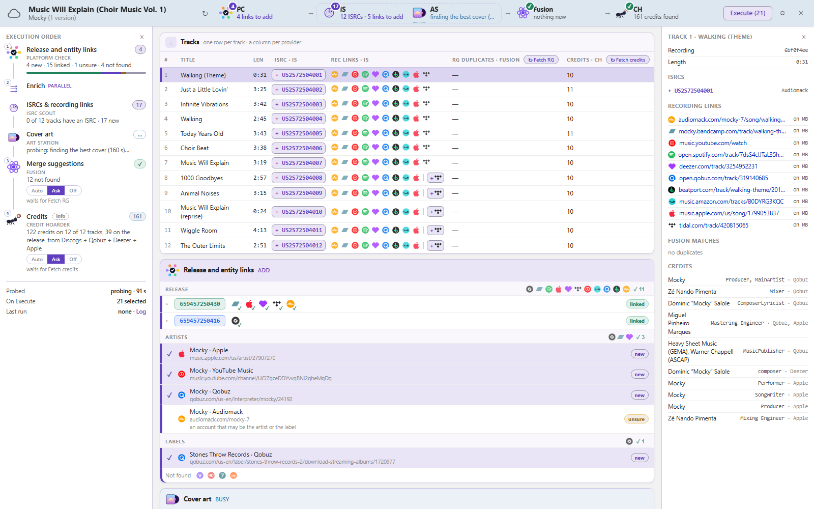

> [!IMPORTANT]
> Mission Control finds and applies nothing on its own: each step is done by another script, which has to be installed. [String Theory](../string_theory/README.md) has them all.

### Features

- **[Probe](#probe)**: one click asks every script what is missing, and each card fills in as its answer comes.
- **[Tracks](#tracks)**: a row per track with its ISRCs, recording links, duplicate recordings and credits.
- **[Release and entity links](#release-and-entity-links)**: the platform pages found for the release, its artists and its labels.
- **[Compare with the platforms](#compare-with-the-platforms)**: read the release on its platforms and add what it lacks: a barcode, labels and catalog numbers, a release event, track lengths.
- **[Cover art](#cover-art)**: the best cover found, beside the current front, and Art Station's gallery, to add, order and type the other images Discogs and Amazon have.
- **[Release credits](#release-credits)**: what the credit sources have, with a way into Credit Hoarder.
- **[Inspector](#inspector)**: everything found for one track.
- **[Execute](#execute)**: applies what you selected, script by script, in a fixed order.
- **[Consolidate a new release](#consolidate-a-new-release)**: compare an album across the platforms and take the best of each into the release editor, or into the release MusicBrainz already has.

Open Mission Control with its corner icon on a release page. On a phone it fills the screen in one column.

### Probe

**↻** in the header asks every script at once. The header and the **Execution order** on the left show each step as it works: what it is doing, and how long since it last reported. A step that stays silent turns amber.

| Step                     | Script                                        | Finds                                                  |
| ------------------------ | --------------------------------------------- | ------------------------------------------------------ |
| Release and entity links | [Platform Check](../platform_check/README.md) | platform pages for the release, its artists and labels |
| Platforms                | [First Contact](../first_contact/README.md)   | what the release lacks, from the platforms' own pages  |
| ISRCs & recording links  | [ISRC Scout](../isrc_scout/README.md)         | ISRCs and track links                                  |
| Cover art                | [Art Station](../art_station/README.md)       | a better front cover, and the stores' other images     |
| Merge suggestions        | [Fusion](../fusion/README.md)                 | duplicate recordings in the release group              |
| Credits                  | [Credit Hoarder](../credit_hoarder/README.md) | per-track credits                                      |

Platforms, Fusion and Credit Hoarder are slow, so each has a switch under its step: **Auto** fetches during the probe, **Ask** waits for its button in the Tracks header (**Compare**, **Fetch RG**, **Fetch credits**), **Off** leaves it out. Platforms starts on Auto, Fusion and Credit Hoarder on Ask.

Click a step in the header to switch it off for this page, right-click to switch it off for good; click it again to switch it back on. The format icon left of the release title shows or hides the Execution order.

The album links you select in the Release and entity links card are passed on to ISRC Scout before they are added, so the tracks get their links from those albums too.

### Tracks

One row per track, a column per script: the ISRCs and recording links ISRC Scout found, what the platforms give for the track ([Compare with the platforms](#compare-with-the-platforms)), the duplicates Fusion grouped with the recording, and how many credits Credit Hoarder has. ISRCs are shown in parts, `US-AM1-85-74817`, unless ISRC Scout's *Show ISRCs in parts* is off.

The Tracks header counts the changes taken in and on how many tracks; each track with one has a bar on its left.

Click a finding to take it in or leave it out; new findings start taken in. A click elsewhere in a row shows the track in the [Inspector](#inspector).

To take in or leave out many at once, hold a key while you click: the others follow the one you click.

| Click with | Takes                                                    |
| ---------- | -------------------------------------------------------- |
| Ctrl       | the whole track                                          |
| Alt        | the whole column; on a found link, that platform's links |
| Ctrl+Alt   | everything in the table                                  |

Found links take the same keys with a right-click. Press on an ISRC or a duplicate and drag up or down the column to do the same to every one you pass.

Fusion's count opens its group card under the row, as on Fusion's board: the star picks the recording the others merge into, ✎ writes the edit note, and Fusion's icon opens the group in Fusion. **Execute** merges the groups taken in. **Expand all** / **Collapse all** in the header open or fold every track's comparison and [platform versions](#compare-with-the-platforms).

### Release and entity links

The platform pages Platform Check found, grouped by the barcode each platform gives: the release's own barcode first, in green, then the others, then the platforms that gave none.

| Mark     | Means                                                                                                          |
| -------- | -------------------------------------------------------------------------------------------------------------- |
| new      | found and not on the release; taken in                                                                         |
| linked   | the release already has it                                                                                     |
| withheld | held back by [link confidence](../platform_check/README.md#link-confidence); take it in by hand if it is right |
| unsure   | may be another artist or label; take it in by hand if it is right                                              |

A link whose track count or format is not the release's is most likely another release: its icon gets an amber dot, and its row says what differs in amber (*10 tracks, the release has 13*). **take all in** leaves those links out; click one to take it in anyway.

A new link found without the release's barcode matched on its track count alone, so it starts left out and [First Contact](../first_contact/README.md) reads it on every probe. It is then taken in, unless fewer than half its track lengths match (*another tracklist*, even with the same titles) or, without lengths, no title does. A platform First Contact can't read (Spotify) stays left out.

A release without a barcode gets a **Barcode** row for each barcode the platforms report. The one Platform Check is sure of starts taken in: one you pasted, one a consolidation brings ([Update this release](#update-this-release)), or one from a link the release already has, with its track count and medium. Taking another in leaves the first out.

Catalog numbers the platforms give, for a label the release has without one, sit beside their group's barcode: one per label in a group with a barcode, maybe several in the group without. Only the one in the release's own group, from a platform with its track count and medium, starts taken in; **take all in** never takes one, and a label takes one at a time.

**Artists** and **Labels** list the pages the matched albums name for them. A page MusicBrainz has on another artist or label is withheld, its row naming both with their disambiguations, so you can tell a wrong one from a duplicate. A heading's ✓ count lists the links it already has.

After [Compare with the platforms](#compare-with-the-platforms), *Release* also has a row for the **Release event** and one for the **Track lengths**, when the release lacks them.

Execute adds the links through [Falcon](../falcon/README.md), listing each with its status; **Open Falcon** shows why one failed, to retry.

### Compare with the platforms

**Compare**, in the Platforms column of Tracks, reads the release on its platforms with [First Contact](../first_contact/README.md#consolidate), on every probe while its step is **Auto**.

1. It reads the release's links, and the ones found with its barcode or, without one, with as many tracks. Another barcode, track count, format or [tracklist](#release-and-entity-links) is another release, left out. Spotify's data isn't compared.
2. For each field, the value most platforms give wins, as in a consolidation.
3. What the release lacks is offered where it is added, taken in:

| What                | Offered when                                                 | Shown in                                    |
| ------------------- | ------------------------------------------------------------ | ------------------------------------------- |
| Barcode             | the release has none                                         | Release and entity links                    |
| Label, cat. no.     | as in [Update this release](#update-this-release)            | Release and entity links                    |
| Platform links      | the release hasn't them, even ones Platform Check holds back | Release and entity links                    |
| Release event       | the release has none: the date and country most give         | Release and entity links                    |
| Track lengths       | a track has none                                             | Release and entity links, and the track row |
| ISRCs               | a track has none                                             | ISRCs                                       |
| Track title, length | you take a platform's, or type your own                      | the row under the track                     |
| Title               | the platforms give another                                   | shown only, never changed                   |

Nothing the release has changes unless you take it. Tracks are compared only when the platforms have as many as the release. The Platforms column shows a length to add (*+ 4:01*) *≠ title* when the platforms call the track something else, *≠ case* when only its capitals differ (*✓* when they agree); either opens its versions under the row, the differing part marked. Click a title or length to take it, or type your own on the track's line (Enter keeps it, Esc reverts). **Aa** takes the title as [Guess case](../apollo_editor/README.md#guess-case) writes it; *the recording too* renames the recording as well; **↺** reverts the track. The column then shows what the track gets (*→ Title · → 5:02*).

Execute adds the release event, the track lengths and the titles and lengths you took with the barcode, labels and links, in one edit of the release, through [Falcon](../falcon/README.md). A track that changed on MusicBrainz since you compared keeps what it has.

### Cover art

Art Station looks for the largest cover on the release's platforms, the album links taken in included, and looks again when those change. The best cover shows beside the current front, each with its size, and what Execute will do with it underneath.

Each platform searched shows its cover's size (click to open it) or *no cover*. A release without a front starts with the cover taken in.

#### Gallery

Under the front is [Art Station's gallery](../art_station/README.md#gallery) for the release, doing all it does there.

Discogs and Amazon have every image of a release. The gallery ends with **More images**, a row per store, larger images first; stores with one image each share a row. **＋ take in** on an image, or **＋ take all in** on a row, adds them after the covers, untyped. An image the release already has says *in archive*, and one equal to the best front or a larger image says which (*= Amazon 1*); such duplicates can't be taken in.

Taking the best front's platform in or out puts the best cover, and the removal of the front it replaces, in the gallery or out; your own changes there win. **Execute:** under the gallery lists what Execute will do there.

Execute enters what the gallery holds; an image MusicBrainz refused shows its error, with **Retry**.

An upload that fails is repeated as Art Station's [auto-repeat](../art_station/README.md#applying-changes) setting says, and the card shows each attempt.

### Release credits

Credit Hoarder's count of credits for each track, from every credit source the release links (Discogs, Qobuz, Deezer, Apple Music). Mission Control only shows them: **Import credits** opens Credit Hoarder on the release's relationship editor with that source, or with all of them, to review and add them there.

### Inspector

Click a track to see, on the right, everything found for it: its ISRCs and where they came from, its recording links (and which are already in MusicBrainz), Fusion's matches, its credits, and its versions on the platforms, with what differs from its title highlighted.

### Execute

**Execute** applies what is taken in, in the Execution order (steps on one line together), counting it on the button. A failed step doesn't stop the next.

First it lists what it will send, a line per change under its step: untick one to leave it out, then **Execute**, or **Cancel**. A right-click on **Execute** skips the list, and so does the Execute that runs itself [after a consolidation](#consolidate-a-new-release). *Review the changes before Execute* in the settings turns the list off.

Every edit note ends with *Via Mission Control v&lt;version&gt;* and the release.

A failed step that can be tried again shows **Retry** beside its error; what got through before shows as done.

Click a card's icon or title to switch it off: Execute leaves it out, and your selection waits for it.

The log of a page with an Execute in it is kept in this browser, so it can still be read after the page reloads: the log window lists the last 10, by date and release. **Clear history** deletes Mission Control's.

### Consolidate a new release

For an album MusicBrainz doesn't have yet. On its page on a platform, **Consolidate** in [First Contact](../first_contact/README.md#consolidate) reads it and opens Mission Control over MusicBrainz's empty release editor:

1. [Platform Check](../platform_check/README.md) finds the album on the other platforms. **Sources** groups them by barcode: the album's own lane first and taken in, with those without a barcode that have as many tracks; another lane is another release, left out until you select it. If MusicBrainz already has the album (same barcode, format and track count), a banner lists it, compared with this album: date, format, tracks and barcode in columns, with the platforms linked to it. Its title opens it in a new tab; [Update](#update-this-release) updates it. **Other editions** under it, closed until clicked, highlight what sets each apart.
2. First Contact reads each platform taken in. One without a barcode whose track lengths mostly differ is unselected as *another tracklist*, unless you selected it. Spotify's link is added but its data isn't compared.
3. **Release** shows each field's values with the platforms giving them; the most given is taken (a tie goes by Platform Check's order). Click another to take it. Where another value differs from the one taken, the differing part is highlighted.
4. **Tracks** lines the tracklists up. A track whose platforms differ in title, ISRC or length (by over a second) says how many versions it has; click it to see them and take one. **N differ** opens or closes them all. A track only one platform has is left out; click it to take it in, at the end.
5. **Add release** opens the release editor in this tab with what is taken: the fields, the tracklist and ISRCs, every taken platform's link, and each artist's pages for [Apollo Editor](../apollo_editor/README.md#artist-matching) to match by.

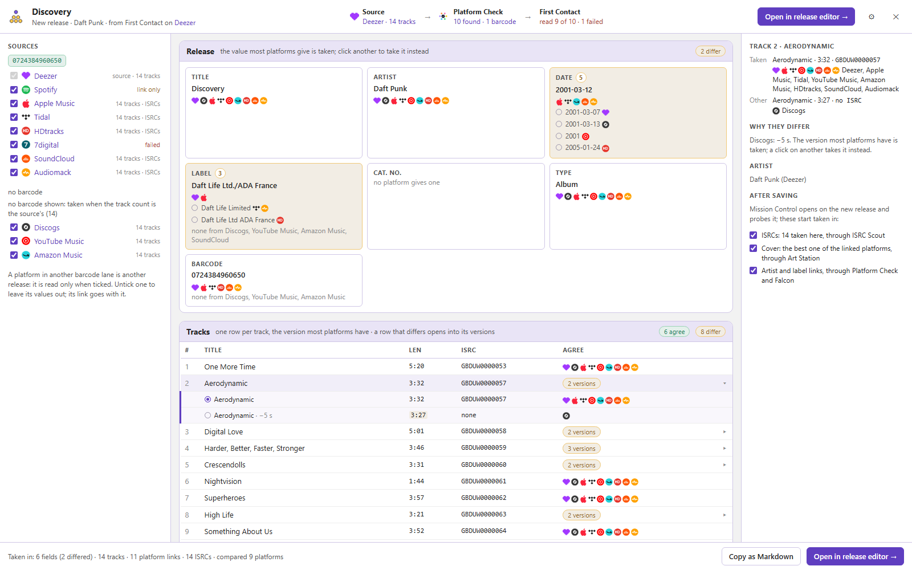

Once saved, Mission Control opens on the release and probes for what the editor can't take: the ISRCs and recording links (ISRC Scout), the best cover (Art Station), and the artist and label links (Platform Check). **After saving** chooses which start taken in. With *…and Execute once the probe has finished*, Execute runs itself after a countdown on the button, 10 seconds unless set otherwise; a click stops it.

A click on a section's heading opens or closes it; a right-click opens every section when one is closed, and closes them all otherwise.

A track's versions show on the right too. **▾ → Copy as Markdown** beside **Add release** copies the comparison as tables. **✕** shows the editor under it; the corner icon brings Mission Control back.

#### Update this release

**Update**, in the banner, opens that release here; Mission Control probes and [compares it with the platforms](#compare-with-the-platforms) at once, offering what it lacks as after saving a new release, but Execute never runs by itself. What you picked by hand isn't carried over.

[First Contact](../first_contact/README.md#already-in-musicbrainz) offers it too, when MusicBrainz already has the album you are about to import: the release opens in a new tab, compared with the platforms and with that album, though the release has neither its link nor its barcode.

A label with another catalog number keeps it. A new label is added with its catalog number when Mission Control can tell which MusicBrainz label it is: by its page on the platform, or, marked unsure, by a name only one label has. The edit note names the platforms read.

### Settings

| Setting                                                         | Default |                                                                                 |
| --------------------------------------------------------------- | ------- | ------------------------------------------------------------------------------- |
| Probe as soon as Mission Control opens                          | on      | no need to click ↻                                                              |
| Review the changes before Execute                               | on      | lists what Execute will send first; a right-click on Execute skips it           |
| Reload the release page after an Execute without errors         | on      | shows the result at once; waits until every added link is through               |
| After saving a consolidated release, open Mission Control on it | on      | [probes the new release](#consolidate-a-new-release) for what it lacks          |
| …and Execute once the probe has finished                        | off     | then applies what is taken in, after a countdown (10 s by default) you can stop |
| Show track differences by default                               | off     | a consolidation opens every track that differs into its versions                |

### Shortcuts

| Key         | Where               |                                                        |
| ----------- | ------------------- | ------------------------------------------------------ |
| right-click | a link in a row     | take it in or leave it out, instead of opening it      |
| Ctrl / Alt  | a click in Tracks   | the whole track / the whole column ([Tracks](#tracks)) |
| drag        | ISRCs or duplicates | take in or leave out every one you pass                |
| ← →         | a cover full screen | the other cover                                        |
| right-click | Execute             | execute without the review                             |
| right-click | the corner icon     | settings                                               |

---

## Platform Check

Finds a MusicBrainz release on the streaming and store platforms, checks each match against the release's barcode, format and track count, and adds the good ones to the release.

- Install: [stable](https://raw.githubusercontent.com/majkinetor/musicbrainz-userscripts/refs/heads/stable/userscripts/platform_check/platform_check.user.js) or [latest](https://raw.githubusercontent.com/majkinetor/musicbrainz-userscripts/refs/heads/main/userscripts/platform_check/platform_check.user.js)
    - Or via bundle: [String Theory](../string_theory/README.md)
- [Changelog](../platform_check/CHANGELOG.md)
- [View users](https://musicbrainz.org/search/edits?auto_edit_filter=&order=desc&negation=0&combinator=and&conditions.0.field=edit_note_content&conditions.0.operator=includes&conditions.0.args.0=Platform+Check)

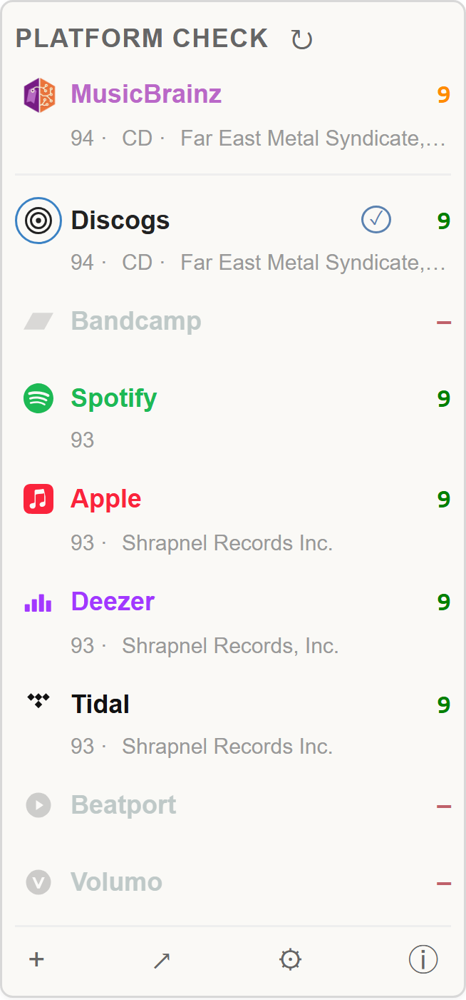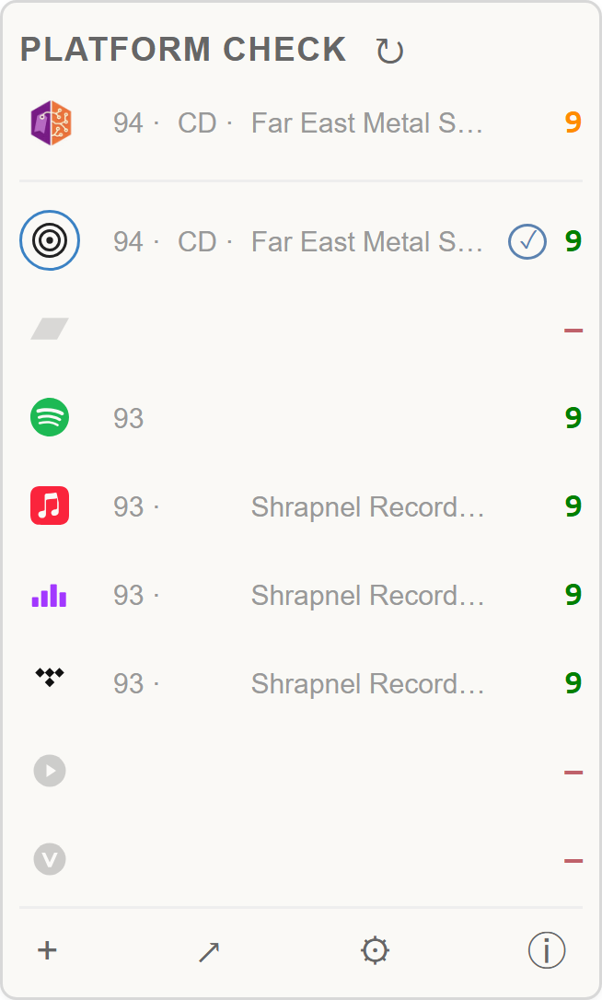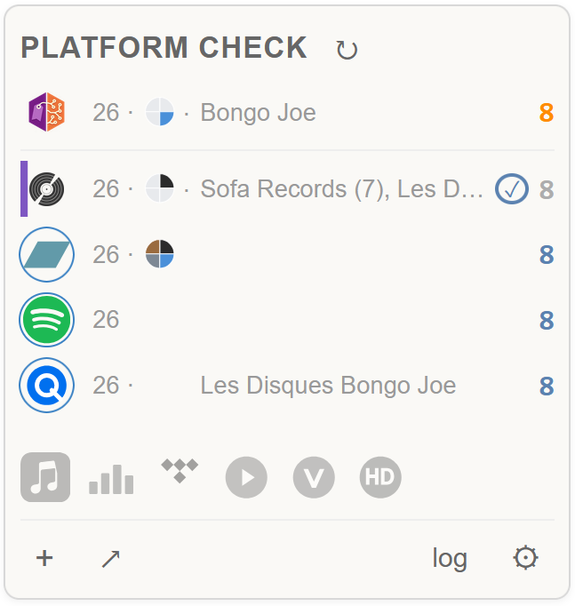

### Features

- **[Dashboard](#dashboard)** on every release page: each [platform](#platforms-2), with its track count, year, label and format beside MusicBrainz's.
- **[Link confidence](#link-confidence)**: a match with a different barcode or format is a different release, and is not added.
- **[Adding links](#adding-links)** to the release, one or all, in the foreground or in the background, or opening all the pages found.
- **[Pasting a barcode](#pasting-a-barcode)**, or picking one the platforms report, for a release without one.
- **[Catalog numbers](#catalog-numbers)** the platforms give, for a label the release has without one.
- **[Artists and labels](#artists-and-labels)**: the artist and label pages the matched albums name, added to the release's MusicBrainz artists and labels through [Falcon](../falcon/README.md).

### Dashboard

A platform the release already links is used as is; the others are searched by barcode, then the platform's own search, Wikidata and a web search. Results are kept until **↻**, which also stops a search.

| Icon and name |                                                                                     |
| ------------- | ----------------------------------------------------------------------------------- |
| coloured      | found                                                                               |
| grey          | found, but the details don't match                                                  |
| faded         | not found                                                                           |
| marked        | already linked in MusicBrainz: a ring, or another mark from *Settings › Appearance* |
| amber bar     | found, with a different barcode                                                     |
| violet bar    | found, in a format this release isn't                                               |

| Track count |                                        |
| ----------- | -------------------------------------- |
| green       | matches MusicBrainz, fetched this scan |
| blue        | matches MusicBrainz, from the cache    |
| amber       | differs from MusicBrainz               |
| ?           | link found, track count unreadable     |
| red —       | not found                              |

A release's format is a four-quadrant circle: vinyl, cassette, CD, digital (DVD, SACD and Blu-ray count as CD).

> [!TIP]
> *Compact › Unmatched* shrinks a platform that found nothing (yet) to a dimmed icon at the bottom; *Compact › Low-confidence* does the same, with an amber ring, for a match that isn't clean. Discogs and Bandcamp always keep their rows.

### Link confidence

MusicBrainz treats a different barcode or a different format as a different release, so such a link [belongs elsewhere](https://musicbrainz.org/doc/Style/Relationships/URLs#Which_entity_to_link_to). Both checks can run *if they exist* (withhold a link only when its barcode or format is known and differs) or *strictly* (also withhold a link that can't be checked). A withheld link is greyed out and left out of adding and *Open all*.

- **Barcodes** are looked up with every zero-padding (UPC-A, EAN-13, 14 digits).
- **Formats**: only Bandcamp and Discogs report one; the others are digital. The medium is compared (DVD and Blu-ray count as CD), so vinyl on a CD release is withheld, but an edition that includes this release's medium ("Digital, CD" on a CD release) passes.
- **Discogs by barcode** takes only an edition that carries the barcode itself (not one sharing a label code or matrix number), in this release's medium; when the barcode finds only other media, Discogs is searched by title in this release's format instead.
- The **Discogs master** is exempt from both: it goes on the release group, which spans every edition.

### Adding links

| Click                                      | on the name                                            | on the icon                                                                                |
| ------------------------------------------ | ------------------------------------------------------ | ------------------------------------------------------------------------------------------ |
| left                                       | open the page (or the platform's search, if not found) | open the release editor with the link added, for you to review                             |
| right                                      | open the platform's search                             | add the link in the background                                                             |
| middle, or Alt+left                        |                                                        | add the link even when [link confidence](#link-confidence) withholds it, in the foreground |
| Ctrl+middle, or Ctrl+Alt+left (⌘ on a Mac) |                                                        | the same, in the background                                                                |

An override is marked in the edit note with its reason: *(added by hand over link confidence: barcode not confirmed)*.

The footer's **+** adds every confirmed link (middle-click or Alt+click: the withheld ones too; with Ctrl, in the background), the Discogs master onto the release group; **↗** opens them all. A background add submits from an inactive tab that closes itself. The master's own ✓ adds just the master: click for the editor, right-click in the background.

> [!NOTE]
> Firefox slows background tabs down. *Keep background tabs awake* plays an inaudible tone, which exempts the tab. It needs **Allow Audio** for musicbrainz.org (padlock → *Autoplay*); without it, the log reports the tone as blocked.

### Pasting a barcode

On a release without a barcode, copy one and press **Ctrl+V** outside a text field: the platforms are scanned again as if the release had it, and [link confidence](#link-confidence) checks against it.

- The barcode shows on the line under the title; click it to remove it and scan without it.
- A link added from the panel puts the barcode on the release too, in the same edit.
- It stays with the release, across reloads, until it's removed or the release has a barcode of its own.
- Accepted: 8, 12, 13 or 14 digits, spaces and dashes allowed. A wrong check digit is used anyway, with a warning; MusicBrainz then asks you to confirm it in the editor.

On a release without one, a dashed barcode button under the title counts the barcodes the platforms report. Its list gives each with the platforms reporting it, this release's medium first; one from another format, with a wrong check digit, or already on another MusicBrainz release (linked) is marked ⚠. A click uses it as if pasted, restarting a running search; a right-click adds it alone, in the background, after asking for a ⚠ one; Ctrl+click copies it. [Mission Control](../mission_control/README.md#release-and-entity-links) offers the same barcodes.

### Catalog numbers

Beatport and Discogs give the album's catalog number, shown after the platform's label (*Artoffact AOF 146*; *+1* when there are more, all in the tooltip). The MusicBrainz row shows the release's own the same way. When a release's label has none, a dashed tag button beside the barcode's counts the ones the platforms give.

- Click it for the list: each catalog number with its label and the platforms that give it. ✓ marks one from a link like this release (with the release's barcode, or one it already has, and the same track count and medium); ⚠ one from another barcode, another format, or platforms that give no barcode.
- The platform's label name is matched to the release's loosely (*Artoffact* is *Artoffact Records*), and the same number written differently (*AOF146*) is one.
- Click one to use it: a link added from the panel fills it in, in the same edit; its chip removes it. A right-click copies it.
- A label with a catalog number of its own keeps it.

[Mission Control](../mission_control/README.md#release-and-entity-links) offers the same catalog numbers.

### Artists and labels

A matched album usually names its artists' pages, sometimes its label's. **Artists & labels** in the footer lists them against this release's artists and labels, a row each and a column per platform; its purple badge counts the links to add.

| Mark |                                                                                                                       |
| ---- | --------------------------------------------------------------------------------------------------------------------- |
| ✓    | already linked in MusicBrainz                                                                                         |
| +    | found, not linked yet: will be added                                                                                  |
| ⚠    | on another MusicBrainz artist or label: not added; hover shows which, click opens it                                  |
| +?   | may be the artist or the label (Bandcamp, SoundCloud, Audiomack), or a label of another name: left out until taken in |
| ·    | no page, or the platform didn't find the release                                                                      |

Click a mark to open its page; right-click to take it in or leave it out. **Run N in Falcon** queues the new links in Falcon and starts it; **▾ › Send only** queues them for you to start. Where Falcon doesn't run, it opens in a new tab, not started. Without Falcon, a row's **✎** opens the edit page with its new links filled in.

- **Which artists**: the release's artist credit (not Various Artists) and each track's, which a compilation needs. Tracks are paired by position, so a platform with another track count gives no track artists.
- **Matching**: by name, ignoring case, accents and *&* / *and*; else by position, when both credits have as many artists and the platform's name isn't several in one (*Samrai & SCAPA & Vindya*). A mark paired by position shows the platform's name on hover.
- **Labels**: by name, also ignoring company forms such as *Inc.*, *Ltd*, *Records* or *Productions* (*Arts & Crafts Productions Inc.* is *Arts & Crafts*). A label of another name is paired by position only when each side has as many labels, and shows **+?**: it is often another label (an imprint where MusicBrainz has the distributor), so it waits for you to take it in.
- **Which platforms**: Discogs, Deezer, Apple Music, Qobuz, Beatport (signed in), YouTube Music, Bandcamp, SoundCloud and Audiomack. Track artists come from Discogs, Deezer, Apple Music, Qobuz and YouTube Music; Beatport and the accounts give only the release's. Label pages come from Discogs, Qobuz, Beatport and the accounts.
- **Link types**: MusicBrainz types most links itself. Where it offers several and picks none, the link is sent typed: Qobuz as *purchase for download*, Apple Music as *streaming page* (and *purchase for download* when the iTunes Store sells it), Audiomack as *stream for free*.
- **Other locales**: a Qobuz or Apple Music page linked in another locale (`gb-en`, `/gb/`…) shows ✓; Falcon catches the rest.
- Every matched platform counts (a ✓), including one that [link confidence](#link-confidence) withholds for its barcode or format: another edition still has the same artists and labels.

> [!NOTE]
> The pages come from the albums the scan already read, so they cost no extra platform requests. With *Count the links to add* off, MusicBrainz is asked which links it already has only when you open the table.

### Platforms

| Platform      | Barcode                                                                    | Login    |
| ------------- | -------------------------------------------------------------------------- | -------- |
| Discogs       | read                                                                       |          |
| Bandcamp      | read                                                                       |          |
| Spotify       | looked up (through [Wallstream](https://tools.wallstream.com/isrc-lookup)) |          |
| Apple Music   | looked up and read                                                         |          |
| Deezer        | looked up                                                                  |          |
| Tidal         | looked up and read                                                         |          |
| YouTube Music | looked up                                                                  |          |
| Amazon Music  |                                                                            |          |
| Qobuz         | looked up and read                                                         | optional |
| Beatport      |                                                                            | optional |
| Volumo        | looked up and read                                                         |          |
| AllMusic      | looked up and read                                                         |          |
| HDtracks      | looked up and read                                                         |          |
| 7digital      | looked up and read                                                         |          |
| SoundCloud    | read from the linked set                                                   |          |
| Audiomack     | read                                                                       |          |

*Looked up*: the barcode finds the album. *Read*: the found album's barcode is checked against the release's. Each platform's API, credentials and search order are in [Provider details](../platform_check/DEVELOP.md#provider-details).

- **Qobuz**: signed in, matches are verified (track count and barcode); otherwise its store page is read, slower and throttled. ISRC Scout and Credit Hoarder share the login; only its token is kept.
- **Beatport** is behind Cloudflare: without a login, a match found by web search can't be verified, shows `?`, and isn't added. Signed in, it is verified, and ISRC Scout can import its ISRCs.
- **Bandcamp**: bonus tracks that are download-only are counted and marked ⁿ. A Bandcamp barcode that is really a physical package's is ignored.
- **Apple Music** needs no login. The track count leaves out music videos. A release is looked for in several countries' stores, and the link keeps the one it was found in.
- **Discogs**: on a CD release, a CD edition is searched first. The release group's Discogs master is checked too.
- **YouTube Music** needs no login. It finds most albums by barcode, the rest by artist and title, but shows no barcode and may return another edition: every hit must match on track count and title, and strict barcode mode withholds it. The *other versions* it lists are named in the tooltip, for you to check. The label comes from a song's credits, when the label sends them. Links are added as *stream for free*.
- **Amazon Music** needs no account. It is searched by artist and title only, taken when title and track count match (of two editions, the release's year wins), and strict barcode mode withholds it. Its catalogue is amazon.com's, so an album sold only elsewhere may be missed. The label comes from the ℗ line.
- **SoundCloud** can't be searched by barcode; it's read from the linked set, and trusted only when the whole set agrees on it.
- **Audiomack** needs no login. It is searched by artist and title, and fans re-upload albums, so every hit's barcode is read: the release's barcode wins, else a hit with a barcode and the track count. A song link is a one-track release. The label comes from the ℗ line; links are *stream for free*.
- **7digital** needs no login. It is searched by barcode in the UK store, then the US one, then by artist and title; the link is to the store it was found in.
- **Volumo** and **HDtracks** are added as *purchase for download*, since MusicBrainz has no type of their own.

### Settings

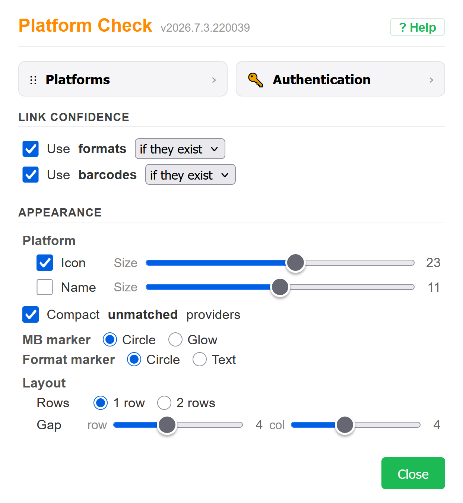

| Setting                                | Default      |                                                                                      |
| -------------------------------------- | ------------ | ------------------------------------------------------------------------------------ |
| Platforms                              | all          | order them, or leave some out                                                        |
| Logins                                 | none         | Beatport and Qobuz; see [Platforms](#platforms-2)                                      |
| Use barcodes                           | on, strictly | [link confidence](#link-confidence); *if they exist* withholds only a known mismatch |
| Use formats                            | on, strictly | the same, for the format                                                             |
| Open the editor in a new tab           | on           | off navigates this tab                                                               |
| Keep background tabs awake             | off          | see [Adding links](#adding-links)                                                    |
| Count the links to add                 | on           | the badge on [Artists & labels](#artists-and-labels)                                 |
| Close Falcon after a successful import | on           | see [Artists and labels](#artists-and-labels)                                        |
| Icon, Name                             | icon only    | what each row shows, and its size                                                    |
| Compact: Unmatched, Low-confidence     | on, off      | see [Dashboard](#dashboard)                                                          |
| In MusicBrainz                         | Ring         | how a platform already linked is marked                                              |
| Format                                 | Circle       | the release's format as a circle or as text                                          |
| Layout                                 | 1 row        | or 2 rows per platform                                                               |
| Spacing                                | 5 px         | between rows, and between columns in the 1-row layout                                |

### Shortcuts

| Key                                            |                                                                                                    |
| ---------------------------------------------- | -------------------------------------------------------------------------------------------------- |
| Esc                                            | close the open dialog                                                                              |
| Ctrl+V                                         | on a release without a barcode, [use the pasted barcode](#pasting-a-barcode)                       |
| Alt+click                                      | as a middle click: add a link [link confidence](#link-confidence) withholds; on **+**, all of them |
| Ctrl+middle-click, Ctrl+Alt+click (⌘ on a Mac) | the same, in the background                                                                        |
| right-click                                    | in the [platforms' barcodes](#pasting-a-barcode), add the barcode alone, in the background         |
| Ctrl+click                                     | in the platforms' barcodes, copy the barcode                                                       |

### Notes

The **Log** keeps every lookup, with a filter per platform. The log of a page where links were added is kept in this browser, so it can still be read after the page reloads: the log window lists the last 10, by date and release. **Clear history** deletes Platform Check's.


---

*[String Theory](https://github.com/majkinetor/musicbrainz-userscripts/blob/main/userscripts/string_theory/README.md) — by majkinetor*
